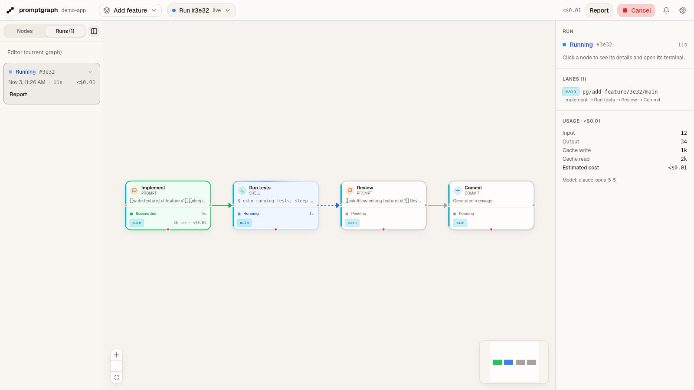
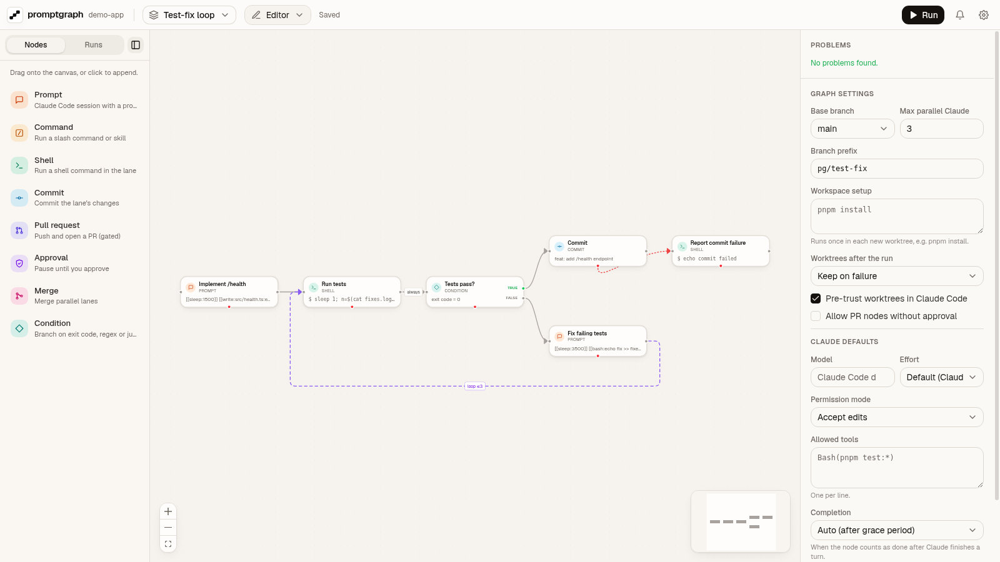
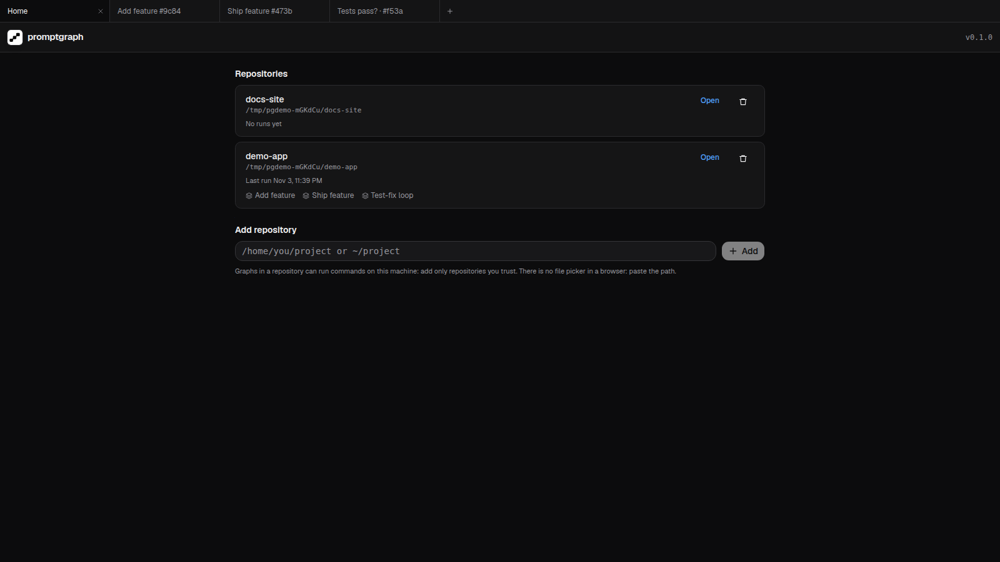
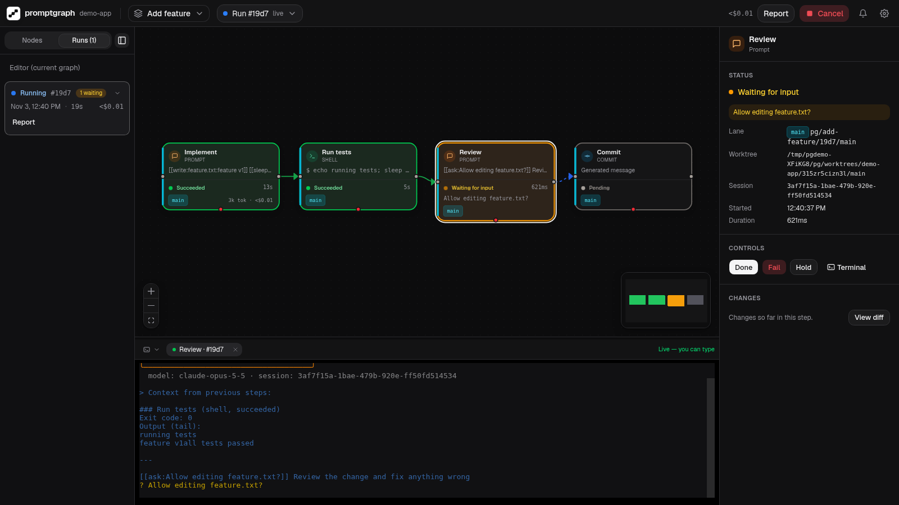
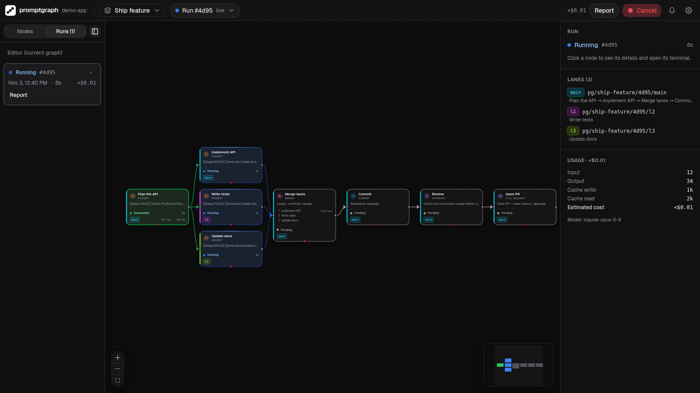
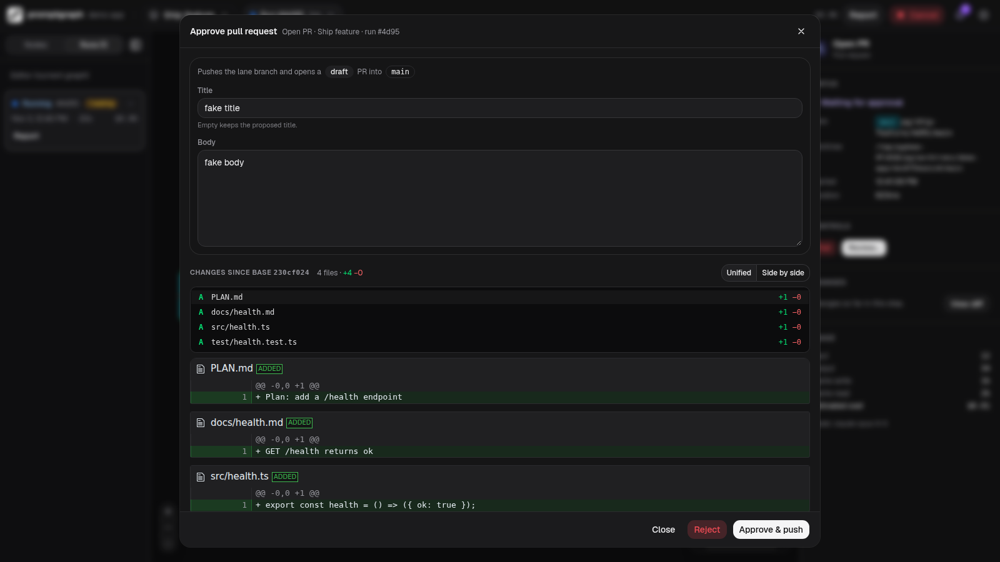
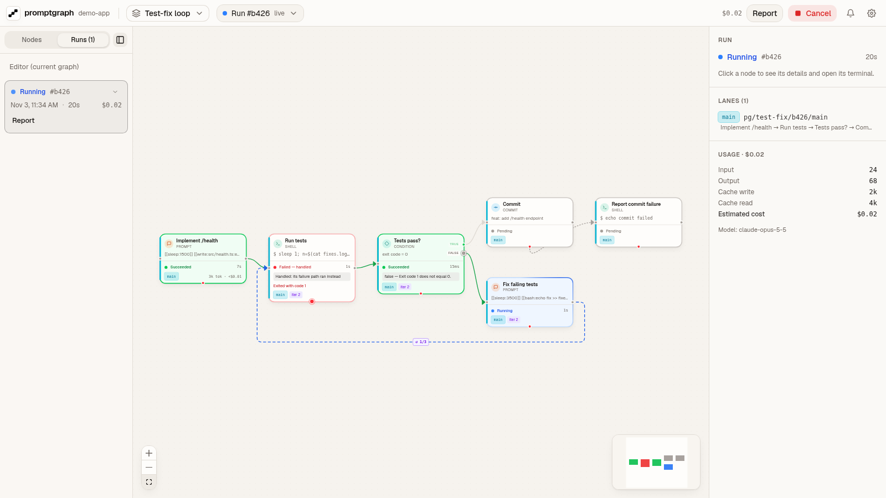
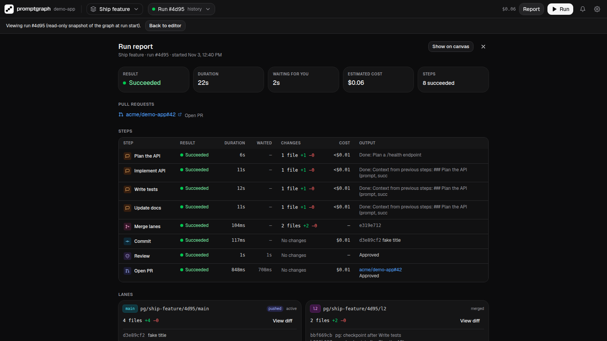

<p align="center">
  
</p>

# promptgraph

Draw a flow of Claude Code steps, run it, and watch each step work in a real terminal.

promptgraph is a local tool. You start it from a terminal inside a git repository, and it opens a
web UI on `127.0.0.1`. One background process serves every repository you open, so the graphs, runs
and terminals of several repositories can sit side by side in tabs. In the UI you draw a graph: each box is a step (a Claude Code prompt, a slash
command, a shell command, a commit, a pull request, an approval, a merge, a condition). When you run
the graph, the boxes change colour as they progress. Click a box to open the **real, interactive
Claude Code session** of that step, where you can watch and type.



It is a single-user tool for your own machine. There is no account and no remote hosting.

## Requirements

- **Linux or WSL** (macOS and Windows are not supported)
- **Node.js 22** or newer, and **pnpm** 10 (`corepack enable` provides it)
- **git**: required
- **Claude Code** (`claude` on `PATH`, logged in): needed by prompt, command and merge-conflict steps
- **curl**: Claude Code's hooks use it to report each session's status to promptgraph
- **GitHub CLI** (`gh`, authenticated): optional, only needed for pull-request steps
- `notify-send` (Linux) or WSL: optional, for desktop notifications

At startup promptgraph checks these. A missing `git` is fatal. The others only print a warning (and
the steps that need them fail).

## Install and build

```bash
git clone <this repository> promptgraph
cd promptgraph
pnpm install
pnpm build
```

This builds the server (`packages/server/dist`) and the web UI (`packages/web/dist`, which the server
serves). To get a `promptgraph` command on your `PATH`:

```bash
cd packages/server && pnpm link --global
# or: alias promptgraph="node /path/to/promptgraph/packages/server/dist/cli/index.js"
```

## Usage

```bash
promptgraph [repo-dir] [--port 4777] [--no-open] [--foreground]   # register a repository and open it
promptgraph ls [--json]                                           # the daemon and its repositories
promptgraph open [repo-dir|repo-id] [--next <path>] [--print-url] [--json] [--web-port <p>]   # open the UI, signed in
promptgraph rm <repo-dir|repo-id> [--force]                       # forget a repository (alias: close)
promptgraph stop                                                  # stop the daemon
promptgraph token rotate                                          # new token; every window signs in again
promptgraph sessions [--json] | sessions revoke <id>|--all        # signed-in browsers and desktop windows
promptgraph daemon [--port 4777]                                  # run the daemon in this terminal
promptgraph mcp                                                   # MCP server for Claude Code (see below)
```

One background process, the **daemon**, manages every repository you open. `promptgraph [repo-dir]`
starts it if it is not running, registers the repository (any directory inside it; the default is
the current directory), opens the browser already signed in and returns. It prints a line like
`Opened my-repo: http://127.0.0.1:4777/r/my-repo-3f9a1c2e`; that URL holds no secret, so open it
again from any signed-in browser. Running it for a second repository adds that repository to the same
daemon. A subcommand is recognised only as the first argument: a repository directory named `ls` is
passed as `./ls`.

- `--port`: the port on `127.0.0.1`, used only when this command starts the daemon (a running daemon
  keeps its port, and you get a warning). Without it the daemon reuses the port it had last time
  (the **sticky port**, kept in `~/.promptgraph/port`), else `4777`, else any free port. The port stays
  the same because the browser keeps your tabs, last graphs and theme per origin, and the origin
  includes the port.
- `--no-open`: register and print only.
- `--foreground`: run the daemon in this terminal instead; Ctrl-C (or closing the terminal) stops it.

Other commands:

- `ls`: the daemon's pid, version, port and uptime, then one line per repository (active runs, steps
  waiting for approval or input, unavailable directories, errors). It never starts the daemon.
- `open`: opens the UI signed in, on a repository (an id from `ls` or a directory) or on Home.
  `--print-url` prints the one-time sign-in URL instead of opening a browser (it is valid once, for
  30 seconds); `--json` prints it as JSON for scripts and the desktop app.
- `rm`: forgets a repository. It is refused while the repository has a running run, unless you pass
  `--force`, which interrupts those runs. It never deletes graphs, runs, worktrees or branches: adding
  the same path again brings its history back.
- `sessions`: lists the browsers and desktop windows that are signed in; `sessions revoke <id>` signs
  one out, `--all` every one.
- `token rotate`: replaces the daemon's token. Every browser and window must sign in again with
  `promptgraph open`; running Claude sessions are not affected.

The daemon keeps running after the terminal closes, so long runs are not tied to a window.
`promptgraph stop` stops it: running Claude sessions are asked to exit (up to 5 seconds), their steps
are marked **interrupted** and the runs are paused. Start promptgraph again and retry or skip the
interrupted steps to continue. A different promptgraph version refuses to talk to a running daemon
(after an upgrade, say): run `promptgraph stop`, then retry.

**Environment.** Every Claude, shell, git and `gh` process of every repository inherits the daemon's
environment. A daemon started in the background therefore does not take the environment of the
terminal (or Claude Code session) that started it: it uses your **login shell's** environment
(`$SHELL -ilc`, like an editor does), plus a few variables of the caller such as `HOME`, `DISPLAY`,
`SSH_AUTH_SOCK` and `CLAUDE_CONFIG_DIR`. Put what your steps need (`PATH`, nvm, `AWS_PROFILE`) in your
shell profile, then `promptgraph stop` and start again. Per-directory tools such as direnv do not
apply. A `--foreground` daemon keeps the environment of its terminal.

## Desktop app (Linux, optional)

`packages/desktop` contains a small Tauri v2 window for the same UI, with the tab strip as its title
bar and the Ctrl tab shortcuts. It is one more client of the daemon, not a replacement: it runs
`promptgraph open --print-url --json` through your login shell to start the daemon if needed and to
sign in, then loads the UI from `http://127.0.0.1:<port>`. Closing the window does not stop the daemon
or its runs. The released AppImage and `.deb` bundle Node and the server, so they work just by opening
them (you still need `git`, `claude`, `curl` and `gh`), offer to install the `promptgraph` command in
`~/.local/bin`, and update themselves from signed GitHub releases. You need Rust and WebKitGTK only to
build it (`pnpm install`, `pnpm build` and `pnpm test` never do). Installing, building, releasing and the
manual checklist are in [packages/desktop/README.md](packages/desktop/README.md).

## Use it from Claude Code (MCP server and plugin)

promptgraph includes an MCP server, so Claude Code can design graphs, run them and supervise them
for you: "split this refactor into parallel steps and run it", "add a test-fix loop to the release
graph", "what happened in the last run?".

```bash
promptgraph mcp          # MCP server on stdio (Claude Code starts it; you do not run it by hand)
```

The easiest way to set it up is the **plugin** in this repository. It registers the MCP server and
adds three skills: `design-graph`, `run-graph` and `review-run`.

```text
/plugin marketplace add /path/to/promptgraph
/plugin install promptgraph@promptgraph
```

The plugin runs `promptgraph mcp`, so `promptgraph` must be on your `PATH` (see
[Install and build](#install-and-build)). Otherwise set `PROMPTGRAPH_BIN` to
`/path/to/promptgraph/packages/server/dist/cli/index.js`. Without the plugin, you can register the
server by hand: `claude mcp add promptgraph -- promptgraph mcp`.

How it works:

- The MCP server talks to the daemon. It reads the daemon's address from `~/.promptgraph/daemon.json`
  and its token from `~/.promptgraph/token`, and sends the token only after the daemon has proved that
  it knows it (`/api/daemon/hello`). It re-reads both on every call, so a restarted daemon or a rotated
  token is picked up without restarting Claude Code. The repository Claude Code runs in is registered
  on first use.
- If no daemon is running, Claude can start one in the background (`start_server`, no browser). The
  daemon keeps running after the session ends, because runs can take longer than one conversation;
  stop it with `promptgraph stop`. `server_status` shows whether it runs and whether this repository
  is registered.
- Claude can save and validate graphs, start and cancel runs, wait for them, read outputs, diffs and
  reports, and mark steps done, retried or skipped.
- The **Claude Code** button in the header opens a setup guide: the commands to install the plugin (or
  register the server alone), a check that Claude Code sees it, the skills, the tools, and prompts to try.
- **Approvals stay with you.** Claude can show you what an approval or PR step asks for, but only you
  approve or reject it, in the UI. `open_ui` opens the canvas in your browser, already signed in; the
  tool result only holds the plain `http://127.0.0.1:<port>/r/<repo-id>` address, never a sign-in link.

## A quick tour



### Repositories and tabs

**Home** (the first tab of a new window, a new tab, or the promptgraph logo in the header) lists every registered repository with
its active runs, the steps waiting for you and its last run, with links to its graphs. Add a repository
there by its absolute path (`~/…` works), or with `promptgraph <dir>` from a terminal; remove it there or
with `promptgraph rm`. Registering a repository trusts it: its graphs can run commands.



Every view has its own URL (`/r/<repo-id>/graphs/<graph-id>`, `/r/<repo-id>/runs/<run-id>`, …) and opens
in a tab of the tab strip at the top. Ctrl/Cmd-click or middle-click a link to open it in a new tab.
Tabs keep their terminals and canvases alive while hidden, and each browser window remembers its own
tabs across reloads. The browser keeps Ctrl+T, Ctrl+W and Ctrl+Tab for itself, so in a browser the tab
shortcuts use Alt:

| Action | Browser | Desktop app |
|---|---|---|
| New tab (Home) | Alt+T | Ctrl+T |
| Close tab | Alt+W | Ctrl+W |
| Reopen closed tab | Alt+Shift+T | Ctrl+Shift+T |
| Next / previous tab | Alt+PageDown / Alt+PageUp | Ctrl+Tab / Ctrl+Shift+Tab, Ctrl+PageDown / Ctrl+PageUp |
| Go to tab 1–8 / last | Alt+1–8 / Alt+9 | Ctrl+1–8 / Ctrl+9 |

While a terminal has focus, only switching tabs is handled; the other keys go to Claude Code. The Alt
keys work in the desktop app too.

### Graphs

A graph is a JSON file in your repository at `.promptgraph/graphs/<graph-id>.json`, so you can commit
and share it. The editor saves it as you edit. While a run of a graph is active, the graph is
read-only. Every run stores a snapshot of the graph as it was when the run started.

Example graphs are in [`docs/examples/`](docs/examples). Copy one into `.promptgraph/graphs/` to try
it (the file name must be `<id>.json`):

| Example | What it shows |
|---|---|
| [`linear.json`](docs/examples/linear.json) | Plan (plan mode) → implement (resumes the planning session) → run tests → commit |
| [`fan-out-merge-pr.json`](docs/examples/fan-out-merge-pr.json) | One spec fans out to two parallel lanes, a merge joins them, then review, commit and a draft PR |
| [`test-fix-loop.json`](docs/examples/test-fix-loop.json) | Run tests; while they fail, Claude fixes and the tests run again (at most 3 times) |
| [`review-loop.json`](docs/examples/review-loop.json) | `/code-review`; a judge decides whether there are blocking issues, Claude addresses them, review again; approval before the commit |

### Node types

| Type | What it does |
|---|---|
| **Prompt** | A Claude Code session started with your prompt |
| **Command** | A Claude Code session started with a slash command or skill, e.g. `/code-review high` |
| **Shell** | A shell command in the step's worktree (exit code 0 = success). Output is shown in a terminal |
| **Commit** | `git add -A` and commit. The message is fixed or generated by Claude from the diff and the earlier steps. By default the automatic checkpoint commits are squashed first |
| **Pull request** | Pushes the branch and opens a PR with `gh` (draft by default). Title and body can be generated. Always gated by an approval unless you explicitly allow otherwise in the graph settings |
| **Approval** | Pauses the run until you approve or reject. Shows a message, the diff and the outputs of the steps before it |
| **Merge** | Joins parallel lanes (one after another, as a merge or a squash). Conflicts are resolved by Claude or left to you in a shell |
| **Condition** | Chooses a branch (`true` / `false`) from an exit code, a regular expression on the previous output, or a yes/no question answered by Claude ("judge") |

Claude steps take their model, effort, permission mode, allowed tools and completion policy from the
graph's defaults unless the step sets its own. `bypassPermissions` is never offered; the default is
`acceptEdits`.

### Context between steps

Each Claude step has a **context** mode:

- **fresh** (default): a new session whose first message starts with a "Context from previous steps"
  block (the outputs of the steps directly before it), then your prompt.
- **resume**: continues the previous Claude step's session in the same lane (`claude --resume`), so
  Claude remembers the conversation. Inside a loop, later passes continue the step's own session.
- **clean**: a new session with only your prompt; the files in the worktree are the only context.

### When is a Claude step done?

Claude Code reports the end of each turn. The **completion policy** decides what that means:

- **auto** (default, 5 s grace): the step succeeds a few seconds after Claude's turn ends. A countdown
  ("Auto-continuing in 5s… **Hold**") shows on the step, in the inspector and above its terminal. If you
  type in the terminal or click **Hold** during that time, it does not: you are steering.
- **manual**: the step turns blue ("Idle — awaiting Done") until you click **Done** or **Fail**.
- **marker**: the step succeeds only when Claude's last message ends with a token (`<<PG_DONE>>`).

**Hold** makes the current turn behave like manual, for example when you want to ask a follow-up
question. When Claude asks for permission or needs input, the step turns yellow and you answer in its
terminal. **Reopen session** on a finished step starts `claude --resume` on its session so you can
keep talking to it.



### Lanes and worktrees

Steps never run in your checkout. Each run works in **git worktrees** under
`~/.promptgraph/worktrees/<repo>/<run-id>/<lane>`, on branches named
`<prefix>/<run-short-id>/<lane>` (prefix `pg/<graph-id>` by default) created from the graph's base
branch. A straight path of steps shares one lane. When the graph fans out, each branch gets its own
lane (forked from the parent lane's state) and runs in parallel, up to `maxParallelClaude` Claude
sessions at a time. A merge step joins lanes again.

Before a lane forks or merges, promptgraph commits uncommitted work as `pg: checkpoint after <step>`
so nothing is lost. An optional **workspace setup** command (e.g. `pnpm install`) runs once in each new
lane.

At the end of a run, worktrees are removed according to `keepWorktrees` (default: keep them only when
the run failed). Branches that were pushed or carry commits are always kept. **Clean up** in the run
history removes a finished run's worktrees on demand.



### Approvals and pull requests

Nothing leaves your machine without your approval. A pull-request step shows the diff of exactly what
will be pushed, plus the title and body, which you can edit. Approving pushes that commit and opens
the PR. The repository's pending approvals are counted in the header and can be answered from there; a
dot on a tab shows that its repository has steps waiting for you.



### Conditions and loops

Edges can fire on success (default), on failure (from the error port) or always. A condition step
sends the flow down its `true` or `false` port; the other branch is skipped. A **loop** edge goes back
to an earlier step with a maximum number of iterations, and either fails or continues when the limit
is reached. The canvas shows each loop's counter and lets you look at every iteration of a step.



### Run report and per-step diffs

**Report** (in the header and in each run of the history) opens a summary of the run: the result of each
step, how long it took and how long it waited for you, what it changed, its cost and output, the commits
and changes of each lane, the PR links, and where the run stopped or waited. It opens by itself when the
run you are watching finishes.



Each step's changes are recorded separately: promptgraph snapshots the worktree when a step starts and
when it finishes (hidden refs under `refs/promptgraph/`, never on your branches; kept 30 days). **View
diff** in the inspector or the report shows what that step changed, with a switch to the whole lane.
Both keep working after the worktrees are cleaned up.

### Failures and recovery

A failed step pauses the run (or fails it, if the step says `fail-run`, or follows a failure edge if
there is one). You can **retry** the step, **skip** it (treated as success), or cancel the run.
Retrying a Claude step that was interrupted resumes its session.

### Notifications

When a step needs you (a question, a permission prompt, an approval, Claude idle in manual mode), the
UI marks it and promptgraph sends a desktop notification. Turn notifications off in the settings menu.

### Theme

The UI is dark by default. Switch to the light theme in the settings menu; the choice is remembered in
your browser.

### Tokens and cost

Every Claude step shows its token usage (input, output, cache) and an estimated cost, read from Claude
Code's session transcript. Runs show the total. Generated commit messages, PR texts and judge
conditions are counted too. The cost is an estimate from public per-model prices.

## Where data lives

| Path | What |
|---|---|
| `<repo>/.promptgraph/graphs/*.json` | Your graphs (commit them) |
| `~/.promptgraph/state.db` | Registered repositories, runs, step results, events and browser sessions (SQLite), written by the daemon only |
| `~/.promptgraph/token` | The daemon's token (mode 0600). The CLI and the MCP server read it; `promptgraph token rotate` replaces it |
| `~/.promptgraph/daemon.json` | The running daemon's pid, port and version (mode 0600, no secret), removed when it stops |
| `~/.promptgraph/port` | The last port the daemon used (the sticky port) |
| `~/.promptgraph/runs/<run-id>/` | Terminal logs and the hook settings of each run |
| `~/.promptgraph/worktrees/` | Lane worktrees |
| `~/.promptgraph/settings.json` | App settings (notifications) |
| `~/.promptgraph/locks/` | `daemon.pid` (the daemon's pid, for messages only: the lock itself is held by the kernel) and one `<repo-key>.pid` per registered repository, which keeps promptgraph versions from before the daemon from starting on it |
| `~/.promptgraph/logs/daemon.log` | Output of a daemon started in the background (rotated to `daemon.log.1` above 5 MB) |
| `~/.promptgraph/bin/` | The `pg-hook` helper that Claude Code's hooks call |

`~/.promptgraph` is created readable by you only (mode 0700), because it holds prompts, outputs,
terminal logs and the token. Set `PG_HOME` to use another directory (each `PG_HOME` has its own
daemon).

**Upgrading from a version before the daemon.** Older versions ran one server per repository and kept
records in `~/.promptgraph/servers/`. The daemon refuses to start while such a server is still running
(stop it first) and removes the stale records. Your runs are kept, and the repositories of earlier runs
appear on Home.

## Claude Code's trust dialog

Claude Code asks "Do you trust the files in this folder?" the first time it runs in a directory. Each
run uses new worktree directories, so promptgraph **pre-accepts** the dialog for them: before starting
Claude in a worktree, it sets `projects["<worktree path>"].hasTrustDialogAccepted = true` in Claude
Code's config file (`~/.claude.json`, or `$CLAUDE_CONFIG_DIR/.claude.json`). Only the worktree paths
promptgraph creates are added; nothing else in the file changes.

To turn this off, set `"autoTrustWorktrees": false` in the graph's settings (Graph settings in the
UI). Claude then shows the dialog in the step's terminal, the step turns yellow, and you answer it
there.

## Security notes

- The daemon listens on `127.0.0.1` only and checks the `Host` and `Origin` headers.
- Local clients (the CLI, the MCP server) authenticate with the token in `~/.promptgraph/token`. It
  never appears in a URL, a log, a tool result or a Claude session's environment, and a client sends it
  only to a daemon that has proved it knows it. Claude's file tools are denied access to it.
- Browsers and desktop windows sign in with a one-time code (valid once, for 30 seconds) that
  `promptgraph open` puts in the URL it opens. The daemon then sets a random session cookie, which
  expires after 30 days without use. `promptgraph sessions` lists the sessions and
  `promptgraph sessions revoke <id>|--all` signs them out; `promptgraph token rotate` replaces the token
  and signs every session out.
- Browsers send cookies to every port of `127.0.0.1`, so other local services you visit (dev servers,
  Docker containers) receive the session cookie too. The daemon refuses cookie requests that come from
  other sites' pages (Fetch Metadata checks) and no GET request changes anything, but a program could
  still replay the cookie. Revoke the sessions (`promptgraph sessions revoke --all`) after using
  untrusted local services.
- Claude sessions only get a per-step hook token that can report that step's status and nothing else.
- Registering a repository trusts it: its graphs run commands. Listing its branches, status and diffs
  does not run its `core.fsmonitor` hook.

## Known limitations

- Claude Code's hooks report each session's status. If no hook arrives within 45 s of a start, the
  step turns yellow with a hint. If a later hook (the end of a turn) is lost, the step can stay
  **Running** until Claude reports that it is idle: check its terminal and click **Done** or **Fail**.
- The canvas does not show the auto-completion grace period: a step reads "Running" for a few seconds
  after Claude's turn ended.
- Terminal tabs of earlier runs stay open in the drawer; their titles show the run id and attempt.
- Edge labels can be clipped between close nodes, and a loop edge can pass under the minimap.
- The session cookie can be replayed by other local servers on `127.0.0.1` (see Security notes).
- In a browser the tab shortcuts use Alt (the browser keeps Ctrl+T, Ctrl+W and Ctrl+Tab), and some
  browsers or window managers take some Alt keys too (Firefox on Linux: Alt+1–9 switch browser tabs).
  The tab strip's buttons always work.
- The daemon has one environment for every repository (see [Usage](#usage)): a variable a single
  project needs belongs in your shell profile.
- Linux and WSL only. The desktop app is Linux only (WSLg on WSL) and has to be built with Rust and
  WebKitGTK; there are no prebuilt packages yet.

## Development

```bash
pnpm install
pnpm --filter @promptgraph/server dev   # the daemon in the foreground (tsx watch)
pnpm --filter @promptgraph/web dev      # vite dev server on 5173, proxying /api, /ws and /login to the daemon
promptgraph open --print-url --web-port 5173   # a sign-in URL on the vite origin
pnpm typecheck
pnpm test                               # all tests (vitest)
pnpm build
```

The vite proxy never reads the token and adds no credentials: you sign the vite origin in with
`promptgraph open --print-url --web-port <vite port>`, and the session cookie it sets works for the
daemon's own port too. The proxy forwards to the daemon on `PG_DEV_PORT` (default 4777); set it when
the dev daemon got another port. `pnpm dev` starts the daemon, vite and the Astro site together.

The dev daemon uses `PG_HOME` (default `~/.promptgraph`) like an installed one, and only one daemon
runs per `PG_HOME`: if you already run promptgraph, set `PG_HOME` to another directory for development
(and for the `promptgraph open` above) or stop that daemon first (`promptgraph stop`). The `video`
package typechecks only after `video/scripts/record.mjs` has generated its recording manifest; skip it
with `pnpm -r --filter '!@promptgraph/video' typecheck`.

The repository is a pnpm workspace:

- `packages/shared`: graph schema, validation, topology, API and WebSocket types
- `packages/server`: CLI, daemon (HTTP/WS server, repository registry), execution engine, runners, git worktrees, SQLite store
- `packages/web`: React UI (router, tabs, React Flow canvas, xterm.js terminals)
- `packages/desktop`: the Tauri v2 desktop shell (Rust in `src-tauri`, TypeScript contract tests)
- `plugins/promptgraph`: the Claude Code plugin (MCP registration and skills); the MCP server itself is `packages/server/src/mcp`

### Tests

Tests never call the real Claude Code or GitHub by default:

- `packages/server/test/fixtures/fake-claude` emulates the parts of Claude Code that promptgraph uses
  (interactive TUI, hooks, transcripts with usage, `--resume`, headless `-p`). Tests point
  `PG_CLAUDE_BIN` at it; markers in the prompt script its behaviour (see
  [docs/CONTRACTS.md](docs/CONTRACTS.md)).
- `packages/server/test/fixtures/fake-gh` stands in for `gh` (`PG_GH_BIN`).
- Every test uses its own `PG_HOME` and `CLAUDE_CONFIG_DIR`, so your real `~/.promptgraph` and
  `~/.claude.json` are never touched.

Tests against the **real** Claude Code are opt-in and use a copy of your Claude config, the `haiku`
model and tiny prompts:

```bash
PG_REAL_CLAUDE=1 pnpm test
```

## Documentation

- [docs/DESIGN.md](docs/DESIGN.md): the design (concepts, engine, lanes, security, control flow)
- [docs/CONTRACTS.md](docs/CONTRACTS.md): module contracts and the fake-claude reference
- [docs/SPIKE.md](docs/SPIKE.md): what was verified against the real Claude Code
- [docs/examples/](docs/examples): example graphs
- [docs/screenshots/](docs/screenshots): screenshots of the UI

## License

[MIT](LICENSE)
