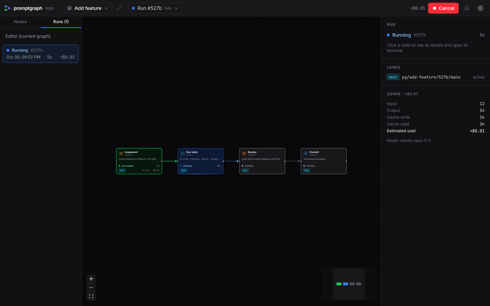
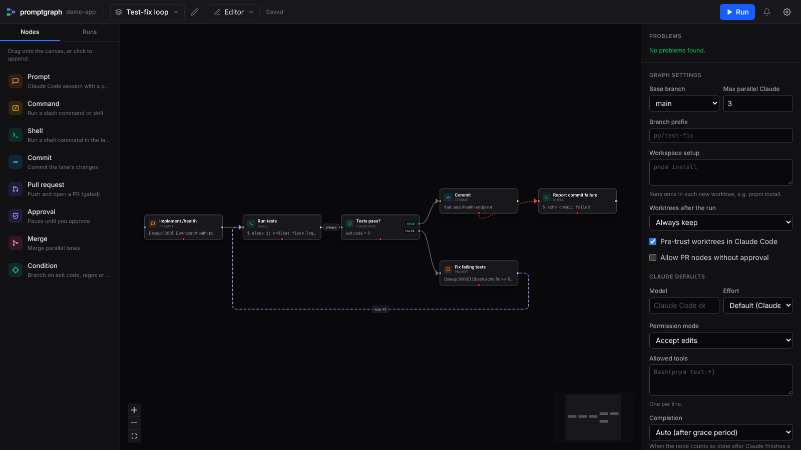
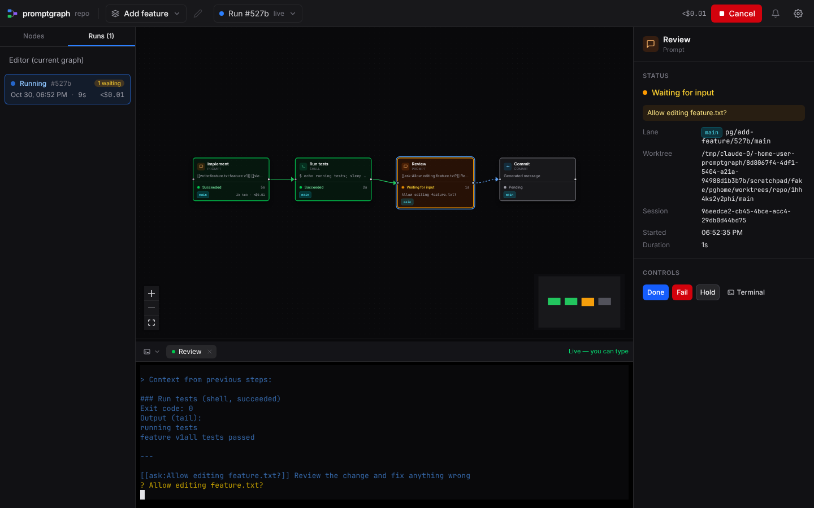
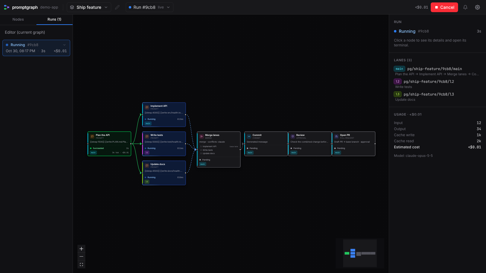
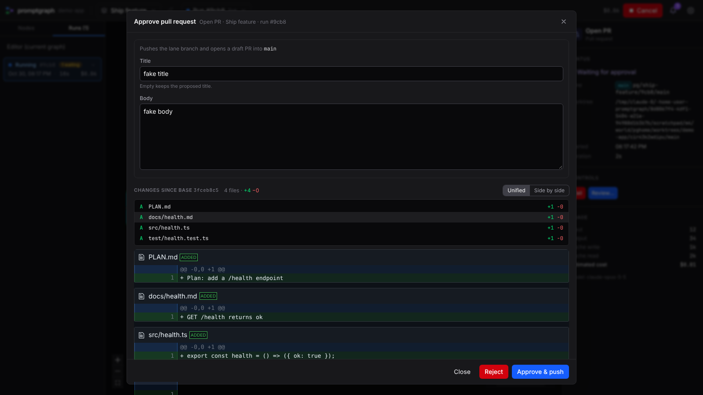
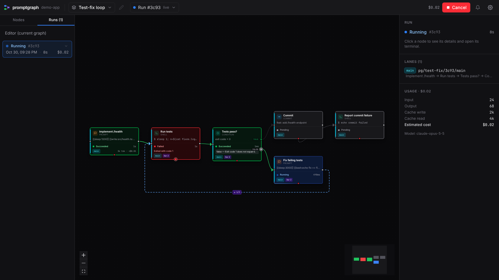

# promptgraph

Draw a flow of Claude Code steps, run it, and watch each step work in a real terminal.

promptgraph is a local tool. You start it from a terminal inside a git repository, and it opens a
web UI on `127.0.0.1`. In the UI you draw a graph: each box is a step (a Claude Code prompt, a slash
command, a shell command, a commit, a pull request, an approval, a merge, a condition). When you run
the graph, the boxes change colour as they progress. Click a box to open the **real, interactive
Claude Code session** of that step, where you can watch and type.



It is a single-user tool for your own machine. There is no account and no remote hosting.

## Requirements

- **Linux or WSL** (macOS and Windows are not supported)
- **Node.js 22** or newer, and **pnpm** 10 (`corepack enable` provides it)
- **git**: required
- **Claude Code** (`claude` on `PATH`, logged in): needed by prompt, command and merge-conflict steps
- **curl**: Claude Code's hooks use it to report each session's status to promptgraph
- **GitHub CLI** (`gh`, authenticated): optional, only needed for pull-request steps
- `notify-send` (Linux) or WSL: optional, for desktop notifications

At startup promptgraph checks these. A missing `git` is fatal. The others only print a warning (and
the steps that need them fail).

## Install and build

```bash
git clone <this repository> promptgraph
cd promptgraph
pnpm install
pnpm build
```

This builds the server (`packages/server/dist`) and the web UI (`packages/web/dist`, which the server
serves). To get a `promptgraph` command on your `PATH`:

```bash
cd packages/server && pnpm link --global
# or: alias promptgraph="node /path/to/promptgraph/packages/server/dist/cli/index.js"
```

## Usage

```bash
promptgraph [repo-dir] [--port 4777] [--no-open]
```

- `repo-dir`: any directory inside the git repository to work on (default: the current directory).
  promptgraph uses the repository's top level.
- `--port`: the port on `127.0.0.1` (default `4777`). Use another port to run promptgraph for
  another repository at the same time.
- `--no-open`: print the URL but do not open a browser.

The command prints a URL like `http://127.0.0.1:4777/?t=<token>`. The token is new on every start: a
browser tab from an earlier start shows "The promptgraph server was restarted" until you open the
new URL.

One promptgraph process manages one repository. Starting a second one for the same repository is
refused (it would interfere with the first one's runs).

Press **Ctrl-C** to stop. Running Claude sessions are asked to exit (up to 5 seconds), and their steps
are marked **interrupted**. When you start promptgraph again, the run is shown as paused: retry or
skip the interrupted steps to continue.

## A quick tour



### Graphs

A graph is a JSON file in your repository at `.promptgraph/graphs/<graph-id>.json`, so you can commit
and share it. The editor saves it as you edit. While a run of a graph is active, the graph is
read-only. Every run stores a snapshot of the graph as it was when the run started.

Example graphs are in [`docs/examples/`](docs/examples). Copy one into `.promptgraph/graphs/` to try
it (the file name must be `<id>.json`):

| Example | What it shows |
|---|---|
| [`linear.json`](docs/examples/linear.json) | Plan (plan mode) → implement (resumes the planning session) → run tests → commit |
| [`fan-out-merge-pr.json`](docs/examples/fan-out-merge-pr.json) | One spec fans out to two parallel lanes, a merge joins them, then review, commit and a draft PR |
| [`test-fix-loop.json`](docs/examples/test-fix-loop.json) | Run tests; while they fail, Claude fixes and the tests run again (at most 3 times) |
| [`review-loop.json`](docs/examples/review-loop.json) | `/code-review`; a judge decides whether there are blocking issues, Claude addresses them, review again; approval before the commit |

### Node types

| Type | What it does |
|---|---|
| **Prompt** | A Claude Code session started with your prompt |
| **Command** | A Claude Code session started with a slash command or skill, e.g. `/code-review high` |
| **Shell** | A shell command in the step's worktree (exit code 0 = success). Output is shown in a terminal |
| **Commit** | `git add -A` and commit. The message is fixed or generated by Claude from the diff and the earlier steps. By default the automatic checkpoint commits are squashed first |
| **Pull request** | Pushes the branch and opens a PR with `gh` (draft by default). Title and body can be generated. Always gated by an approval unless you explicitly allow otherwise in the graph settings |
| **Approval** | Pauses the run until you approve or reject. Shows a message, the diff and the outputs of the steps before it |
| **Merge** | Joins parallel lanes (one after another, as a merge or a squash). Conflicts are resolved by Claude or left to you in a shell |
| **Condition** | Chooses a branch (`true` / `false`) from an exit code, a regular expression on the previous output, or a yes/no question answered by Claude ("judge") |

Claude steps take their model, effort, permission mode, allowed tools and completion policy from the
graph's defaults unless the step sets its own. `bypassPermissions` is never offered; the default is
`acceptEdits`.

### Context between steps

Each Claude step has a **context** mode:

- **fresh** (default): a new session whose first message starts with a "Context from previous steps"
  block (the outputs of the steps directly before it), then your prompt.
- **resume**: continues the previous Claude step's session in the same lane (`claude --resume`), so
  Claude remembers the conversation. Inside a loop, later passes continue the step's own session.
- **clean**: a new session with only your prompt; the files in the worktree are the only context.

### When is a Claude step done?

Claude Code reports the end of each turn. The **completion policy** decides what that means:

- **auto** (default, 5 s grace): the step succeeds a few seconds after Claude's turn ends. If you type
  in the terminal during that time, it does not: you are steering.
- **manual**: the step turns blue ("Idle — awaiting Done") until you click **Done** or **Fail**.
- **marker**: the step succeeds only when Claude's last message ends with a token (`<<PG_DONE>>`).

**Hold** makes the current turn behave like manual, for example when you want to ask a follow-up
question. When Claude asks for permission or needs input, the step turns yellow and you answer in its
terminal. **Reopen session** on a finished step starts `claude --resume` on its session so you can
keep talking to it.



### Lanes and worktrees

Steps never run in your checkout. Each run works in **git worktrees** under
`~/.promptgraph/worktrees/<repo>/<run-id>/<lane>`, on branches named
`<prefix>/<run-short-id>/<lane>` (prefix `pg/<graph-id>` by default) created from the graph's base
branch. A straight path of steps shares one lane. When the graph fans out, each branch gets its own
lane (forked from the parent lane's state) and runs in parallel, up to `maxParallelClaude` Claude
sessions at a time. A merge step joins lanes again.

Before a lane forks or merges, promptgraph commits uncommitted work as `pg: checkpoint after <step>`
so nothing is lost. An optional **workspace setup** command (e.g. `pnpm install`) runs once in each new
lane.

At the end of a run, worktrees are removed according to `keepWorktrees` (default: keep them only when
the run failed). Branches that were pushed or carry commits are always kept. **Clean up** in the run
history removes a finished run's worktrees on demand.



### Approvals and pull requests

Nothing leaves your machine without your approval. A pull-request step shows the diff of exactly what
will be pushed, plus the title and body, which you can edit. Approving pushes that commit and opens
the PR. Pending approvals are counted in the header and can be answered from there.



### Conditions and loops

Edges can fire on success (default), on failure (from the error port) or always. A condition step
sends the flow down its `true` or `false` port; the other branch is skipped. A **loop** edge goes back
to an earlier step with a maximum number of iterations, and either fails or continues when the limit
is reached. The canvas shows each loop's counter and lets you look at every iteration of a step.



### Failures and recovery

A failed step pauses the run (or fails it, if the step says `fail-run`, or follows a failure edge if
there is one). You can **retry** the step, **skip** it (treated as success), or cancel the run.
Retrying a Claude step that was interrupted resumes its session.

### Notifications

When a step needs you (a question, a permission prompt, an approval, Claude idle in manual mode), the
UI marks it and promptgraph sends a desktop notification. Turn notifications off in the settings menu.

### Tokens and cost

Every Claude step shows its token usage (input, output, cache) and an estimated cost, read from Claude
Code's session transcript. Runs show the total. Generated commit messages, PR texts and judge
conditions are counted too. The cost is an estimate from public per-model prices.

## Where data lives

| Path | What |
|---|---|
| `<repo>/.promptgraph/graphs/*.json` | Your graphs (commit them) |
| `~/.promptgraph/state.db` | Runs, step results, events (SQLite), shared by all promptgraph processes |
| `~/.promptgraph/runs/<run-id>/` | Terminal logs and the hook settings of each run |
| `~/.promptgraph/worktrees/` | Lane worktrees |
| `~/.promptgraph/settings.json` | App settings (notifications) |
| `~/.promptgraph/locks/` | One pid file per repository with a running promptgraph |
| `~/.promptgraph/bin/` | The `pg-hook` helper that Claude Code's hooks call |

`~/.promptgraph` is created readable by you only (mode 0700), because it holds prompts, outputs and
terminal logs. Set `PG_HOME` to use another directory.

## Claude Code's trust dialog

Claude Code asks "Do you trust the files in this folder?" the first time it runs in a directory. Each
run uses new worktree directories, so promptgraph **pre-accepts** the dialog for them: before starting
Claude in a worktree, it sets `projects["<worktree path>"].hasTrustDialogAccepted = true` in Claude
Code's config file (`~/.claude.json`, or `$CLAUDE_CONFIG_DIR/.claude.json`). Only the worktree paths
promptgraph creates are added; nothing else in the file changes.

To turn this off, set `"autoTrustWorktrees": false` in the graph's settings (Graph settings in the
UI). Claude then shows the dialog in the step's terminal, the step turns yellow, and you answer it
there.

## Security notes

- The server listens on `127.0.0.1` only and checks the `Host` and `Origin` headers.
- Every API call needs the session token from the URL. The browser keeps a derived value in an
  HttpOnly cookie; other local web servers you open on `127.0.0.1` receive that cookie too (browsers do
  not separate cookies by port), so do not run untrusted local servers while promptgraph is open.
- Claude sessions only get a per-step hook token that can report that step's status and nothing else.

## Known limitations

- Claude Code's hooks report each session's status. If no hook arrives within 45 s of a start, the
  step turns yellow with a hint. If a later hook (the end of a turn) is lost, the step can stay
  **Running** until Claude reports that it is idle: check its terminal and click **Done** or **Fail**.
- The canvas does not show the auto-completion grace period: a step reads "Running" for a few seconds
  after Claude's turn ended.
- Terminal tabs of earlier runs stay open in the drawer; their titles show the run id and attempt.
- Edge labels can be clipped between close nodes, and a loop edge can pass under the minimap.
- The session cookie can be replayed by other local servers on `127.0.0.1` (see Security notes).
- Linux and WSL only.

## Development

```bash
pnpm install
pnpm dev                 # server (tsx watch, port 4777) + vite dev server; open the vite URL with ?t=<token>
pnpm -r typecheck
pnpm test                # all tests (vitest)
pnpm -r build
```

The repository is a pnpm workspace:

- `packages/shared`: graph schema, validation, topology, API and WebSocket types
- `packages/server`: CLI, HTTP/WS server, execution engine, runners, git worktrees, SQLite store
- `packages/web`: React UI (React Flow canvas, xterm.js terminals)

### Tests

Tests never call the real Claude Code or GitHub by default:

- `packages/server/test/fixtures/fake-claude` emulates the parts of Claude Code that promptgraph uses
  (interactive TUI, hooks, transcripts with usage, `--resume`, headless `-p`). Tests point
  `PG_CLAUDE_BIN` at it; markers in the prompt script its behaviour (see
  [docs/CONTRACTS.md](docs/CONTRACTS.md)).
- `packages/server/test/fixtures/fake-gh` stands in for `gh` (`PG_GH_BIN`).
- Every test uses its own `PG_HOME` and `CLAUDE_CONFIG_DIR`, so your real `~/.promptgraph` and
  `~/.claude.json` are never touched.

Tests against the **real** Claude Code are opt-in and use a copy of your Claude config, the `haiku`
model and tiny prompts:

```bash
PG_REAL_CLAUDE=1 pnpm test
```

## Documentation

- [docs/DESIGN.md](docs/DESIGN.md): the design (concepts, engine, lanes, security, control flow)
- [docs/CONTRACTS.md](docs/CONTRACTS.md): module contracts and the fake-claude reference
- [docs/SPIKE.md](docs/SPIKE.md): what was verified against the real Claude Code
- [docs/examples/](docs/examples): example graphs
- [docs/screenshots/](docs/screenshots): screenshots of the UI
