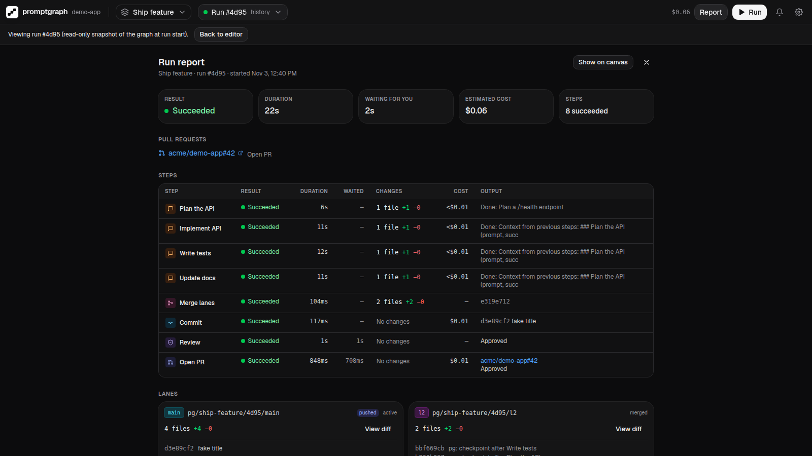
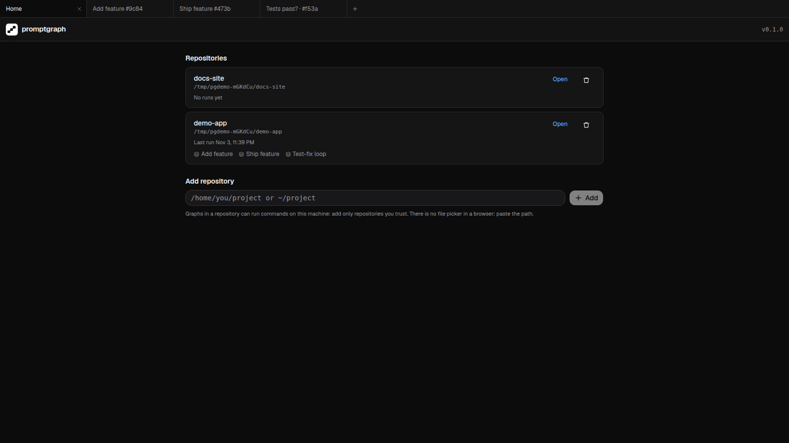

# promptgraph — Design Document

> Status: M0–M9 implemented (M7 daemon §4, M8 multi-repo UI with tabs §13, M9 desktop app §20; the desktop shell's Rust side is not yet built or run, §20.5); desktop distribution (bundled runtime, `~/.local/bin` command, signed updates, release workflow, §20.6–§20.11) designed · Scope: Phase 0–1 (Core), Phase 2 (Control flow) · Audience: personal use (single user, Linux/WSL)

`promptgraph` is a local tool that runs as one background **daemon** per user, bound to `127.0.0.1`, managing any number of git repositories. It is started from the terminal (`promptgraph [repo-dir]` registers a repository and opens it) and serves a React UI that runs in the browser or in a small desktop window (Tauri, §20). In it you draw a flow diagram where each box is a step (a Claude Code prompt, a slash command, a shell command, a commit, a PR…), run it, and watch each box progress in real time. Clicking a box opens the **real, interactive Claude Code terminal** of that step. Graphs, runs and terminals of different repositories can be open side by side in in-app tabs (§13.4).

---

## 1. Goals and non-goals

### Goals

- Define pipelines of Claude Code work as a **directed graph** and run them unattended.
- Run independent branches **in parallel**, each isolated in its own **git worktree**.
- First-class **git steps**: commit, push + PR, merge of parallel branches.
- **Live visibility**: per-node status on the canvas and a real terminal (xterm.js attached to the Claude Code PTY) where you can watch and type.
- **Human-in-the-loop**: approval gates (mandatory before anything leaves the machine) and nodes that pause when Claude needs input.
- **Control flow** (Phase 2): conditional branches, failure routing and bounded loops (e.g. *review → fix → review*, max 3).

### Non-goals

- Multi-user, accounts, remote hosting. It binds to `127.0.0.1` only; the only credential is a local per-user token the user never has to see (§14).
- Windows/macOS support. Linux and WSL only.
- Reusable flow libraries, context templating language, export to Claude Code workflows (explicitly out of scope).
- Replacing Claude Code's own subagents/workflows. Each node is a full Claude Code session; orchestration happens outside.

---

## 2. Phases

| Phase | Name | Content |
|---|---|---|
| **0–1** | **Core** | CLI + server + UI, graph editor, DAG engine, PTY runner with hooks, live terminal, parallel lanes with worktrees, merge node, git nodes, approval gates, run history, resume/retry |
| **2** | **Control flow** | Edge conditions (success/failure), condition node (exit code / LLM judge / regex), dead-path elimination and join policies, bounded loops |

Phase 0 (the original "list of prompts run one after another") is **not a separate product**: it is milestone M1 of the Core phase — a linear graph drawn on the same canvas, executed by the same engine. The data model and engine are designed from day one to support Phase 2 without a rewrite (see §8.1).

---

## 3. Architecture

```
┌──── Browser tab  or  desktop window (Tauri webview, §20), both on http://127.0.0.1:<port> ────┐
│ React + Vite: tab strip (§13.4) ─ one view per tab: Home │ Graph editor │ Run │ Report        │
│  ├─ Canvas (@xyflow/react)      ├─ Inspector (node config)                                     │
│  ├─ Run view (live statuses)    ├─ Terminal drawer (xterm.js, one per node)                    │
│  └─ Approval dialog (diff)      └─ Run history                                                 │
└───────────────▲───────────────────────────────▲──────────────────────────────────────────────┘
                │ REST /api/repos/:repoId/…      │ one WebSocket (repo subscriptions, PTY I/O)
┌───────────────┴───────────────────────────────┴──────────────────────────────────────────────┐
│ promptgraph daemon (Node, Hono + ws), one per user (PG_HOME)                                 │
│  DaemonContext: token · Store (SQLite ~/.promptgraph/state.db) · EventBus · PtyManager        │
│                 HookRouter (POST /hooks/:nodeRunId/:event) · ClaudeRunner · Notifier · WsHub  │
│  RepoRegistry ── RepoContext per registered repository (created lazily, disposed on remove):  │
│     ├─ Graph store ── <repo>/.promptgraph/graphs/*.json (+ file watcher)                      │
│     ├─ Engine ─────── scheduler, state machine, activation tokens                             │
│     ├─ Workspaces ─── git worktree lanes, checkpoints, merges (repo git lock)                 │
│     └─ Runners ────── ShellRunner · GitRunner · Claude (shared ClaudeRunner)                  │
└───────────────┬──────────────────────────────────────────────────────────────────────────────┘
                │ spawn (PTY)                          ▲ curl (hook scripts)
        ┌───────┴──────────┐                           │
        │ claude (interactive) in worktree  ───────────┘
        │ --session-id --settings(hooks) --permission-mode …
        └──────────────────┘
```

Clients of the daemon: the web UI, the CLI (`promptgraph ls`, `open`, …, §4), `promptgraph mcp` (§19) and the desktop shell (§20). They find it through the daemon record (§11.3).

### 3.1 Tech stack

| Layer | Choice | Reason |
|---|---|---|
| Runtime | Node 22, TypeScript, pnpm workspace | `node-pty` and the Agent ecosystem are Node-native |
| Server | Hono + `ws` | Small, typed, easy WebSocket upgrade |
| PTY | `node-pty` | Real TTY so Claude Code runs its interactive TUI |
| DB | `better-sqlite3` | Synchronous, zero-config, crash-safe enough for one user |
| Validation | `zod` | Single schema for graph files, API and WS messages |
| UI | React 19, Vite, `@xyflow/react`, `@xterm/xterm` (+ fit, web-links addons), `zustand`, Tailwind v4, shadcn/ui (Radix primitives) | Standard; React Flow covers nodes/ports/edges/minimap; shadcn/Radix give accessible dialogs, menus, tabs and form controls (focus trap/restore, keyboard navigation) |
| Routing | Hand-written history router in `packages/web/src/lib/router` (no dependency) | Five routes, and each in-app tab owns a location that is not `window.location`, which generic routers do not model |
| Diff view | `react-diff-view` or `diff2html` | Approval dialog |
| Desktop | Tauri v2 (Rust shell, system WebKitGTK), Linux only | A native window and title bar for the same UI; the backend stays the Node daemon (`node-pty` and `better-sqlite3` cannot move into the webview or Rust) |

### 3.2 Repository layout

```
promptgraph/
  packages/
    shared/   # zod schemas, TS types, WS protocol, web URL builders
    server/   # daemon: engine, runners, store, HTTP/WS, CLI entry (bin: promptgraph), MCP server
    web/      # React app (built assets are served by the daemon)
    desktop/  # Tauri v2 shell: src-tauri (Rust), splash page, runtime script, contract tests in TypeScript (§20)
  scripts/set-version.mjs  # one version for every package, Cargo.toml and tauri.conf.json (§20.4)
  .github/workflows/release-desktop.yml  # signed desktop releases (§20.11)
  docs/
```

---

## 4. CLI and daemon

```bash
promptgraph [repo-dir] [--port 4777] [--no-open] [--foreground]   # register a repository and open it
promptgraph daemon [--port 4777]                                  # run the daemon in this terminal
promptgraph ls [--json]                                           # daemon status, repositories, attention
promptgraph open [repo-dir|repo-id] [--next <path>] [--print-url] [--json] [--web-port <p>]
                 [--on-version-mismatch auto|restart|attach]      # open the UI, signed in
promptgraph rm <repo-dir|repo-id> [--force]                       # forget a repository (alias: close)
promptgraph stop                                                  # stop the daemon
promptgraph token rotate                                          # new token; every window signs in again
promptgraph sessions [--json] | sessions revoke <id>|--all        # signed-in browsers and desktop windows
promptgraph mcp                                                   # MCP server for Claude Code (§19.2)
promptgraph desktop install --json                                # internal: install the app's bundled runtime (§20.7)
promptgraph desktop shim status|install [--replace]|decline|uninstall --json   # internal: the ~/.local/bin command (§20.8)
```

A subcommand is recognised only as the first argument; a repository directory named like one is passed as `./ls`. Exit codes: 0 success, 1 error (incl. "not running" for `ls`/`stop`/`sessions`, and a version mismatch, §4.1 item 4), 2 usage, 3 (`daemon` only) another daemon holds the lock, 4 (`open --json --on-version-mismatch auto`, only) a daemon of another version runs and the caller must decide (§4.3, §20.9). The `desktop` subcommands are used by the desktop app only and are left out of `--help`.

### 4.1 The daemon

One daemon per user (per `PG_HOME`) manages every repository. It is the only process that writes the state DB.

1. **Start** (`promptgraph daemon`, `--foreground`, or detached by `ensureDaemon`, item 4), in this order: take the daemon lock (below; held → exit code 3) → refuse while a legacy per-repo server is alive (§4.4) → load or create the token (§14) → open `state.db` and migrate (migrations are additive, so a start that fails later leaves only an upgraded DB) → build the `DaemonContext` and the HTTP app (it reads the port through a getter) → bind `127.0.0.1` (item 2) → mark interrupted every run left `running` by a previous daemon (§8.6, no repository filter: there is one writer) → backfill repositories once (§4.4) → take the legacy locks of the registered repositories (§4.4) → start the notifier and the WebSocket hub → write the `port` file and the daemon record (§11.3) → install the process handlers (item 8). Once ready it prints one line, `Listening: http://127.0.0.1:<port> (pid <pid>, promptgraph <version>)`.
   - **The lock is held by the kernel**, not by a pid file: the daemon listens on the Linux abstract Unix socket `\0promptgraph-<uid>-<sha256(realpath PG_HOME)[:16]>`. The kernel releases it when the process dies, so there is no stale lock to take over, no takeover race between concurrent spawners, and no pid-reuse problem after a reboot. `locks/daemon.pid` is written next to it for messages only (`promptgraph daemon is already running (pid N)`).
2. **Port**: an explicit `--port` must be free (else exit 1, `Port <p> is already in use`). Without one, the daemon tries in order the **sticky port** from `<PG_HOME>/port` (the last port it bound), then `PG_PORT_DEFAULT` or 4777, then a random free port, and writes the port it got to `<PG_HOME>/port`. The port is sticky because everything the browser stores (tabs, last graphs, theme) is per origin, and the origin includes the port. Clients never assume 4777: they read the record.
3. **Identity before credentials.** A client never sends the token to whatever answers on the recorded port: loopback ports are shared by every user of the machine, the daemon may have died and the token is long-lived. It first calls `GET /api/daemon/hello?nonce=<16 random bytes, base64url>` (no credentials) and checks that the answer's `proof` equals `HMAC-SHA256(token, "hello:" + nonce)` and that its `pid` is the record's. A record is **stale** when its pid is dead, when the start time of that pid (`/proc/<pid>/stat` field 22) differs from the record's `pidStart`, or when the proof fails; stale records are ignored (and removed by the next daemon start).
4. **Detached start** (`ensureDaemon`, shared by the CLI and `promptgraph mcp`, and through the CLI by the desktop shell): a verified record is reused. If its `serverVersion` differs from the client's version, every command except `ls` and `stop` fails with `promptgraph <old> is running (this is <new>); run promptgraph stop, then retry` (exit 1; MCP tools return the same text, except when the daemon is **newer** than the MCP server: then a Claude Code session kept an MCP server started before an update handed the daemon over (§20.9), and the text is `promptgraph was updated to <daemon version> while this MCP server still runs <own version>; run /mcp in Claude Code and reconnect promptgraph (or restart Claude Code)`). The one exception is `open --on-version-mismatch` (§4.3), which the desktop app uses to hand over to the version it bundles (§20.9). Otherwise it spawns `<node> <cli> daemon` detached, forwarding `--port` **only when the user gave one** (so the daemon keeps its port fallback), with cwd `PG_HOME`, the daemon environment of item 5, and output appended to `~/.promptgraph/logs/daemon.log`, then polls for a verified record for up to 20 s. If the child exits with code 3, another daemon holds the lock (another spawner won, or a daemon is still stopping) and the client keeps polling while the lock stays held; once it is free and no daemon answered, it spawns a new child within the same 20 s. Any other exit before the record is ready, or the timeout, is an error that quotes the last 20 lines of the log.
5. **Environment.** The daemon's environment is what every Claude, shell, git and `gh` child of **every** repository inherits (§7.1), so a detached daemon does not inherit its spawner's environment (often Claude Code in another repository, a shell with direnv secrets, or a desktop launcher without the user's `PATH`). `ensureDaemon` builds it from an allowlist of the caller's variables (`HOME`, `USER`, `LOGNAME`, `SHELL`, `LANG`, `LC_*`, `TZ`, `TERM`, `DISPLAY`, `WAYLAND_DISPLAY`, `XDG_*`, `DBUS_SESSION_BUS_ADDRESS`, `SSH_AUTH_SOCK`, `WSL_DISTRO_NAME`, `WSL_INTEROP`, `WSLENV`, `CLAUDE_CONFIG_DIR` (so its Claude children, transcripts and trust use the caller's Claude config), `PG_*` except a node run's hook variables `PG_PORT`, `PG_HOOK_HEADER_FILE` and `PG_NODE_RUN_ID`, which a daemon started from inside a run would otherwise hand to every child) merged with the environment of the user's login shell (`$SHELL -ilc` printing its environment as JSON, 10 s timeout, the way editors resolve the shell environment; skipped with `PG_DAEMON_SHELL_ENV=0`, which tests use, falling back to the caller's `PATH`), then removes `LD_LIBRARY_PATH`, `LD_PRELOAD`, `APPDIR`, `APPIMAGE`, `ARGV0`, `OWD`, `PG_DESKTOP_*`, `GTK_*`, `GDK_*`, `GIO_*`, `GI_*`, `GSETTINGS_*`, `WEBKIT_*`, the Claude nesting variables, and every entry inside an AppImage mount (a path segment starting with `.mount_` or `appimage_extracted_`) of `DESKTOP_MOUNT_PATH_LISTS` (`PATH`, the XDG lists, `PYTHONHOME`, `PYTHONPATH`, …; the shell removes them too, §20.1 item 2). Node-run children additionally never get `PG_DESKTOP_*` (`childEnv`). A foreground daemon (`daemon`, `--foreground`) keeps its terminal's environment, which the user chose. The daemon checks prerequisites (`git`, `claude`, `gh`, `curl`) against its own environment and reports them as `warnings` in `GET /api/daemon`. There is no per-repository environment: a variable a repository's nodes need belongs in the login shell profile (or is set by its shell nodes); after changing the profile, `promptgraph stop` and start again.
6. **Lifetime**: no idle timeout. Runs outlive terminals, Claude sessions and windows; the daemon stops only with `promptgraph stop`, SIGINT/SIGTERM, or (foreground) SIGHUP when its terminal closes.
7. **Stop** (SIGINT/SIGTERM/SIGHUP): every repository's engine shuts down concurrently (Claude PTYs get `/exit`, ≤5 s, then are killed; running node runs → `interrupted`, runs → `paused`, resumable, §8.6), then the remaining PTYs are killed, the record and the legacy locks are removed, WS/HTTP/DB close and the lock socket closes. The record stays while the engines shut down, so `ls` still lists the daemon, a second `stop` finds and waits for it, and repository requests get 503 `daemon_stopping`.
8. **One repository cannot take the others down.** Activating a repository (§4.2) is isolated: a failure (unreadable directory, git error) is reported for that repository (`RepoSummary.error`, 409/500 on its routes) and retried on the next trigger. A graph watcher that cannot start or stops (inotify limit) is reported in `RepoSummary.error` too, but does not fail the activation: the repository keeps working without live reloads of external edits. The graph watcher has an `error` listener (an `FSWatcher` error without one would throw). `unhandledRejection` is logged and the daemon keeps running; `uncaughtException` is logged, then the daemon stops gracefully (item 7, so runs stay resumable) and exits 1.
9. **Log**: `logs/daemon.log` is renamed to `daemon.log.1` when it is larger than 5 MB (one old file is kept), by `ensureDaemon` just before it spawns a detached daemon: the spawner opens the file and hands the daemon its descriptor, so a daemon rotating at its own start would rename the file it is writing to.

### 4.2 Repositories

- **`promptgraph [repo-dir]`** resolves `repo-dir` (default `cwd`) to the git top level and its realpath (fails if not a git repo), checks prerequisites (only warns, `gh` is needed for PR nodes), runs `ensureDaemon`, registers the repository (`POST /api/repos`, idempotent), opens the browser **signed in** on `/r/<repoId>` through a one-time login URL (§14), prints `Opened <name>: http://127.0.0.1:<port>/r/<repoId>` (no secret in it) and exits. `--no-open` registers and prints only. `--port` only applies when this call starts the daemon (a warning says so otherwise).
- **`--foreground`** runs the daemon in this process instead (refused while another daemon runs), registers the repository, opens it and prints `Open: http://127.0.0.1:<port>/r/<repoId>`; Ctrl-C (or closing the terminal) stops the daemon and with it every repository. Tests, crash tests and the screenshot/video scripts use this form.
- **Lane worktrees are never repositories.** A path whose git top level (realpath) is at or under the worktrees root (`<PG_HOME>/worktrees`, as configured and as its realpath) is refused with 422 `lane_worktree`, and the backfill (§4.4) skips such paths: registering one would activate it (graphs dir inside the lane, a second lane manager running `git worktree prune` and snapshot-ref pruning on the shared git directory without the owning repository's lock) and let graphs run inside a lane. `promptgraph mcp` maps such a cwd to its repository (§19.2).
- **Paths**: `POST /api/repos` takes an **absolute** path; a leading `~` or `~/` is expanded to the daemon user's home, anything else relative is refused with 422 `path_not_absolute` (the daemon's cwd is `PG_HOME`, so a relative path would mean nothing useful). The CLI and `promptgraph mcp` resolve paths before sending them; Home's add field says so.
- **Repository id** (`repoId`, used in every URL and API path): `<slug>-<hash8>`, where `slug` is the directory name lowercased with runs of other characters than `[a-z0-9]` replaced by `-`, trimmed, at most 24 characters (`repo` if empty), and `hash8` the first 8 hex digits of the SHA-256 of the realpath. Readable (`/r/promptgraph-3f9a1c2e`), stable across restarts and re-registration, and distinct for two checkouts with the same name. Only the daemon derives it; clients get it from `POST /api/repos`. Two paths that resolve to the same realpath are the same repository, so two engines never race on one repository's git lock. The registry, the engine (`RepoRef.path`) and `runs.repo_path` all hold that realpath (§4.4 normalises older rows).
- **Registered repositories persist** (table `repos`, §11.2) until removed. A repository whose directory has disappeared stays listed with `available: false`; it is never removed automatically.
- **Loading vs activation.** Any request for a registered repository **loads** its `RepoContext` (graph store, lane manager, runners, engine) without side effects: it reads graph files and the DB, never writes into the repository and runs no git command beyond read-only ones (with `-c core.fsmonitor=false`, §14). **Activation** — create `.promptgraph/graphs/` if missing, start the graph watcher, `git worktree prune`, prune snapshot refs (§9.6, §9.7) — happens only on `POST /api/repos`, a `repo:subscribe` on the WebSocket, or the first mutating (non-GET) request under `/api/repos/:repoId`; never on a GET, so a cross-site `` cannot make the daemon touch a repository (§14). Loading and activation are memoised per repository (two concurrent first requests build one context), a failure clears the memo and is reported in `RepoSummary.error`. Inactive repositories cost a DB row; Home's counters come from the DB. Contexts stay loaded until the repository is removed or the daemon stops.
- **`promptgraph rm <repo>`** (`DELETE /api/repos/:repoId`) is refused with 409 `repo_active` while the repository has a `running` run; `--force` shuts its engine down as in a daemon stop first. Disposing a context unsubscribes its PTY input listener, stops its watcher, shuts its engine down (killing only its own PTYs) and waits for its execution chains to finish, with no timeout, before the row is deleted, its legacy lock released and `repo:removed` sent; while a repository is disposing, requests and re-registration for it wait for the dispose. Removing never loads or activates the repository (an unavailable one, or one whose activation fails, can always be removed) and never deletes graph files, runs, worktrees or branches: re-adding the same path gives the same id and its history back.

### 4.3 Other commands

- **`ls`**: daemon pid, version, port and uptime, then one line per repository (name, id, path, active runs, waiting for approval, waiting for input, unavailable, activation error). `--json` prints `ListReposResponse` (§12.1). Without a daemon it prints `promptgraph is not running` (exit 1); it never starts one. With a daemon of another version it still lists and prints the mismatch on stderr.
- **`open [repo]`**: `ensureDaemon`, registers the repository if one is given, mints a one-time login code and opens `/login?code=…&next=/r/<repoId>` (or Home without an argument), then prints `Opened <name>: <origin><path>`. `repo` (also for `rm`) is a repository id when it has the id shape and the daemon knows it, otherwise a directory (`./name` is always a directory, ids contain no slash). `--next <path>` replaces the target path (a path starting with a single `/`, else exit 2). `--print-url` prints that URL instead of opening a browser; `--json` (which implies `--print-url`: no browser opens) prints `OpenUrlResult {v: 1, cliVersion, url, port, repoId}` on one line and nothing else on stdout: the desktop shell's only interface to the CLI (§20), so the session its URL creates is labelled "promptgraph desktop". `port` is the port of the URL's origin (the web port with `--web-port`), the origin the shell allows. `--web-port <p>` (development) builds the URL on `http://127.0.0.1:<p>`, the vite dev server, which proxies `/login` (§14). The code is valid once, for 30 s.
  - **`--on-version-mismatch <policy>`** (requires `--json`) decides what `open` does when the verified daemon reports another `serverVersion` than the CLI's, instead of failing with the message of §4.1 item 4. It counts the daemon's running runs first (the sum of `RepoSummary.runs.running` from `GET /api/repos`, null when that call fails). `auto`: when the daemon is **older** than the CLI (numeric `major.minor.patch` comparison, a pre-release sorts before its release) and has no running run, stop it exactly like `promptgraph stop` (identity check, SIGTERM, up to 30 s; runs become `paused`, resumable) and let `ensureDaemon` start this version; otherwise (a newer daemon, a running run, or an unknown count) print `OpenMismatchResult {v: 1, mismatch: {serverVersion, cliVersion, runningRuns, daemonIsOlder}}` on one line and exit 4 without changing anything. `restart`: stop the daemon whatever it runs, then start this version. `attach`: use the running daemon as it is (only `hello`, `GET /api/repos`, `POST /api/repos` and `POST /api/daemon/login-codes` are called, which every daemon with a `version: 2` record serves); the window then shows that daemon's own web UI. A daemon that stops on its own while `open` decides is not an error: `ensureDaemon` starts this version. Worst-case duration with `auto`/`restart`: the stop (≤ 30 s) plus the start (≤ 20 s) plus the login-shell environment (≤ 10 s), which is why the desktop shell gives those calls a 90 s budget (§20.1 item 4). Before stopping, the CLI prints `promptgraph: restarting the daemon (<old> → <new>)…` on stderr.
  - **Runtime activation**: with `--on-version-mismatch`, once `open` holds a daemon that reports **this CLI's** version and this CLI runs from an installed desktop runtime (`SERVER_PACKAGE_DIR/..` is a `<version>-<id8>` directory with a valid `manifest.json` whose name matches it, inside a runtime directory, §20.7), it switches that runtime directory's `current` to it (under the runtime lock; a failure is a warning on stderr, never an error of `open`). The runtime directory is **the parent of the CLI's own realpath** (it must be a directory named `runtime`, owned by the user, not group- or world-writable, and already hold `current`), never `<data>/runtime` recomputed from `open`'s environment: `desktop install` runs with the app's environment, `open` through the login shell, and an `XDG_DATA_HOME` exported only by a start-up file would otherwise point `open` at another directory, so `current` would silently stay on the first build installed. A CLI with a valid manifest that is not such an installed build (run from the AppImage's mount, or copied elsewhere) prints a warning and switches nothing. So `current`, and with it the `~/.local/bin` command (§20.8), always follows the runtime whose daemon the app last started; with `attach` nothing is switched.
- **`desktop install` / `desktop shim …`** (internal, `--json` only): the desktop app's runtime installer and `~/.local/bin` command (§20.7, §20.8). They live in the CLI so that the logic is TypeScript, tested with vitest against temporary directories, and the Rust shell only shows the questions.
- **`stop`**: checks the record's identity (pid alive with the recorded start time), sends SIGTERM and waits up to 30 s for the process to exit, printing progress; a stale record is removed and reported as "not running". It never signals a process whose start time does not match.
- **`token rotate`**: with a running daemon `POST /api/daemon/token/rotate` (the daemon swaps the token in memory, rewrites the file, drops every session and closes every WebSocket); otherwise it takes the daemon lock while it rewrites the file, so a daemon starting at the same moment cannot load the old value (lock held but no verified daemon → error, retry); the sessions are deleted by the next daemon start, which finds a token other than the one recorded in `meta` (§14). Every browser and desktop window must sign in again; Claude sessions in flight are not affected (§14).
- **`sessions`**: lists the browser and desktop sessions (§14: id prefix, label, created, last seen; `--json` prints `ListSessionsResponse`); `sessions revoke <id>` ends one (an id that matches no session is an error), `--all` every one. Bearer-only routes, so only a local client with the token can call them.

### 4.4 Upgrading from per-repository servers

Before M7 each repository had its own server (`servers/<repo-key>.json`, `locks/<repo-key>.pid`, `logs/server-<repo-key>.log`).

- The daemon refuses to start while such a record names a live process (`stop the promptgraph server for <repo> (pid <n>) first`), because it would interrupt that server's runs, and deletes stale legacy records. The record has no process start time, so a pid reused by another process (typically after a reboot) is recognised when that process started well after the record's `startedAt` and its command line does not mention promptgraph; when in doubt the record counts as live.
- **The daemon owns the legacy locks.** An old binary started while the daemon runs (an old global install, an outdated `PROMPTGRAPH_BIN`) would open the same `state.db` (it migrates only up to the versions it knows, so it starts normally), interrupt the daemon's runs of its repository and race on its worktrees. Old binaries take `locks/<repo-key>.pid` before they open the DB, so the daemon writes that file with its own pid for every registered repository (at start, on registration and again before each activation) and removes it on `rm` and stop: an old binary then fails with its existing "already running" error. When a live old server already holds it, registration fails with 409 `legacy_server_running` and activation fails (the repository stays inactive) until that server is stopped. `config/repo-key.ts` stays for this.
- The state DB needs no data migration: runs are already keyed by `repo_path`. Migration 3 adds the `repos`, `sessions` and `meta` tables. **Backfill** runs at daemon start until it has committed once: in one transaction it rewrites `runs.repo_path` and `graph_meta.repo_path` to their realpath where that differs and exists, inserts a `repos` row for every distinct `runs.repo_path` that is still a git top level, and sets `meta.repos_backfilled = 1`. It is idempotent and recorded in the DB, so a crash before the commit only retries it, and a repository removed later with `rm` is not brought back.

---

## 5. Core concepts

| Concept | Definition |
|---|---|
| **Graph** | A versioned JSON file in the repo: nodes + edges + settings. Editable only when no run is active on it. |
| **Node** | A step. Has a `type`, a config, input/output ports. |
| **Edge** | Connects an output port to an input port. In Phase 2 it can carry a condition and be a loop back-edge. |
| **Run** | One execution of a graph. Stores an immutable **snapshot** of the graph at start time. |
| **NodeRun** | One execution of a node within a run (Phase 2: one per loop iteration). Has status, timestamps, output, session id, lane. |
| **Lane** | An isolated workspace: one git worktree + one branch. Nodes on a linear path share a lane; fan-out creates new lanes; merge nodes join them. |
| **Session** | A Claude Code conversation (`session_id` UUID). Persisted by Claude Code on disk; can be resumed. |

---

## 6. Graph file format

Stored at `.promptgraph/graphs/<slug>.json`. Committable, diffable. Layout positions live in the same file (they're harmless in diffs and avoid a second file).

```ts
type Graph = {
  version: 1;
  id: string;                 // slug
  name: string;
  settings: GraphSettings;
  issues?: GraphIssue[];      // the Linear issues the graph works on (at most 20), §24
  nodes: Node[];
  edges: Edge[];
};

type GraphSettings = {
  baseBranch: string;               // e.g. "main"; lanes branch off this
  branchPrefix: string;             // default "pg/<graph-id>"
  maxParallelClaude: number;        // default 3
  workspaceSetup?: string;          // shell run once per new worktree, e.g. "pnpm install"
  defaults: {
    model?: string;                 // "opus" | "sonnet" | full id
    effort?: "low" | "medium" | "high" | "xhigh" | "max";
    permissionMode: "acceptEdits" | "auto" | "manual" | "dontAsk" | "plan"; // default "auto"
    allowedTools?: string[];
    completion: CompletionPolicy;   // see §7.4
  };
  keepWorktrees: "never" | "on-failure" | "always";   // default "on-failure"
  brief: { enabled: boolean; model?: string };         // run brief, §13.6; default { enabled: false }, model "haiku"
};

type Node = {
  id: string;
  type: NodeType;
  label: string;
  position: { x: number; y: number };
  config: NodeConfig;               // discriminated by type, §6.1
  onError?: "fail-run" | "pause";   // default "pause" (Phase 2 adds failure edges)
};

type Edge = {
  id: string;
  source: string; sourcePort: string;   // "out" in Phase 1; "true"/"false"/"error" in Phase 2
  target: string; targetPort: string;   // "in"
  // Phase 2:
  when?: "success" | "failure" | "always";   // default "success"
  loop?: { maxIterations: number; onExhausted: "fail" | "continue" };
};
```

Roots are nodes with no incoming (non-loop) edges. A graph may have several roots (they start in parallel).

### 6.1 Node types (Phase 1)

| Type | Runner | Config | Output |
|---|---|---|---|
| `prompt` | Claude (PTY) | `prompt`, `context`, `model?`, `effort?`, `permissionMode?`, `allowedTools?`, `completion?` | Last assistant message |
| `command` | Claude (PTY) | `command` (e.g. `/simplify`, `/code-review high`), plus same options as `prompt` | Last assistant message |
| `shell` | Shell (PTY) | `run`, `timeoutSec?`, `env?` | Exit code + tail of stdout/stderr (last 200 lines) |
| `commit` | Git | `message?` (fixed) or `generateMessage: true` (default), `squashCheckpoints: true` (§9.3) | Commit SHA, message |
| `pr` | Git + `gh` | `title?`/`body?` or generated, `draft: true`, `base?` (default `baseBranch`), `requireApproval: true`; a graph linked to issues adds their identifiers to both (§24) | PR URL |
| `approval` | — | `message?`, `showDiff: true` | `approved` / `rejected` + comment |
| `linear` | Headless Claude + Linear API (§24.5) | `prompt?` (default: update the linked issues' progress), `allowComments: true`, `allowStateChanges: true`, `model?`, `timeoutSec?` (300); approval always | Proposed and applied updates, summary |
| `merge` | Git (+ Claude on conflict) | `strategy: "merge" \| "squash"`, `onConflict: "claude" \| "pause"` | Merge SHA, conflicted files |

`prompt` and `command` share the same runner; `command` exists so the canvas shows slash-command boxes distinctly and the inspector can offer a picker of the repo's/user's available commands and skills.

**Generated messages** (`commit`, `pr`): the server runs a short headless call, `claude -p --output-format json --json-schema <schema>`, feeding the staged diff stat + the outputs of the nodes since the last commit in that lane. Headless is fine here: there is nothing to watch.

**`pr` always implies `git push`.** With `requireApproval: true` (the default, and the only option exposed in the UI unless explicitly unlocked in graph settings), the node enters `waiting_approval` before pushing.

---

## 7. Claude runner (PTY + hooks)

This is the core technical piece and the main thing the spike (M0 in §16, assumptions in §17) validates.

### 7.1 Spawn

For each `prompt`/`command` NodeRun the server spawns, via `node-pty`, inside the lane's worktree:

```bash
claude "<initial message>" \
  --session-id <uuid>               # generated by us → we know it before start
  --name "pg:<graph>/<node-label>"  # visible in /resume and terminal title
  --settings <run-dir>/hooks.json   # hook injection, §7.2
  --permission-mode <mode> \
  [--model <m>] [--effort <e>] [--allowedTools ...]
```

or, when `context = "resume"` (§7.5): `claude --resume <previous-session-id> "<message>" ...`.

- `cols/rows`: start at 120×40; resized on attach from the browser (`pty.resize`).
- Env: inherits the daemon's environment (§4.1 item 5: the same for every repository, never the environment of whoever registered the repository) minus `PG_HOME` and any inherited hook variables, plus `TERM=xterm-256color`, `PG_PORT` (the daemon's port), `PG_HOOK_HEADER_FILE`, `PG_NODE_RUN_ID`. The token is never passed to Claude: the header file (mode 0600, in the run dir) holds a per-node-run hook token, `HMAC(hook secret, nodeRunId)`, that only authorises `POST /hooks/<nodeRunId>/*`. The hook secret is random per daemon start and kept in memory only (PTYs never outlive the daemon), so rotating the token (§14) does not cut live sessions off.
- `<initial message>` for `command` nodes is the slash command itself (`/simplify`); for `prompt` nodes it is the prompt plus the context block (§7.5).

### 7.2 Hook injection

`hooks.json` (generated once per run) adds hooks on top of the user's own (Claude Code merges settings sources), and the deny rules of §7.6:

```json
{
  "hooks": {
    "SessionStart": [{ "hooks": [{ "type": "command", "command": "pg-hook session-start" }] }],
    "Stop":         [{ "hooks": [{ "type": "command", "command": "pg-hook stop" }] }],
    "Notification": [{ "hooks": [{ "type": "command", "command": "pg-hook notification" }] }],
    "PreToolUse":   [{ "hooks": [{ "type": "command", "command": "pg-hook activity" }] }]
  }
}
```

`pg-hook` is a tiny script shipped with the server (absolute path written into the JSON):

```sh
#!/bin/sh
# Forwards the hook payload (stdin JSON) to the promptgraph server. Never blocks Claude.
curl -s -m 2 -X POST \
  -H @"$PG_HOOK_HEADER_FILE" -H "Content-Type: application/json" \
  --data-binary @- "http://127.0.0.1:$PG_PORT/hooks/$PG_NODE_RUN_ID/$1" >/dev/null 2>&1
exit 0
```

| Hook | Payload fields used | Effect |
|---|---|---|
| `SessionStart` | `session_id`, `transcript_path` | Confirms the session; node → `running` |
| `PreToolUse` | `tool_name` | Updates "last activity" shown on the node (e.g. `Edit src/app.ts`) |
| `Notification` | `message` | Node → `waiting_input` (permission prompt or idle waiting). Badge + optional desktop notification |
| `Stop` | `session_id`, `transcript_path`, `stop_hook_active` | Claude finished a turn → completion policy (§7.4) |

Activity resets `waiting_input` back to `running` (next `PreToolUse` or PTY input from the user).

### 7.3 Terminal streaming

- The server keeps a **ring buffer** (2 MB) of raw PTY output per NodeRun. Attaching a terminal replays the buffer, then streams live.
- WS messages: `pty:data` (server→client, base64 chunks), `pty:input` (client→server keystrokes), `pty:resize`.
- Multiple viewers allowed; the most recent attach drives the PTY size.
- After the process exits, the buffer is flushed to `~/.promptgraph/runs/<run>/<nodeRun>.log` so finished nodes still show their terminal (read-only), with a button **"Reopen session"** that spawns `claude --resume <session-id>` in a new PTY (not part of the run).

### 7.4 Completion policy

`Stop` fires at the end of **every** turn, including when Claude stops to ask a question. Policy per node:

```ts
type CompletionPolicy =
  | { mode: "auto"; graceSec: number }   // default: graceSec = 5
  | { mode: "manual" }                   // wait for the user to click "Done"
  | { mode: "marker"; token: string };   // done only if last message contains token
```

- **auto**: on `Stop`, start a grace timer. If the user types into the PTY during the grace period, cancel (the user is steering). If the grace expires → node `succeeded`.
- **manual**: node → `idle` (blue, "Claude finished a turn") until you click **Done** or **Fail**.
- **marker**: the prompt gets an appended instruction: *"When the task is fully complete, end your final message with `<token>`. If you need input, ask instead."* On `Stop` the server reads the last assistant message; token present → `succeeded`, otherwise → `idle` (needs you).

A node in the canvas can be toggled to **Hold** at any time while running: it behaves as `manual` for the current turn.

The auto grace period is visible (risk R3): while it runs, the node run carries `graceUntil` (epoch ms when it succeeds) and the UI shows *"Auto-continuing in 5s… [Hold]"* on the node card, in the inspector and in the terminal drawer's tab bar. Hold during the countdown cancels it and the node goes `idle`. `graceUntil` is cleared when the countdown stops (typing, new activity, Hold) and whenever the node leaves `running`.

On success the server sends `/exit` to the PTY, waits 3s, then kills it. The session stays on disk. `/exit` is only typed while Claude sits at its input prompt; when it may be showing a permission or trust dialog (where Enter accepts the default "Yes"), the process gets SIGTERM instead.

### 7.5 Context between nodes

Fixed modes on the target node (no templating language):

| `context` | Behaviour | Valid when |
|---|---|---|
| `fresh` *(default)* | New session. The initial message is prefixed with a **"Context from previous steps"** block containing the outputs of the direct predecessors (truncated to 4k chars each), then the node's prompt | Always |
| `resume` | `claude --resume <predecessor-session-id>`: same conversation, same memory | Exactly one predecessor is a Claude node **in the same lane** |
| `clean` | New session, only the prompt. The repo state is the only context | Always |

Output of a Claude node = text of the **last assistant message**, read from `transcript_path` (JSONL) on `Stop`. Stored in `node_runs.output`.

### 7.6 Permissions

- Default `permissionMode: "auto"` (Claude Code's auto mode: it decides which actions need a prompt). Graph files
  written before this change store `"acceptEdits"` explicitly and keep it.
- **`bypassPermissions` is a per-user app setting, never a graph value.** Settings → *Bypass permissions*
  (`AppSettings.bypassPermissions` in `~/.promptgraph/settings.json`, off by default) starts every Claude node console
  in Claude Code's `bypassPermissions` mode in place of the graph's default; a mode set on the node itself (e.g. a
  `plan` step) still wins. The runner reads the setting when a console starts, so a change applies to the next one, and
  "Reopen session" follows it while the lane worktree exists (in the main checkout it keeps asking, as before).
  `PermissionModeSchema` deliberately has no `bypassPermissions`: a graph committed to a repository, cloned by someone
  else, can never turn it on. The inspector's "Default (…)" and the graph settings say when the setting replaces the
  graph default. Claude Code asks once, in the terminal, to accept the mode. **What it costs:** Claude no longer asks
  before running commands or before reading outside its worktree, so the `blockReadsOutsideWorkingDirectories`
  prompt below no longer protects the token; only the `permissions.deny` rules remain. A step could then read the
  token, approve its own gate and push. The setting's description says so, and turning it on is the user's explicit
  choice (invariant 5). The chat (§21) never uses it.
- When a permission prompt appears, `Notification` turns the node yellow; you answer it in the terminal.
- `allowedTools` per node to make unattended runs smoother (e.g. `Bash(pnpm test:*)`).
- The generated `--settings` file (§7.2) also carries `permissions.deny` rules for promptgraph's own secrets: `Read` of `<PG_HOME>` itself (a recursive `grep`/`find` naming it, or `..` from a lane worktree, which lives under it), and `Read` and `Edit` of `<PG_HOME>/token`, `<PG_HOME>/linear-key` (§24), `<PG_HOME>/state.db*`, `<PG_HOME>/runs/**` (the hook header files), `<PG_HOME>/servers/**` (the discovery records of pre-M7 per-repository servers, which hold that server's live API token) and `<PG_HOME>/logs/**` (pre-M7 detached servers printed a token URL to their logs; the daemon logs no credential, but old logs may remain), as absolute rule paths (`//…`), written for `PG_HOME` as given and, when it is a symlink, for its realpath too. Deny rules alone do not contain Bash: Claude Code runs its built-in read-only commands (`cat`, `grep`, `find`, `head`, …) without a prompt in every mode, also outside the working directory, and a deny rule does not apply to a command that reads files without naming them (`grep -r x .` run from a parent directory). So the file also sets `permissions.blockReadsOutsideWorkingDirectories: true` (Claude Code ≥ 2.1.257): the file tools refuse paths outside the session's working directory (the lane worktree; Claude Code's own files such as skills and plugins stay readable) and recognised file-reading Bash commands on such paths prompt the user even in `acceptEdits` mode. A step that needs a directory outside its worktree gets it with `/add-dir` in its terminal. An agent therefore cannot read the token and approve its own gate through the API without the user approving the read (invariant: nothing leaves the machine without approval). `PG_HOME` is not passed to children. Other programs an approved command runs (a script that opens files itself) are not contained; shell nodes are trusted graph code (§14).

---

## 8. Execution engine

### 8.1 Model: activation tokens

The engine is **activation-based**, not a one-shot topological sort, so Phase 2 (conditions, loops) is an extension rather than a rewrite:

- When a NodeRun finishes, it emits an **outcome** (`success` | `failure`, Phase 2: plus port `true`/`false`).
- For each outgoing edge whose condition matches the outcome, the engine delivers an **activation** to the target's input; edges that don't match deliver a **skip** (§10.3).
- A node becomes **ready** when every incoming non-loop edge has delivered either an activation or a skip, and at least one is an activation (Phase 1: all are activations).
- Ready nodes enter a queue; the scheduler starts them subject to concurrency limits.

In Phase 1 every edge is `when: success`, so this reduces to "a node runs when all its predecessors have succeeded".

### 8.2 Node states

```
pending ─► ready ─► running ─┬─► succeeded
                    ▲   │    ├─► failed
                    │   ▼    └─► cancelled
                    │ waiting_input / idle / waiting_approval
                    │
           skipped (Phase 2: dead path)     interrupted (server stopped mid-run)
```

| State | Canvas colour |
|---|---|
| pending | grey outline |
| ready / queued | grey filled |
| running | blue, animated border, last activity text |
| idle (turn finished, awaiting Done) | light blue |
| waiting_input | amber, pulsing |
| waiting_approval | violet |
| succeeded | green |
| failed | red |
| skipped | faded, dashed |
| cancelled / interrupted | dark grey |

Edges animate while their source is running and are coloured green once they delivered an activation.

### 8.3 Run states

`running` → `succeeded` | `failed` | `paused` | `cancelled`.
A run is `paused` when a node failed with `onError: "pause"` and no other branch can make progress; you can **retry** the node, **skip** it (treat as success), or **cancel** the run.

### 8.4 Scheduling and limits

- `maxParallelClaude` (default 3) caps concurrent Claude PTYs across the run. `shell`/git nodes are not capped (they are short) except one git write operation per lane at a time.
- Queue order: FIFO by readiness time.
- Rate-limit/usage-limit messages from Claude Code are just terminal text; the node stays `running`/`waiting_input` and you see it. (A later improvement could detect them and back off.)

### 8.5 Failure semantics (Phase 1)

| Node type | Fails when |
|---|---|
| prompt / command | PTY exits unexpectedly before success; user clicks **Fail**; `marker` mode and user marks failed |
| shell | Exit code ≠ 0 or timeout |
| commit | Git error. Nothing to commit → **succeeds** with `output.noop = true` (no empty commit is created) |
| pr | Push/`gh` error, or approval rejected |
| approval | Rejected |
| merge | Unresolved conflicts with `onConflict: "pause"` after you cancel, or the Claude resolver fails |

### 8.6 Resume after crash

When the daemon starts it finds runs (of every repository) with NodeRuns in `running`/`waiting_*` state and marks them `interrupted`, the run `paused`; removing a repository with `--force` does the same for its runs. **Retry** on an interrupted Claude node spawns `claude --resume <session-id>` with the message *"You were interrupted. Continue the task."* (completion policy applies normally).

---

## 9. Workspaces and lanes

### 9.1 Layout

```
~/.promptgraph/worktrees/<repo-name>/<run-id>/<lane-id>/   # git worktree
branches: <branchPrefix>/<run-short-id>/<lane-id>           # e.g. pg/feature-x/3f9a/main
```

Worktrees live outside the repo to avoid polluting it and to avoid nested-repo confusion for tools. Two registered repositories with the same directory name share `<repo-name>/`; run ids keep their worktrees apart.

### 9.2 Lane assignment (computed at run start, on the snapshot)

1. Each root gets a new lane branched from `baseBranch`.
2. A node with **one** successor: the successor stays in the same lane.
3. A node with **N > 1** successors (fan-out): the first successor (by canvas x/y order) keeps the lane; each other successor gets a new lane branched from the parent lane **after a checkpoint**.
4. A `merge` node continues in the lane of its first input (by canvas order) and merges the others into it.
5. Any non-`merge` node with more than one incoming edge is a **validation error** in Phase 1 (to join parallel work you must use `merge`). Phase 2 relaxes this for nodes whose inputs come from mutually exclusive branches.

### 9.3 Checkpoints

Before a fan-out creates new lanes, and before a `merge` reads a lane, the engine makes a checkpoint commit if the lane is dirty:

```
git add -A && git commit -m "pg: checkpoint after <node-label>" --no-verify
```

Checkpoints are regular commits on the lane branch. A later `commit` node with `squashCheckpoints: true` (default) soft-resets to the last non-checkpoint commit before committing, so PRs don't contain "checkpoint" noise.

### 9.4 New-lane setup

When a worktree is created: `git worktree add -b <branch> <path> <from-ref>`, then `settings.workspaceSetup` (e.g. `pnpm install`) runs as a hidden shell step shown as a small badge on the first node of the lane. Failure fails that node.

### 9.5 Merge node

```
git merge --no-ff <other-lane-branch>        # for each other input, in canvas order
```

- On conflict with `onConflict: "claude"`: the merge node spawns a Claude PTY in the lane with *"Resolve the merge conflicts in: <files>. Keep the intent of both branches. Run the tests if available. Then stage the files."* When it succeeds, the engine runs `git commit --no-edit`. You can watch/steer in the terminal like any other node.
- With `onConflict: "pause"`: node → `waiting_input`; the terminal drawer opens a shell in the worktree for you to resolve manually, then click **Done**.

### 9.6 Cleanup

At run end, per `keepWorktrees`: `git worktree remove --force` + delete local branches that were not pushed and hold no commits of their own (or were merged). Pushed branches, and unpushed branches carrying commits (e.g. from a commit node), are kept so no committed work is lost. A **"Clean up"** action in run history does the same on demand. `git worktree prune` runs when a repository is activated in the daemon (§4.2).

### 9.7 Per-node snapshots

To show what each node changed (not only the lane against the base branch), the engine snapshots the lane's worktree right before a node's runner starts (after lane creation, workspace setup and the pr/merge checkpoints) and right after it finishes (before the next node of the lane can start):

```
cp <worktree index> $TMP/index                    # keeps the stat cache: only changed files are hashed
GIT_INDEX_FILE=$TMP/index git add -A && git write-tree
git commit-tree <tree> -p HEAD -m "pg: snapshot <start|end> of <label>"   # fixed identity "promptgraph"
git update-ref refs/promptgraph/<run-id>/<node-run-id>/<start|end> <sha>
```

- HEAD, the lane's index and its branch never change; the snapshots are not checkpoints and never appear in a lane's history. The shas are stored on the node run (`snapshotStart`, `snapshotEnd`).
- The node's diff is `snapshotStart..snapshotEnd` (while it runs: `snapshotStart` → the live worktree). It is computed in the main checkout, so it still works after cleanup.
- A snapshot's parent is the lane's HEAD, so the hidden refs also keep the lane's commits reachable after cleanup deletes the branch: the run report (§13.1) shows a lane's changes and commits from its last end snapshot.
- Snapshots are best effort: a failure is logged (`snapshot.failed`) and only loses that node's diff.
- When a repository is activated in the daemon, the refs of its runs that finished more than 30 days ago (or are unknown) are deleted. They live under `refs/promptgraph/`, so `git branch` does not list them and a normal `git push` does not send them.

---

## 10. Approval gates

- `approval` node: pauses with status `waiting_approval`. The UI shows a dialog with: the message, the lane's diff against `baseBranch` (file list + unified diff), outputs of predecessors, and **Approve / Reject (+ comment)**.
- `pr` node with `requireApproval: true` shows the same dialog, plus the generated title/body editable before pushing.
- `linear` node (§24.5) always waits: the dialog lists the proposed update of every linked issue (apply or not, the comment, the new state), editable, without a diff. **Approve & update Linear** sends the edited updates; nothing is written to Linear before.
- Approvals can be given from the canvas (violet node → click), from the "Pending" counter in the header of a repository's views, or from Home, which counts the nodes waiting for approval in every repository (§13.3).

---

## 11. Persistence

### 11.1 Graph files

`.promptgraph/graphs/*.json` in the repo. Saved on every edit (debounced 500ms). Validated with zod on load; invalid files are shown with the error and not runnable.

### 11.2 SQLite (`~/.promptgraph/state.db`)

```sql
CREATE TABLE runs (
  id TEXT PRIMARY KEY, repo_path TEXT, graph_id TEXT,
  graph_snapshot TEXT NOT NULL,          -- JSON
  status TEXT, started_at INTEGER, finished_at INTEGER,
  billing_mode TEXT                      -- how Claude was billed at run start, §23.2; NULL = unknown
);
CREATE TABLE lanes (
  id TEXT, run_id TEXT, branch TEXT, worktree_path TEXT,
  base_ref TEXT, status TEXT,            -- active | merged | removed
  PRIMARY KEY (run_id, id)
);
CREATE TABLE node_runs (
  id TEXT PRIMARY KEY, run_id TEXT, node_id TEXT,
  iteration INTEGER DEFAULT 0,           -- Phase 2 loops
  lane_id TEXT, status TEXT,
  session_id TEXT, transcript_path TEXT,
  output TEXT,                           -- JSON: { text?, exitCode?, sha?, prUrl?, ... }
  error TEXT, started_at INTEGER, finished_at INTEGER
);
CREATE TABLE events (                    -- append-only log; drives UI replay and debugging
  id INTEGER PRIMARY KEY AUTOINCREMENT, run_id TEXT, node_run_id TEXT,
  type TEXT, payload TEXT, at INTEGER
);
CREATE TABLE chat_sessions (             -- chats, §21.8; history comes from the Claude transcript
  id TEXT PRIMARY KEY,                   -- = Claude session id
  repo_path TEXT, title TEXT, model TEXT,
  total_cost_usd REAL,
  started INTEGER,                       -- 1 once Claude created the session: the next process uses --resume
  created_at INTEGER, updated_at INTEGER
);
CREATE TABLE run_brief (                 -- run brief, §13.6 (migration 6); cascades with its run
  id INTEGER PRIMARY KEY AUTOINCREMENT, run_id TEXT,
  kind TEXT,                             -- node | run
  node_run_id TEXT, node_id TEXT,
  outcome TEXT,                          -- NodeStatus of the step, or RunStatus of the run
  status TEXT,                           -- pending | ready | failed
  title TEXT, summary TEXT, error TEXT,
  usage TEXT,                            -- JSON TokenUsage of the summary call, counted in the run's usage
  created_at INTEGER, updated_at INTEGER
);
```

Migration 3 (§4.2, §4.4, §14):

```sql
CREATE TABLE repos (                     -- registered repositories
  id TEXT PRIMARY KEY,                   -- repoId, <slug>-<hash8> (§4.2)
  path TEXT NOT NULL UNIQUE,             -- realpath of the git top level; = runs.repo_path
  name TEXT NOT NULL,                    -- directory name, shown in tabs and on Home
  added_at INTEGER NOT NULL, last_opened_at INTEGER
);
CREATE TABLE sessions (                  -- signed-in browsers and desktop windows (§14)
  id_hash TEXT PRIMARY KEY,              -- SHA-256 of the cookie value; the value itself is never stored
  label TEXT NOT NULL,                   -- short user-agent summary ("Firefox", "promptgraph desktop")
  created_at INTEGER NOT NULL, last_seen_at INTEGER NOT NULL, expires_at INTEGER NOT NULL
);
CREATE TABLE meta (key TEXT PRIMARY KEY, value TEXT NOT NULL);   -- one-time steps (repos_backfilled), token_fingerprint (§14), usage_limits (§23.3)
```

`runs` keep `repo_path` (no `repo_id` column): a repository's id is a function of its path, so the join is `repos.path = runs.repo_path` and removing then re-adding a repository finds its runs again.

Terminal logs: `~/.promptgraph/runs/<run-id>/<node-run-id>.log`.

### 11.3 Daemon files (`~/.promptgraph`, directory mode 0700)

| File | Mode | Content |
|---|---|---|
| `token` | 0600 | The persistent token (32 random bytes, base64url), created on first start, replaced by `promptgraph token rotate` (§14) |
| `linear-key` | 0600 | The user's Linear personal API key (§24), written by `PUT /api/linear/key` (temp file + rename), removed by `DELETE`; absent when Linear is not connected |
| `daemon.json` | 0600 | `DaemonInfo {version: 2, pid, pidStart, port, serverVersion, startedAt}`: written atomically once the daemon is ready, removed on stop. `pidStart` is the process start time (`/proc/<pid>/stat` field 22) so a reused pid is recognised as stale (§4.1 item 3). It holds no secret: clients read `token` separately |
| `port` | 0600 | The last port the daemon bound (the sticky port, §4.1 item 2) |
| `locks/daemon.pid` | 0600 | Pid of the daemon, for messages only; the lock itself is an abstract Unix socket held by the kernel (§4.1 item 1) |
| `locks/<repo-key>.pid` | 0600 | Legacy per-repository locks, written by the daemon for every registered repository so pre-M7 binaries refuse to start (§4.4) |
| `logs/daemon.log` | 0600 | Output of a detached daemon (appended; rotated to `daemon.log.1` above 5 MB at start) |
| `state.db`, `settings.json`, `runs/`, `worktrees/`, `bin/pg-hook` | | As before; `settings.json` (notifications, voice, bypass permissions) is global to the daemon |

The daemon re-asserts the modes of the directory, `token` and `state.db` on every start.

---

## 12. Server API

### 12.1 REST

Daemon-level routes:

| Method | Path | Purpose |
|---|---|---|
| GET | `/api/daemon/hello?nonce=` | **No credentials.** `{pid, serverVersion, proof}` with `proof = HMAC-SHA256(token, "hello:" + nonce)`: lets a client verify the daemon before it sends the token (§4.1 item 3) |
| GET | `/api/daemon` | `DaemonInfoResponse`: version, pid, port, startedAt, phase, supportedNodeTypes, prerequisite warnings of the daemon's own environment, notificationsAvailable |
| GET | `/api/repos` | `ListReposResponse`: every registered repository with its status (`RepoSummary`, §13.3) |
| POST | `/api/repos` | `{ path }` (absolute, `~` expanded) → `RepoSummary`. Resolves to the git top level and realpath, idempotent, updates `lastOpenedAt`, activates the repository; 422 `path_not_absolute` / `not_a_git_repo` / `lane_worktree` |
| DELETE | `/api/repos/:repoId?force=1` | Forget a repository (§4.2); 409 `repo_active` while it has a running run and `force` is not set |
| GET | `/api/fs/dirs?path=&hidden=1` | `ListDirsResponse`: the subdirectories of `path` (absolute or `~`-prefixed; default the daemon user's home), each flagged `isGitRepo` when it holds a `.git`, plus `parent`, `home` and the directory's own `isGitRepo`; dot-directories only with `hidden=1`. Names only, no file contents. 422 `path_not_absolute`, 404 `not_a_directory`, 403 `permission_denied`. For Home's folder picker (§13.3) |
| GET/PUT | `/api/settings` | App settings (global) |
| GET | `/api/daemon/usage-limits` | `UsageLimitsResponse`: the last subscription usage limits Claude Code reported (§23.3), or `null` |
| POST | `/api/daemon/login-codes` | One-time login code `{ code, expiresAt }` (**Bearer only**, §14); optional body `{ desktop: true }` labels the session it creates "promptgraph desktop" |
| POST | `/api/daemon/token/rotate` | Replace the token, drop every session (**Bearer only**, §14) |
| GET | `/api/daemon/sessions` | `ListSessionsResponse` (**Bearer only**) |
| DELETE | `/api/daemon/sessions/:id` | Revoke one session (id prefix of at least 8 hex digits) or every one (`:id` = `all`) (**Bearer only**) |
| GET | `/login?code=&next=` | Page: redeems a login code, creates a session, sets the cookie, redirects to `next` (§14) |
| GET | `/api/linear` | `LinearStatusResponse` (§24): whether a key is saved, its user and workspace, or why it could not be checked. Never contains the key |
| PUT/DELETE | `/api/linear/key` | `{ apiKey }`: checked with Linear, then saved (422 `linear_key_invalid`, nothing saved) / removed; both answer `LinearStatusResponse` |
| GET | `/api/linear/issue-states?ids=` | `LinearIssueStatesResponse` (§24.3): the current title and state of linked issues by Linear id (comma-separated, 1–50; issues Linear does not know are missing), cached by the daemon for 60 s; 409 / 502 as below |
| GET | `/api/linear/issues?q=&states=&scope=` | `LinearIssuesResponse` (§24): up to 25 issues: a list by last update (`q` empty), one issue (`q` an identifier or issue URL, never filtered) or a search; `states` = comma-separated Linear state types (default the open ones; an unknown type → 400); `scope` = `mine` (assigned to the viewer) or `all` (absent: `mine` for the list, `all` for a search); 409 `linear_not_connected`, 502 `linear_key_invalid` / `linear_unavailable` |
| GET | `/api/voice` | Voice dictation status, daemon-wide (`VoiceStatus`, §22): whisper binary and model found, why not, setup lines, resolved mode / language / autoSubmit and where each came from. Cached for 5 s; `?refresh=1` ("Check again") re-probes, at most once per second and coalesced with a probe in flight; honoured only without `Sec-Fetch-Site` or with `same-origin`/`none` (a probe spawns `whisper-cli --help`, and the cookie also rides subresource GETs from other localhost ports) |

Repository routes, all under `/api/repos/:repoId` (404 `unknown_repo` for an unregistered id, 409 `repo_unavailable` when its directory is gone; requests for a repository being removed wait for the removal, §4.2). The middleware **loads** the repository's context for every request and **activates** it before any non-GET request (§4.2). Run, node-run and PTY ids are globally unique, but they are still addressed under their repository: the engine answers `not_found` for another repository's ids, so routing needs no lookup and a tab can never act on the wrong repository.

| Method | Path (after `/api/repos/:repoId`) | Purpose |
|---|---|---|
| GET | (the prefix itself) | `RepoInfoResponse`: id, path, name, current branch, branches |
| GET | `/graphs` | List graphs in the repo |
| GET | `/graph-overviews` | The graph list with each graph's thumbnail (node types and positions, edges; null when the file does not parse) and run stats (`GraphRunStats`: total, active, cost, last run), for the overview (§13.3) |
| GET/PUT/DELETE | `/graphs/:id` | Read / save / delete a graph. `PUT ?baseHash=<hash>` saves only if the file still has that hash, else 409 `graph_conflict` (§21.7) |
| POST | `/graphs/:id/validate` | Validation errors (cycles, invalid joins, missing config) |
| POST | `/graphs/:id/runs` | Start a run |
| GET | `/runs?graph=` | Run history |
| GET | `/runs/:id` | Run + lanes + node runs |
| DELETE | `/runs/:id` | Delete a finished run: worktrees and removable branches, rows, events, terminal logs, snapshot refs (§13.2, run menu); 409 `run_active` while it runs or is paused |
| POST | `/runs/:id/{cancel,cleanup,resume}` | Run controls |
| GET | `/runs/:id/report` | Run report (§13.1) |
| GET | `/runs/:id/lanes/:laneId/diff` | Lane diff vs base, also after cleanup (from snapshots) |
| GET | `/pending` | Node runs waiting for approval in this repository |
| POST | `/node-runs/:id/{done,fail,retry,skip,hold}` | Manual controls |
| GET/POST | `/node-runs/:id/approval` | Approval info / `{ approved, comment, title?, body? }` |
| GET | `/node-runs/:id/diff?scope=lane\|node` | Lane diff vs base (default), or what the node changed (§9.7) |
| POST | `/node-runs/:id/reopen` | Spawn `claude --resume` PTY for a finished node |
| DELETE | `/ptys/:ptyId` | End a reopened session |
| GET | `/commands` | Available slash commands/skills (for the `command` picker) |
| GET | `/claude-setup` | Setup guide for this repository (§19.5) |
| POST | `/claude-setup/check` | Runs `claude mcp get promptgraph` **in the repository** (`cwd` = its path), because MCP servers registered at local or project scope depend on the directory (§19.5) |
| GET | `/claude-auth?refresh=1` | `ClaudeAuthInfo` (§23.1): `claude auth status` run **in the repository** with the daemon's environment, cached 5 min; `refresh` re-checks (honoured as for `/api/voice`, at most once per second) |
| GET/POST | `/chat/sessions` | This repository's chat sessions / create one (`{ model? }`), §21 |
| GET/DELETE | `/chat/sessions/:id` | Session + item history + open permission prompts + partial streamed text / delete (kills the process; the Claude transcript stays) |

Hooks: `POST /hooks/:nodeRunId/:event` stays unscoped. Node run ids are unique across repositories, the `HookRouter` is daemon-wide and keyed by node run id, and the handler registered for that id belongs to the owning repository's execution, so the hook reaches the right engine without naming the repository. `pg-hook` and `hooks.json` are unchanged; `PG_PORT` is the daemon's port.

Every route except `/login`, `/api/daemon/hello` and the hook receiver requires the token (`Authorization: Bearer`) or a session cookie (§14); routes marked Bearer only refuse the cookie with 403 `forbidden_cookie_auth`; hooks accept the node run's hook token.

### 12.2 WebSocket (`/ws`)

One socket per page, whatever the number of tabs and repositories. Run and PTY traffic is already scoped by subscription; repository traffic is scoped by a repository subscription, so a page only receives events of the repositories its tabs show.

```ts
// server → client
{ type: "hello", version }
{ type: "repo:status", repo }                 // RepoSummary; to every client (Home, tab badges), debounced 250 ms per repo
{ type: "repo:removed", repoId }              // to every client
{ type: "usage:limits", limits }              // UsageLimits (§23.3); to every client
{ type: "run:update", repoId, run }           // to clients subscribed to the repo
{ type: "run:deleted", repoId, runId, graphId } // to clients subscribed to the repo
{ type: "graphs:changed", repoId, graphId }   // to clients subscribed to the repo
{ type: "node:update", nodeRun }              // to clients subscribed to the run
{ type: "lane:update", lane }                 // to clients subscribed to the run
{ type: "brief:update", entry }               // RunBriefEntry (§13.6); to clients subscribed to the run
{ type: "pty:attached" | "pty:data" | "pty:exit" | "pty:error", ptyId, … }   // to clients attached to the pty
{ type: "chat:item", repoId, sessionId, item }        // §21: normalised ChatItem
{ type: "chat:delta", repoId, sessionId, messageId, text, offset } // streamed assistant text; offset = chars streamed before it
{ type: "chat:status", repoId, sessionId, status, warning? }
{ type: "chat:session", repoId, session }     // created / metadata changed
{ type: "chat:deleted", repoId, sessionId }
{ type: "voice:partial", voiceId, text }      // §22: transcript of all audio so far (replaces, not a delta)
{ type: "voice:final", voiceId, text, truncated?, notice? } // terminal; truncated = stopped at the 2 min cap; notice = final pass failed, text is the last partial
{ type: "voice:error", voiceId, code, message } // terminal; code: unavailable | too_long | failed | busy | cancelled
// client → server
{ type: "repo:subscribe", repoId }  { type: "repo:unsubscribe", repoId }
{ type: "subscribe", runId }        { type: "unsubscribe", runId }
{ type: "pty:attach", ptyId, cols?, rows? }   // server replies with buffered output first
{ type: "pty:detach", ptyId }
{ type: "pty:input", ptyId, data }
{ type: "pty:resize", ptyId, cols, rows }
{ type: "chat:send", repoId, sessionId, text, context }
{ type: "chat:interrupt", repoId, sessionId }
{ type: "chat:permission", repoId, sessionId, requestId, allow, message? }
{ type: "voice:start", voiceId, sampleRate: 16000, keyterms?, language? } // §22
<binary frame>                                // voice audio: LE Int16 mono PCM, 16 kHz, ~100 ms per frame
{ type: "voice:stop", voiceId }
{ type: "voice:cancel", voiceId }
```

The client reference-counts its subscriptions (two tabs on one run share one `subscribe`) and re-sends them after a reconnect. `repo:subscribe` activates the repository (§4.2); the upgrade is checked like any request (Host/Origin, session cookie or Bearer; the URL carries no credential). A token rotation, or revoking the socket's session, closes it with code 4401; the client then treats the session as signed out (§13.5).

`chat:*` messages carry their repository and, like `run:update` and `graphs:changed`, go to the clients subscribed to it; a client `chat:*` message activates its repository and goes to that repository's ChatManager (§21). `voice:*` replies go only to the client that started the recording (voice is daemon-wide, §22). Text frames are JSON; the only binary frames are voice audio (§22.4). The full protocol is `packages/shared/src/ws.ts`.

---

## 13. UI

Every view has a URL (§13.2) and lives in an in-app tab (§13.4). The views are the **overview** (Home and a repository's graphs, §13.3), the **graph editor**, a **run** (the canvas in run mode), a **node run** (a run with one node selected and its terminal open) and the **run report** (§13.1). The graph editor and run views are made of:

- **No top bar.** Graphs are picked in the overview (§13.3); the graph is renamed in the inspector's graph settings (**Name**, saved on blur or Enter, one undo step; the file name stays) and deleted from its overview card. Floating over the **top left of the canvas**, opposite Run / Cancel / Arrange (top right): the left sidebar's expand button while it is collapsed, the **run menu** and the graph's linked Linear issues (§24.3).
- **Run menu**: what the canvas shows, **Editor** or one of the graph's runs (the run history lives only there; there is no runs panel). Each run row shows its status, number, start, duration, cost and what waits for the user, and links to the run; on hover or focus (always on the selected row) it shows **Report** and **Delete**. Delete asks for a confirmation and is disabled while the run is running or paused (cancel it first): it removes the run's worktrees and the branches cleanup removes (pushed branches and branches with commits stay), its rows, events and terminal logs, and its snapshot refs (`DELETE /api/repos/:repoId/runs/:id`, `run:deleted`); a view showing that run goes back to the editor. ↑/↓ move between the rows. The repository's pending approvals and the settings are in the tab strip (§13.4), as is the app logo; the repository's name is in the tab title.
- **Canvas** (React Flow): the node palette on the left (drag node types in; disabled while a run is shown), minimap, snap to grid. Floating over its top right corner: a "Saving…" spinner while an edit is being autosaved (nothing once saved; the error if a save fails), the problems button, the run's cost and **Report**, Resume, **Arrange**, **Undo / Redo**, and Run / Cancel. **Arrange** re-places every node with the automatic top-to-bottom layout (§19.3), overwriting the saved positions (autosaved as one edit, so Undo restores them), then fits the graph in view; it is disabled while the graph is already arranged, has fewer than two nodes, is read-only or a run is shown. The canvas's own controls (bottom left) are zoom in/out and fit view. In run mode the graph is read-only and nodes show status colour, elapsed time, last activity, and lane badge (colour per lane so you can see worktrees at a glance).
- **Inspector** (right): config of the selected node; in run mode, its NodeRun details (output, session id, branch, timings, error) and controls (Done, Fail, Hold, Retry, Skip).
- **Terminal drawer** (bottom, resizable): opens on node click. Its own small tab row, one per open terminal (not to be confused with the app tabs of §13.4). Live PTY for running nodes, replayed log for finished ones with "Reopen session".
- **Approval dialog**: diff viewer + approve/reject.
- **Diff dialog**: what a node changed (§9.7), with a switch to its whole lane; opened from the inspector and the report.
- **Validation**: invalid nodes/edges are outlined red with a tooltip; Run is disabled while there are errors.
- **Undo / Redo**: always shown left of Run / Cancel while a graph is open, so the row never shifts; disabled when there is nothing to undo or redo, while the graph is read-only and in run mode. Also Ctrl/Cmd+Z and Ctrl/Cmd+Shift+Z (or Ctrl+Y) in the visible view, outside text fields, terminals, dialogs and menus. Each editor store (one per `(repoId, graphId)`, §13.4) keeps an in-memory history of the graph's local edits: at most 100 steps; consecutive edits of the same node, edge, drag, name or settings less than a second apart share one step. Undo and redo are ordinary edits, so they autosave. The history is cleared whenever the graph is (re)loaded from disk, so a version older than the file is never written back silently; when it was reloaded because it changed outside the editor, Undo reverts that change (§21.9).

### 13.1 Run report

A page that answers "what happened while I was away", at `/r/<repoId>/runs/<runId>/report`. It replaces the run view in its tab until closed (back to the run's URL); it opens from **Report** on the canvas, from each run in the history (both links, so Ctrl-click opens it in a new tab), and by itself when the run shown on the canvas of the active tab finishes. It follows the run live.

- **Summary**: result, duration, total time spent waiting for the user, estimated cost, step counts, the run error.
- **Where it stopped or waited**: unhandled failures, interruptions, cancellations and steps waiting for the user now; then waits of at least a minute, longest first. Waiting time is the time a node run spent in `idle`, `waiting_input` or `waiting_approval`, from the `node.status` events.
- **Steps**: one row per (node, iteration), latest attempt: result, attempts, duration, waited, what it changed (opens its diff), cost, and its output (commit, PR, approval, branch taken, error).
- **Pull requests** and **lanes**: per lane its branch, state, changes and commits since the base branch (checkpoints marked), and its diff.



### 13.2 URLs and navigation

The web app has a small router of its own (`lib/router`, no dependency). The URL shapes are fixed in `packages/shared/src/urls.ts` (`webRoutes`), so the CLI, `promptgraph mcp` and the desktop shell build the same links the web parses:

| Path | View |
|---|---|
| `/` | Home, in the page (§13.4) |
| `/r/:repoId` | The overview filtered to the repository (§13.3), in the page (§13.4): what opening a repository shows |
| `/r/:repoId/graphs/:graphId` | Graph editor |
| `/r/:repoId/runs/:runId` | Run (canvas in run mode, history of its graph on the left) |
| `/r/:repoId/runs/:runId/nodes/:nodeRunId` | Run with that node run selected and its terminal open in the drawer |
| `/r/:repoId/runs/:runId/report` | Run report (§13.1) |
| `/login?code=&next=` | Served by the daemon, never by the router (§14) |

- The route is the source of truth: stores follow the location of their tab (graph opened, run selected and subscribed, node selected). Selecting a graph, a run, a node on the run canvas (replacing the history entry within the same run) or the report navigates; starting a run navigates to it; leaving run mode navigates to the graph. A graph route whose graph has an active run stays on the (read-only) graph with a "View live run" link. Selection inside the graph editor is not in the URL.
- Every in-app navigation target is a real `<a href>` (`<Link>`): a plain click navigates the current tab, Ctrl/Cmd-click or middle-click opens a background tab, Ctrl/Cmd+Shift-click a foreground tab. The run menu's rows and Report, the pending list (a plain click also opens the approval dialog), banners, the overview's repository rows and graph cards (§13.3) are links.
- The window URL mirrors the active tab: navigating inside it pushes a history entry `{tabId, path}`, switching tabs replaces the entry. Back/forward (`popstate`) re-applies the entry to its tab (activating it); an entry whose tab has been closed is skipped (the window URL is put back to the active tab's path with `replaceState`), so it never overwrites an unrelated tab. Reloading the page restores the window's tabs (§13.4).
- Links to other origins (pull requests, docs) are plain `<a target="_blank" rel="noopener noreferrer">` in a browser. In the desktop window a delegated `click`/`auxclick` handler on `document` sends every link whose origin is not the daemon's, or whose target is `_blank`, to the system browser (`https:` only) instead, because a webview has no tabs (§20.2).
- The daemon serves `index.html` for every path without an extension outside `/api`, `/hooks`, `/ws` and `/login`, so deep links and reloads work.
- Unknown repository ids, graphs or runs show a not-found state in the tab with a link to Home; they never redirect silently.

### 13.3 Home: the overview

Home and a repository's graphs are one screen, the **overview**: every graph of every registered repository, so the user finds a graph without first picking its repository. The repository filter is the route: `/` shows every repository's graphs, `/r/<repoId>` one repository's (what opening a repository lands on: Home's links, `promptgraph [repo-dir]`, `promptgraph open <repo>`, `open_ui`), so links, history and the tab title follow it. `/r/<repoId>` renders inside the repository's view (its bottom bar, chats and pending approvals, §13.4); `/` has no bottom bar. Like the rest of the inside of the app it has no separator lines and nearly square corners.

- **Repositories column** (left, a quiet tinted column): the app's name, **All graphs** with the total count, then each repository with its initial, name, graph count and a dot while it has active runs (blue) or nodes waiting for the user (amber); the selected scope is lit. Each row is a link (Ctrl/Cmd-click opens a background tab, §13.2). Hovering (or focusing) a repository replaces its count with a star that moves it to a **Favorites** section above **Repositories** (the filled star takes it back). Rows are reordered within their section by dragging them, like the tabs (§13.4: past a few pixels the row lifts and follows the pointer, the others slide aside, the order changes on release, Escape slides it back; releasing a drag never opens the row), or with Alt+↑/↓ on a focused row; repositories the user has not placed come last, in the daemon's order. The column's right edge resizes it (drag, ←/→ when focused, double-click resets; 180–420 px, default 240). The order, the favourites and the width are remembered per browser (`pg.overview.sidebar.order`, `.favorites`, `.width`). **Add repository** at the end opens a dialog: an absolute path field (`~/…` accepted → `POST /api/repos`) that suggests the subfolders of what is typed (↑/↓, Tab or Enter complete) and **Browse…**, a folder browser (breadcrumbs, parent, home, show hidden, git repositories marked, "Add this folder"). Both list folders through `GET /api/fs/dirs`, served by the daemon, because a browser cannot hand a page the absolute path of a chosen folder; the same picker works in the desktop shell. The dialog says that graphs in a repository can run commands (§14); adding opens the repository.
- **Scope header**: "All graphs" as a large title (as tall as a repository's header), or the repository's initial, name, counters (running, paused, awaiting approval, waiting for input) and path, its activation error if any, and **Remove** (`DELETE /api/repos/:repoId`, with the 409 explained and a "Remove anyway" that sends `force`). **New graph** asks for a name and, optionally, Linear issues (§24) and, under All graphs, the repository (default: the first available one); it saves an empty graph on that repository's current branch and opens it. The editor's empty state (no graph open) opens the same dialog and links to the overview.
- **Search** (graph name, graph id and repository name) and **Group by**: **Recent** (Today, Yesterday, Previous 7 days, Previous 30 days, Older, by the newest of the graph's last run and its file's last change), **Repository** or **None**, only under All graphs (inside one repository the graphs are not grouped, newest activity first); the group mode is remembered per browser (`pg.overview.group`) and the search text survives changing the filter.
- **Graph cards** in a grid (one to four columns by width), newest activity first. A card is one link to the graph's editor and shows a **thumbnail** (an SVG miniature drawn from the graph file, not a screenshot: one rounded box per node at its canvas position, coloured by node type like the canvas cards, and the edges; a small graph is not blown up; an empty graph shows a faint icon and a file that does not parse its error icon, with a blue dot while a run is active), the graph's name and a "last opened" badge (the graph remembered in `localStorage` `pg.lastGraph.<repoId>`), the repository under All graphs, its **steps**, **runs** and **cost** (summed over every node run's usage, estimated at API list prices, §23; hidden while 0), and its last run's status and how long ago it started (a link to the run while it is running or paused), else "Never run". A graph linked to Linear issues shows each identifier and the issue's current state as a link to it (two, then "+N", §24.3). **Delete** appears on hover or focus (a confirmation; the run history is kept).

The cards come from `GET /api/repos/:repoId/graph-overviews` (§12.1; the stats are one grouped query, `Store.graphRunStats`) for every available repository, plain GETs that never activate one. They are refetched when a repository's `RepoSummary` changes (a run starting, finishing or waiting; a repository added or removed, from `repo:status` / `repo:removed`, §12.2), when the view becomes visible again, after a reconnect (§13.5) and after a delete; a hidden overview fetches nothing. Unavailable repositories are listed in the column but not fetched. With no repository the overview is a welcome with the Add repository form and a hint to run `promptgraph` in a git repository. Daemon-wide prerequisite warnings (`GET /api/daemon`) show above. Deleting the graph a view shows goes back to the overview of its repository.



`RepoSummary` = `{ id, path, name, available, active, error, addedAt, lastOpenedAt, lastRunAt, runs: { running, paused }, waiting: { approval, input } }` (`error`: the last activation failure, or null), computed from the DB (one grouped query), so inactive repositories have counters too.

### 13.4 Tabs

A Linear/Notion-like tab strip at the top of the page, implemented in React (it works in a browser tab as well as in the desktop window, where it is the window's title bar, §20). Its first element is the app logo, which shows Home in the page; then the diagram tabs (the overview is not a tab). Tabs are separate rounded pills on the window frame, without borders; the active one is lit (a lighter fill). At the end of the strip (before the window controls of the desktop title bar) sit the pending approvals of the active repository tab (the bell; none on Home) and the settings menu (theme, desktop notifications, voice dictation, Linear, the active repository's path and the version), available on every tab. Every tab's view sits below in an inset, rounded, bordered panel, and under the panel of a repository tab is the tab's bottom bar (Home has none, §13.3): in a repository tab, Claude's billing badge (§23.4) and the **Claude Code** setup button (§19.5) on the left, its chats on the right (§21.11).

- **Tabs are for diagrams.** **Tab** = `{ id, path, title?, chats?, graph? }`, held by a global tab store (zustand). A tab shows a graph: its editor, its runs, a run's steps and reports, of any repository; `graph` (`<repoId>/<graphId>`) is taken from a graph route, or reported by the view of a run route (the run's graph), and a graph has **at most one tab**. The overview (`/` and `/r/<repoId>`, §13.3) is not a tab: they show in the **page**, a slot of the store (`id: "page"`, kept first, never in the strip) that the logo and the overview's links (§13.3) navigate; while it is shown no tab is lit. The page is a view like a tab's (same panel, keep-alive, history entries `{tabId: "page", path}`), so everything below about views applies to it.
- **Persistence is per window.** Several windows can be open on the same origin at once (each `promptgraph open` opens a browser tab, a link can be opened in a browser tab, a second desktop launch opens a second window) and they share `localStorage`, so the live tab set (tabs, active id, MRU order, at most 30 tabs) is kept in **`sessionStorage`** (`pg.tabs.v1`), which survives a reload but belongs to one window. Every change is also mirrored to `localStorage` (`pg.tabs.last.v1`), used only to seed a window that starts without a session tab set (a new browser window, the desktop app after a restart); last writer wins there, and no window reads it after its start. Both are validated with zod on load; corrupt data gives one Home tab. Browser storage is per origin, which is why the daemon's port is sticky (§4.1 item 2).
- **Titles** derive from the route and the repository cache: `<repo> · <graph>`, `<graph> #<shortId>`, `<node label> · #<shortId>`, `Report #<shortId>`, `Home`. The last derived title is persisted with the tab; the graph list of every repository that has a tab is loaded (not only for mounted views) and refreshes titles, and until data is known a title falls back to the last derived title, then to the route's shape (`Run`, `Step`, `Report`, `<repo> · Graph`), never a raw id. Run titles come from a mounted view (the repository cache has no runs), so an unmounted run tab keeps the title it was given while mounted. A status dot shows when the tab's repository has nodes waiting for the user (approval or input, from its `RepoSummary`). The window title follows the active tab.
- **Open**: the logo and the new-tab shortcut show Home in the page; modified clicks on links open their target (§13.2). Before comparing, paths are normalised (no trailing slash, canonical percent-encoding). Opening Home or `/r/<repoId>` (`promptgraph open <repo>`, a sidebar row) shows it in the page. Opening a diagram path reuses the tab already showing that path, else the tab of its graph (navigated to the path), else adds a tab at the end of the strip. Navigation follows the same split: a diagram link in the page opens or activates its tab (the page keeps what it showed); a page link in a tab shows the page (the tab stays; with `replace`, as after deleting its graph, the tab is closed); moving a tab to a graph another tab shows activates that tab instead. A window holds at most 30 tabs: opening one more moves the least recently used inactive tab to the closed stack (never the page). Only the active tab follows a finished run to its report automatically (§13.1).
- **Reorder**: drag a tab along the strip (pointer events, so the same code works in the desktop title bar, where tabs are not drag regions). Past a few pixels the tab is activated and lifted (shadow, grabbing cursor) and follows the pointer, clamped to the strip; the tabs it passes slide aside to show where it will land (it takes a neighbour's slot once its leading edge passes that neighbour's middle). The strip order changes once, on release, and the tab slides into its slot; Escape slides it back. A shorter press is a click. Slides respect `prefers-reduced-motion`. Ctrl+Shift+Left/Right move the focused tab. The order is persisted with the tab set; the active tab and the MRU order do not change.
- **Close**: the × button, middle-click on the tab and the close shortcut (the page cannot be closed). Closing the active tab activates its right neighbour (else the left one); closing the last tab shows its repository's overview in the page. Closed tabs go on a stack (at most 10) for "reopen closed tab", which puts them back at their strip position.
- **Shortcuts** (one pure keymap resolver, `(event, {desktop, terminalFocused}) → action | null`, installed on `window` in the capture phase). Letters and digits match `event.code` (`KeyT`, `Digit1`), not `event.key`, so they work on every keyboard layout; an event with `AltGraph` set is never a shortcut (AltGr produces `[`, `]`, `@`… on many layouts).

  | Action | Desktop window | Browser (fallback; the browser reserves Ctrl+T/W/Tab) | While a terminal has focus |
  |---|---|---|---|
  | Home (in the page) | Ctrl+T | Alt+T | goes to the terminal |
  | Close tab | Ctrl+W | Alt+W | goes to the terminal |
  | Reopen closed tab | Ctrl+Shift+T | Alt+Shift+T | goes to the terminal |
  | Next / previous tab | Ctrl+Tab / Ctrl+Shift+Tab, Ctrl+PageDown / Ctrl+PageUp | Alt+PageDown / Alt+PageUp | handled |
  | Go to tab 1–8 / last | Ctrl+1–8 / Ctrl+9 | Alt+1–8 / Alt+9 | goes to the terminal |

  While a terminal has focus only tab switching is handled: Claude Code and readline use Ctrl+W, Ctrl+T, Alt+letters and Alt+digits themselves, and the terminal is the main view. The browser fallbacks also work in the desktop window. Some browsers or window managers take some of these keys before the page sees them (Firefox on Linux: Alt+1–9 switch browser tabs, Alt+letters open menus); the tab strip's controls always work, and D1/D4 (§17) record what is confirmed where. While a dialog or a menu is open (they trap focus and lock the pointer) no tab shortcut is handled.
- **Keep-alive**: inactive tabs stay mounted but hidden (`hidden` + `inert`), because rebuilding xterm instances and React Flow canvases is slow and loses scroll position. After a reload **only the active tab mounts**; other tabs mount the first time they are activated. At most **6** views are mounted; beyond that the least recently used one is unmounted (its descriptor stays and it remounts from its URL when activated), except that a view whose editor has unsaved or in-flight changes is never evicted. Each view gets `useTabActive()`: a hidden view never calls `term.open` or `fit`, does not focus terminals, sends no terminal input and no `pty:resize` (a hidden element measures 0×0, and the most recent resize drives a shared PTY's size), passes `null` key codes to React Flow (whose delete/selection keys listen on `document`), does not show its dialogs (they are portaled outside the hidden wrapper; they show again when the tab is activated) and refits canvas and terminals when shown again. Hidden views keep their run subscriptions and PTY attachments, so they are current when shown. Two views of the same node run share one PTY attachment; the second asks for the replay again, and both redraw from it.
- **State per view**: the editor, run and UI stores (drawer, dialogs) are instances created per mounted view and provided through React context; repository data (info, graph list, commands, pending approvals) is cached once per repository and shared by its tabs; daemon info, repositories, tabs, toasts and the WebSocket client are global. An editor store is shared by every view of the same `(repoId, graphId)` so two views never autosave over each other. Every `localStorage` key that refers to a graph or run includes the `repoId`.
- **No lost edits**: releasing the last reference to an editor store (closing the last tab that shows its graph) flushes its pending autosave before disposing it; `pagehide` flushes every dirty editor store (closing a browser tab or the desktop window).
- **Removed repository**: on `repo:removed` (§12.2) the repository's cache is dropped, its run and repository subscriptions and PTY attachments are released, and its editor stores are discarded with a toast ("<repo> was removed; unsaved changes to <graph> were not saved", since a save would hit 404). Its tabs stay open and show "Repository removed" with **Add again** (`POST /api/repos` with the path remembered from its last `RepoSummary`) and **Close tab**. After it is added again (same id, §4.2) the tabs reload.

### 13.5 Session, connection and version

- The browser holds a long-lived session cookie (§14), so the UI normally just works after a daemon restart: the WebSocket client keeps reconnecting while the daemon is down, with backoff of at most 5 s, a "Reconnecting…" banner, and refetches its views on `hello` (a repository whose first load failed while the daemon was down is loaded again; Home's graph links are refetched after a reconnect and whenever its tab becomes visible, since Home subscribes to no repository).
- **Unreachable**: after 15 s without a connection the banner becomes "promptgraph is not reachable — run `promptgraph open` in a terminal" (it keeps retrying: the daemon may have been stopped, or restarted on another port, which a page cannot discover). In the desktop window the page instead calls `relogin` (§20.3) once after 10 s without an open socket (any state but open, including a socket that never opened after the page loaded); the shell's CLI call restarts the daemon if needed and navigates to its current origin. If that fails the page shows the message with a **Retry** button that calls `relogin` again.
- **Signed out**: a 401 (REST, or a socket closed with 4401; after a socket connect that never opened the client also probes `GET /api/daemon`, because browsers hide the status of a refused upgrade) means the token was rotated, the session was revoked or expired, or the cookie is missing: the page shows "Signed out — run `promptgraph open` in a terminal" and stops retrying; in the desktop window it calls `relogin` once automatically, then shows a **Sign in again** button.
- **No relogin loops**: a successful `relogin` loads a new page, so "once" must outlive the page. The window remembers each automatic attempt per reason in `sessionStorage` and skips the automatic call for the same reason within 60 s, showing the button at once (for example when the webview does not keep the session cookie and every new page is signed out again). The unreachable record is dropped when the socket opens; the signed-out one only expires, because a page whose socket opens while its requests keep failing with 401 would otherwise loop. `sessionStorage` is per origin, so the record does not follow a `relogin` that lands on another port: the first page on the new origin may make one more automatic attempt per reason. That is bounded, because the port is sticky (§4.1 item 2) and changes only when the sticky port is taken, so the cooldown is not also kept in the shell.
- **Version**: the web build embeds its version; when `hello.version` differs (the daemon was upgraded on disk but not restarted, or the other way round), a banner says "promptgraph was updated: run `promptgraph stop` and open it again". The daemon serves `index.html` with `Cache-Control: no-store`.

---

### 13.6 Run brief

A timeline of what has happened in a run so far, readable at any moment without opening terminals. It is a graph setting, `settings.brief` (`enabled`, default off, since every entry is one more Claude call; `model`, default `haiku`), toggled in the graph settings (**Run brief: summarise each step**) and read from the run's snapshot.

- **When.** Each time a node run settles as `succeeded` or `failed` (handled failures and retries included; skips, cancellations and dead paths are not summarised), the engine tells the `RunBriefer` (`engine/brief.ts`), which records a `pending` entry (`kind: "node"`) and queues its summary. When the run ends (any final status) and at least one step was summarised, one more entry (`kind: "run"`) summarises the whole run.
- **How.** A headless call, `claude -p --output-format json --json-schema` (`{ title, summary }`) in the main checkout, 120 s timeout, in minimal mode: `--tools ""`, `--safe-mode --strict-mcp-config` (no CLAUDE.md, skills, plugins, hooks or MCP servers; the login works as usual, unlike `--bare`, which reads only an API key), a short `--system-prompt` instead of Claude Code's and `--no-session-persistence`. Without it each call loads the user's whole setup: measured at about $0.44 per entry with many MCP servers, against about $0.0004 in minimal mode with haiku. Claude answers only from the prompt, which holds the graph's name and steps, the brief so far (the last 30 ready step entries, titles and summaries), and the step: label, type, result, duration, iteration/attempt, its instructions (prompt, command, shell line, …, up to 1 500 characters), its output as in the context block of §7.5 (up to 4 000) and the `git diff --stat` of its snapshots (§9.7). The run entry gets the result of every step instead. Claude writes in the language of the step instructions.
- **Order and failures.** Calls are serial per run, so each entry sees the ones before it; runs do not wait for them (a step's successors start at once) and a failed or timed-out call only marks its entry `failed` with the error. Shutdown aborts the calls in progress (entries → failed); entries a killed daemon left `pending` are marked failed by `markInterrupted` at the next start. Entries are deleted with their run.
- **Cost.** Each entry keeps the usage of its call; it is added to the run's usage (`RunSummary.usage`) and to the graph's cost in the overview.
- **API and UI.** `GET /api/repos/:repoId/runs/:id` returns the entries as `RunDetail.brief` (oldest first); every change is pushed as `brief:update`. The run inspector with no node selected shows them as a timeline under the run status (step name, time, title and Markdown summary; *Summarising…* while pending; clicking a step's name selects its node), and the run report (§13.1) shows the same timeline after its summary, each step linking to its node run. With the setting off the inspector explains how to turn it on.

## 14. Security

The trust boundary is the user's account on one machine: anything running as the user can read `~/.promptgraph` and is trusted, like anything that can write `state.db` or the graph files. What must hold is that **other users, other local web origins and the Claude agents themselves** cannot drive the daemon.

- **Bind** to `127.0.0.1` only; reject requests whose `Host`/`Origin` is not a loopback name on the daemon's own port (DNS-rebinding and cross-port protection). The desktop window therefore loads the UI from `http://127.0.0.1:<port>` itself, never from a `tauri://` origin (§20).
- **Token**: one persistent random token per user in `~/.promptgraph/token` (mode 0600, directory 0700). Local clients (CLI, `promptgraph mcp`) read the file and send it as `Authorization: Bearer`. It is never printed, logged, put in a URL (there is no `?t=` on pages or on the WebSocket URL), put in a tool result or passed to a child process (§7.1, §7.6). A client sends it only after the daemon proved it knows it (`/api/daemon/hello`, §4.1 item 3), so a process of another user that binds the recorded port after a crash collects nothing.
- **Browser sessions**: a browser or desktop window holds the cookie `pg_session`: 32 random bytes, accepted only as a cookie (not as a Bearer credential), `HttpOnly; SameSite=Strict; Path=/; Max-Age=2592000`. The daemon stores only its SHA-256 in the `sessions` table (§11.2) with a label, creation, last use and expiry: **30 days after the last use** (sliding; `last_seen_at` is written at most once an hour, and page loads renew the cookie). Sessions survive daemon restarts, are listed and revoked one by one with `promptgraph sessions`, and are all dropped by a token rotation. Revoking a session closes its WebSockets with 4401; so does its expiry, found at daemon start, when sessions are listed, on a request with its cookie or by an hourly sweep (a socket of a session that expires while connected closes within an hour).
- **Other loopback services see the cookie.** Cookies are not port-scoped and every localhost port is the same site, so the browser also sends `pg_session` to any other service on `127.0.0.1`/`localhost` the user visits (dev servers, Docker-published ports, another user's process), which could replay it outside a browser. Mitigations: sessions are random, expire when idle and are revocable one by one (`promptgraph sessions revoke --all` after visiting untrusted local services); browser-originated replays are refused by Fetch Metadata (next item); GETs have no side effects. Replaying with a non-browser client until the session expires remains possible (§17 R9).
- **Fetch Metadata and safe GETs**: a cookie-authenticated request to `/api/*` or `/ws` whose `Sec-Fetch-Site` is present and not `same-origin` or `none`, or (for `/api/*`) whose `Sec-Fetch-Mode` is `no-cors` or `navigate`, gets 403 `forbidden_cross_site`. This stops ``/`<script>` requests and navigations from pages on other localhost ports, which carry the cookie (SameSite does not help between ports) and no `Origin`. Pages and assets are served to any navigation (they hold no data), never inside a frame: every response carries `X-Frame-Options: DENY` and `Content-Security-Policy: frame-ancestors 'none'` (appended to a page's own policy), and a request whose `Sec-Fetch-Dest` is `iframe`, `frame`, `embed`, `object` or `fencedframe` gets 403 `forbidden_frame`. A page on another localhost port is the same site, so it could otherwise frame the signed-in UI, whose own requests are same-origin and pass every check above, and trick the user into clicking "Approve & push" or typing into a node's terminal (clickjacking). The desktop window loads the UI as a top-level document. No GET has side effects: repository activation happens only on POST, PUT, DELETE or `repo:subscribe` (§4.2). Cookie-authenticated API writes must also send `application/json` (forces a CORS preflight for cross-origin pages). Bearer requests come from local non-browser clients and are not subject to these checks.
- **Signing in** a browser or the desktop window uses a **one-time login code**: a local client with the token calls `POST /api/daemon/login-codes` (Bearer only; a cookie cannot mint codes) and opens `/login?code=<code>&next=<path>`. The code is 32 random bytes (base64url), single use, valid 30 s and held in memory. `GET /login` redeems it, creates a session, sets the cookie and redirects to `next` only if `isSafeNextPath(next)` holds **and** `new URL(next, origin)` keeps the daemon's origin with no user name or password; otherwise to `/`. An invalid or expired code gets the signed-out page. The token never appears in a URL or a process list; a login URL may appear for a moment in the arguments of `xdg-open` or the browser, which other users of the machine can read under `/proc`: whoever redeems it first gets the session, and if that is not the user, the user's browser shows the signed-out page (§17 R9).
- **Unauthenticated pages** get a small static HTML page (401, `Content-Security-Policy: default-src 'none'; style-src 'unsafe-inline'; frame-ancestors 'none'`, `Cache-Control: no-store`): "promptgraph is running, but this browser is not signed in. Run `promptgraph open` in a terminal." API and WS requests get the JSON/HTTP 401.
- **Rotation** (`promptgraph token rotate`, `POST /api/daemon/token/rotate`): new token in memory and in the file, every session deleted, every WebSocket closed with 4401, outstanding login codes dropped. Sessions are tied to the token they were issued under: `meta.token_fingerprint` holds SHA-256 of the token (domain-separated, never the token), and a daemon that starts with a different token (rotated offline, replaced or deleted by hand) deletes every session before it serves a request, then records the new fingerprint. **Hook tokens** are `HMAC(hook secret, nodeRunId)` with a random hook secret per daemon start, held in memory only, so rotation never breaks the hook header files of live Claude sessions (§7.1); a hook token authorises only `POST /hooks/<nodeRunId>/*`.
- **Agents cannot approve their own gates.** Claude PTYs get no token, no session and no `PG_HOME`; the `--settings` file denies Claude's file tools access to the token, the DB and the hook header files (§7.6), and MCP exposes no approval tool (§19.3). A Bash command that reads the token (or anything else outside the lane worktree) prompts the user, because the `--settings` file sets `blockReadsOutsideWorkingDirectories` (§7.6); without it, Claude Code's read-only commands would read it silently. Same-user code outside Claude's permission system (shell nodes, other programs) is trusted: it could read the token as it could read `state.db`.
- **Registering a repository trusts it**: its graphs run commands (below). The daemon's read-only git calls (branch listing, status, diffs, `worktree prune`) pass `-c core.fsmonitor=false`, so listing an untrusted clone does not run its fsmonitor hook; operations that change a repository (worktrees, commits, merges) honour its configuration and hooks as git always does. `POST /api/repos` takes absolute paths only (§4.2). `GET /api/fs/dirs` (§12.1) lets any authenticated client list directory names the daemon user can read, which a same-user local client could already do; it reads no file contents and runs no git command (a `.git` existence check only).
- **Development**: the vite dev server proxies `/api`, `/ws` and `/login` to the daemon. It never reads the token and never adds credentials: the developer signs in with `promptgraph open --print-url --web-port <vite port>`, which builds the login URL on the vite origin; the cookie it sets (for host `127.0.0.1`, any port) then works on both. The proxy accepts only requests whose `Host` is the vite server (`server.allowedHosts`) and whose `Origin`, when present, is the vite origin (403 otherwise), forwards `Sec-Fetch-*` unchanged so the daemon's checks apply, and only then rewrites `Host`/`Origin` to the daemon.
- **Desktop shell** (§20): it gets the UI through `promptgraph open --print-url --json` and never sees the token. Its IPC capability is created at run time for the daemon's exact origin, its navigation guard keeps the webview on that origin, new-window requests are denied (https links go to the system browser), and the page may call only window controls and `relogin`.
- **Desktop updates and runtime** (§20.6–§20.10): the update check, download and install run in Rust only; the daemon's page gets no updater, dialog or process permission, so a page (or anything that injects script into it) can neither trigger nor skip an update. Updates are minisign-signed with a key that never enters the repository (§20.11); the public key is compiled into the app, `requireSignedVersion` binds a signature to its version (no downgrade replay), the endpoint is HTTPS only, and an unsigned or mismatching download is rejected before anything is written. The release notes and version shown in the update question are **not** covered by the signature: they are shown as plain text (no markup, control characters removed, 600 characters at most) under a fixed line saying they come from GitHub (§20.10). An AppImage update replaces the file named by `APPIMAGE` only after checking that this variable describes the running app (§20.10), so an inherited `APPIMAGE` of another AppImage is never overwritten.
  - **The signing key** is reachable only from the protected `desktop-release` GitHub Environment (required reviewer, deployment limited to `desktop-v*` tags, which a tag ruleset protects) and only in the step that signs; the job that runs `pnpm install`, node-gyp, the tests and the runtime script has no secret and a read-only token, and the release workflow restores no cache (§20.11).
  - The bundled Node is pinned by version and SHA-256, verified on every use of the tarball, cached or not (§20.6). The installed runtime (`~/.local/share/promptgraph/runtime`, directory mode 0700) and the `~/.local/bin/promptgraph` command are owned by the user and trusted like any program in their home; the installer refuses a runtime directory that is a symlink or owned by another user, and a `~/.local/bin` owned by another user, writable by others, or writable by a group other than the user's private group (§20.7, §20.8). The app writes the command only after the user agreed, and never replaces a file it did not write without asking, even if one appears between the check and the write (§20.8).
  - The desktop-only switches (`PG_DESKTOP_AUTO_ANSWER`, `PG_DESKTOP_UPDATES`) are removed from the environment of every process the shell starts and from the daemon's children, so a step that starts the app or a nested promptgraph never inherits an automatic answer.
- **Linear** (§24): the only outbound requests the daemon makes itself (`gh` and `git` make their own). The personal API key lives in `~/.promptgraph/linear-key` (0600) and is write-only: no route, WS message or MCP tool returns it, it is never logged, never put in a child's environment, sent only to `https://api.linear.app/graphql`, and the `--settings` file denies Claude's file tools access to it (§7.6). Reads carry the picker's search text and issue ids. The only writes are a `linear` node's comments and state changes (§24.5), each shown to and approved (possibly edited) by the user first, posted as the key's user; they may summarise the run's work, which is why they are gated. The `/api/linear` GETs read Linear and change nothing locally.
- No `bypassPermissions` by default; nothing is pushed without an approval gate. The user may turn on the *Bypass permissions* app setting (§7.6), which weakens that guarantee for Claude steps (a step can then read the token without a prompt); graph files can never turn it on.
- Shell nodes run arbitrary commands by design: graph files are trusted like any script in the repo. The UI shows a warning when opening a graph modified outside the app since the last run (hash comparison).
- Binary WebSocket frames are accepted only as voice audio (§22): routed to the sending client's active voice session, ignored when it has none, at most 64 KiB per frame and 2 minutes of audio (3 840 000 bytes) per session. Audio is never logged, never persisted beyond a mode-0600 temp WAV (in a per-server 0700 directory) deleted after each transcription pass, and never leaves the machine. whisper-cli is spawned with an argument array (no shell), and nothing derived from the audio is ever put in its arguments.

---

## 15. Phase 2 — Control flow

### 15.1 Edge conditions

Each edge gets `when: "success" | "failure" | "always"` (default `success`). In the canvas, every node gets an extra **error port** (red, on its right edge, so error handlers sit beside the main flow); dragging from it creates a `failure` edge.

- A failed node with at least one matching `failure` edge **does not** pause the run: the failure is "handled" and the engine follows those edges. `onError` only applies when no failure edge exists.
- The failing node's output (error, exit code, stdout tail) flows into the next node's context block, so a "fix" node gets the failing test output automatically.
- Editor default: connecting a `shell` node to an `exitCode` condition creates the edge with `when: "always"` (not `success`), because a failing shell (exit code ≠ 0) would otherwise never reach the condition that is meant to evaluate it. As a consequence, such a shell's failure counts as handled (the always edge fires) and its `onError` does not apply.

### 15.2 Condition node

New node type `condition` with two output ports, `true` and `false`.

| Evaluator | Config | Evaluates |
|---|---|---|
| `exitCode` | `equals: 0` | The exit code of the predecessor (`shell`) |
| `regex` | `pattern`, `flags` | The predecessor's output text |
| `judge` | `question` | Headless `claude -p --json-schema '{"pass":boolean,"reason":string}'` with the predecessor's output and the lane diff stat. E.g. *"Did the review report any blocking issue?"* |

The `reason` from a judge becomes part of the condition's output and is passed to the next node's context.

### 15.3 Dead-path elimination and joins

- When a node completes, edges whose condition doesn't match deliver a **skip**. A node that receives only skips becomes `skipped` and propagates skips on all its outgoing edges.
- Join policy on nodes with multiple inputs: `join: "all"` (default; runs if ≥1 activation and all inputs resolved) — which naturally handles if/else re-joining. The Phase 1 rule "multi-input non-merge nodes are invalid" is relaxed: allowed when the validator can prove the inputs come from mutually exclusive ports of the same condition (otherwise a `merge` is still required because they'd be different lanes).
- Lanes: both branches of a condition stay in the **same lane** (only one of them runs), so no merge is needed.

### 15.4 Loops

- An edge can be marked as a **loop back-edge** with `loop: { maxIterations, onExhausted }`. Validation: removing all loop edges must leave a DAG; a loop edge must point to an ancestor of its source.
- The **loop body** = nodes on paths from the loop target to the loop edge's source.
- When the loop edge activates, the engine increments the iteration counter, resets body nodes to `pending` and creates new NodeRuns with `iteration + 1`. History of previous iterations is kept and browsable in the inspector (iteration selector).
- When `maxIterations` is reached and the loop edge would activate again: `onExhausted: "fail"` → the loop edge's source fails (routable via failure edges); `"continue"` → the edge delivers a skip and the flow continues along the other branch.
- Context inside loops: a body node with `context: "resume"` continues its own session from the previous iteration (it remembers what it tried); with `fresh` it gets the outputs of its predecessors in the current iteration (e.g. the judge's reason or the failing test output).

### 15.5 Canonical patterns

```
Test-fix loop
  [prompt: implement] → [shell: pnpm test] → [condition: exitCode = 0]
                              ▲                    │true → [commit] → [pr]
                              │ loop (max 3)       │false
                              └──── [prompt: fix failing tests] ◄┘

Review loop
  [prompt: implement] → [command: /code-review] → [condition: judge "blocking issues?"]
                              ▲                          │false → [command: /simplify] → [commit]
                              │ loop (max 2)             │true
                              └──── [prompt: address review findings] ◄┘

Failure routing
  [shell: pnpm build] ──error──► [prompt: fix the build error] → [shell: pnpm build]
```

In the test-fix loop the `shell → condition` edge is `always` (the editor's default for shell → exit-code condition, §15.1), and the loop edge targets the shell, not the condition: a loop back to an exit-code/regex condition would re-check the same output, so the validator rejects it.

### 15.6 UI additions

- Condition node with labelled `true`/`false` handles on its bottom edge; error handles (right edge) on all nodes.
- Loop edges drawn dashed, with an iteration badge (`2/3`) during runs.
- Inspector iteration selector for NodeRuns inside loops.
- Skipped nodes faded; dead edges greyed.

---

## 16. Milestones

| # | Milestone | Done when |
|---|---|---|
| **M0** | **Spike** (throwaway) | A script spawns `claude` in a PTY with injected hooks, receives `Stop`, reads the last message from the transcript, spawns a second session with it, and streams both to an xterm.js page where you can type. All assumptions in §17 checked |
| **M1** | Linear runner (= old "Phase 0") | Monorepo, CLI, server, SQLite, graph file, canvas with `prompt`/`command`/`shell`/`commit` nodes in a chain, single lane, live statuses, terminal drawer, completion policies |
| **M2** | Editor | Palette, inspector, validation, autosave, run history, replayed terminals, Reopen session |
| **M3** | Parallel | Lanes + worktrees, checkpoints, workspace setup, `merge` node (incl. Claude conflict resolution), concurrency limit, cleanup |
| **M4** | Ship-it nodes | `approval`, `pr` (push + `gh pr create`), diff viewer, generated commit/PR messages, crash resume |
| **M5** | Phase 2a | Edge conditions, error ports, `condition` node (exitCode, regex, judge), dead-path elimination |
| **M6** | Phase 2b | Loops, iterations in DB and UI |
| **M7** | Daemon | One daemon manages many repositories (§4): kernel-held lock, sticky port, verified discovery (`hello`), sanitised environment, repo registry with lazy loading and explicit activation, legacy-lock ownership, `repos`/`sessions`/`meta` tables, repo-scoped API and WS (§12), persistent token, server-side sessions, login codes, Fetch Metadata checks, friendly sign-in page (§14), CLI `daemon`/`ls`/`open`/`rm`/`stop`/`token rotate`/`sessions`, `promptgraph mcp` against the daemon (§19) |
| **M8** | Multi-repo UI | Router and URLs (§13.2), per-view stores, Home (§13.3), session/connection/version states (§13.5), then in-app tabs with per-window persistence, keep-alive and shortcuts (§13.4) |
| **M9** | Desktop | Tauri v2 shell for Linux (§20): attaches to or starts the daemon through the CLI, runtime capability for the daemon origin, tab strip as title bar (native decorations on WSLg), `relogin`; built only where Rust and WebKitGTK are installed |

---

## 17. Assumptions to validate (spike) and risks

| # | Assumption / risk | Validation / mitigation |
|---|---|---|
| A1 | `claude "<msg>"` in interactive mode accepts the initial message and processes slash commands passed that way (`claude "/simplify"`) | Spike. Fallback: write the command into the PTY after the TUI is ready (detected via `SessionStart` + small delay) |
| A2 | Hooks from `--settings` are merged with user hooks and inherit the process env (`PG_*`) | Spike. Fallback: encode node run id in the hook command line itself |
| A3 | `Stop` payload includes a usable `transcript_path`, and the last assistant message can be read reliably right after `Stop` | Spike. Fallback: poll the file briefly until the last line is an assistant message |
| A4 | `Notification` fires for permission prompts and idle-waiting, giving a reliable `waiting_input` signal | Spike. Fallback: detect idle PTY output + no hook activity for N seconds |
| A5 | **Workspace trust dialog** appears for each new worktree directory | Spike: check whether trusting `~/.promptgraph/worktrees/` (parent) covers children. Otherwise the first attach shows it and the node sits in `waiting_input` until answered |
| A6 | `--session-id` with a pre-generated UUID works in interactive mode and `--resume <id>` works afterwards | Spike |
| R1 | Usage limits with several parallel sessions | `maxParallelClaude` default 3; visible in terminal |
| R2 | `node_modules` & build caches per worktree are slow/large | `workspaceSetup` with pnpm (content-addressed store); keep lane count low |
| R3 | Auto-completion advances when Claude actually asked a question | Default `graceSec` + typing cancels; visible countdown with Hold (§7.4); `marker` mode for critical nodes; Hold toggle |
| R4 | Claude Code TUI changes between versions | We depend only on CLI flags and hook payloads, never on parsing the TUI |
| R5 | Alternative process backends | Keep `ClaudeRunner` behind an interface; candidates: tmux sessions (survive server restarts, `tmux attach` from a real terminal) or Claude Code's background sessions (`claude --bg` + `claude attach`, present in 2.1.x) |
| R6 | One daemon is a single point of failure for every repository | Same crash-resume as before (§8.6), now for all repositories at once; the daemon has no state outside the DB that a restart loses except live PTYs |
| R7 | The persistent token widens the blast radius of a leaked file to every repository | 0600/0700 re-asserted on start, never printed or put in a URL, sent only to a daemon that proved it knows it, denied to Claude's file tools, one-time login codes, `token rotate` (§14) |
| R8 | One environment for every repository's children (§4.1 item 5): a variable one project needs (nvm version, `AWS_PROFILE`, direnv) is no longer taken from the terminal that opened it | The daemon environment comes from the login shell, not the spawner, so it is the same whoever starts it; documented; per-repository environments are a possible extension |
| R9 | Session cookies are sent to every service on localhost; a login URL is briefly visible in `/proc` | Random server-side sessions with idle expiry and per-session revocation, Fetch Metadata checks, 30 s single-use codes; residual replay by a non-browser client accepted on a single-user machine (§14) |
| D1 | Tauri v2 with WebKitGTK renders the UI (xterm canvas, React Flow) acceptably and delivers Ctrl+T/W/Tab to the page | Check on a machine with WebKitGTK 4.1 (WSLg on WSL). Fallback: the Alt shortcuts (§13.4) |
| D4 | Browser fallback shortcuts reach the page (Firefox and Chrome on Linux, GNOME/KDE, WSLg) | Record per browser in the README checklist; the tab strip's controls always work |
| D5 | The shell sees every navigation: `on_navigation` for back/forward and redirects, `on_new_window` for `target=_blank` and `window.open` | Manual checklist (§20.5); the web also intercepts foreign and `_blank` links itself (§13.2) |
| D2 | A capability added at run time for `http://127.0.0.1:<port>` lets the daemon-served page call the window commands and `relogin`, including from deep paths (`/r/x/runs/y`) | Check with `withGlobalTauri`; the frontend contract is tested in TypeScript only (§20.5) |
| D6 | External links opened from the AppImage start the host browser: tauri-plugin-opener spawns `xdg-open` with the shell's whole environment (`APPDIR`, `LD_LIBRARY_PATH`, `GTK_*`, `GIO_*`, …), which the `open` crate leaves to the caller, and a host browser may then fail to start or load the bundled GTK modules | Manual checklist (§20.5). If it fails, open `https:` URLs from Rust with `xdg-open` and the environment of §20.1 item 2 stripped (null stdio, not awaited), and route the page's `openExternal` through it instead of the opener command (DESKTOP_COMMANDS, DESKTOP_PERMISSIONS, build.rs and §20.3 together) |
| D3 | The Rust side cannot be compiled or run on the development machine (no Rust toolchain, no WebKitGTK) | Keep `src-tauri` small and free of logic: everything it needs is one CLI call with a zod-defined JSON answer; build in CI or on a machine with the toolchain |
| D7 | linuxdeploy (AppImage) may strip, re-RPATH or pull libraries for the ELF files under `usr/lib/promptgraph/runtime` (`node`, `pty.node`, `better_sqlite3.node`) | The installer's self-check runs the staged Node and loads both modules before switching `current` (§20.7), so a broken copy fails visibly; check `readelf -d` after the first AppImage build. Fallback: `NO_STRIP=true` for the bundler, or ship the runtime as one `runtime.tar.xz` resource extracted with the system `tar`. **Observed** (tauri-cli 2.12.4, §20.11's test procedure): the `.deb` copies are byte-identical to the stage; in the AppImage linuxdeploy rewrites the dynamic section of all three files and adds `RUNPATH [$ORIGIN]` (no strip, no library pulled in for them: their `NEEDED` are glibc and libstdc++ only, found on the host). They load, the self-check passes and the daemon runs from the installed copy, so no fallback is needed. Consequence: `buildId` describes the staged bytes, and the `.deb` and AppImage of one version install as the same `<version>-<id8>` directory with different ELF headers (whichever is installed first is kept; both work) |
| D8 | The GTK message dialog shown from Rust (`run_on_main_thread`) works over the remote page on X11, Wayland and WSLg, and never runs on the main thread's caller | README checklist; every question has a safe default when no dialog can be shown (Not now / Keep / Later, nothing persisted) |
| D9 | An AppImage update needs write access to the AppImage's directory and a temporary directory on the same filesystem; a `.deb` update needs `pkexec` or `sudo` | The error is shown (`update-failed`) and the app keeps running; the release page is the manual fallback |
| D10 | `releases/latest` is repository-wide: another full release without `latest.json` breaks update checks | Documented in §20.11 (`make_latest: false` for other releases); a 404 is non-fatal. Alternative if it bites: a fixed `desktop-latest` release updated by the workflow |
| D11 | The release job of §20.11 works without Node packages: `tauri-action` with `tauriScript: cargo tauri` on a checkout without `node_modules`, the downloaded runtime stage, and a warm-up `cargo tauri build --no-bundle` (same `--config` overlays, no signing key) that leaves the signing step with no crate to compile and no `build.rs` to run | Check locally before the first tag: the warm-up succeeds without `TAURI_SIGNING_*`, and the second build prints `Compiling` for `promptgraph-desktop` at most. If tauri-action insists on a package manager, add `actions/setup-node` without a cache to that job; if the warm-up does not cover the dependencies, accept that their `build.rs` runs in the signing step (documented in §20.11). **Observed** locally (fresh clone without `node_modules`, the stage from the tarball, Rust 1.99, tauri-cli 2.12.4): the warm-up with both overlays and no `TAURI_SIGNING_*` succeeds (`createUpdaterArtifacts` needs the key only when bundling), and the signed build compiles only `promptgraph-desktop` itself. tauri-action 1.0.0 with `tauriScript` set skips its CLI detection ("`tauriScript` set. Skipping cli verification.") and runs `cargo tauri build …`, so it needs no package manager; that part is read from its source, not run |
| D12 | The `desktop-release` Environment's required reviewer and tag-only deployment rule are available for this repository (free for public repositories; private ones need a paid plan) | Checked when the maintainer creates the environment (README); without them the secrets still stay out of the build job, but any `desktop-v*` tag reaches the key |
| D13 | Bundling an AppImage needs tools that tauri-cli and appimagetool download at bundle time: tauri-bundler 2.10.4 (tauri-cli 2.12.4) fetches `AppRun-x86_64` (tauri-apps/binary-releases `apprun-old`), `linuxdeploy-07333c6-x86_64.AppImage` (`linuxdeploy-07333c6`) and `linuxdeploy-plugin-appimage.AppImage` (linuxdeploy's `continuous` release) into `${XDG_CACHE_HOME:-~/.cache}/tauri` unless the file exists, and the plugin's appimagetool downloads the AppImage runtime (the ELF part of every AppImage) from AppImage/type2-runtime `continuous` unless it gets `--runtime-file` (`LDAI_RUNTIME_FILE`). Unverified, and in the release job inside the signing step | `packages/desktop/scripts/appimage-tools.sh` puts the four files there before any bundling, each checked against a pinned SHA-256 (the GitHub asset digests; the runtime from the dated tag `20251108`), refuses a present file that does not match (it accepts the bundler's own patched linuxdeploy, whose AppImage magic bytes it zeroes on every run), and sets `LDAI_RUNTIME_FILE`. **Observed** locally: with the script's files in a scratch `XDG_CACHE_HOME`, a signed `cargo tauri build --bundles deb,appimage` with both overlays in a network namespace without network (`unshare -cn`) wrote both bundles and both `.sig` files, appimagetool was called with `--runtime-file`, the AppImage starts with the pinned runtime (16 bytes differ: the sections appimagetool fills in), and it mounts as `/tmp/.mount_prompt` + 6 characters as before (§20.10). Residual: when upstream replaces the `continuous` plugin asset the step fails until the new file is reviewed and pinned; a tauri-cli bump must re-check the file names and URLs in tauri-bundler's `linux/appimage/linuxdeploy.rs` |

---

## 18. Open questions

1. Should a `commit` node be auto-inserted before `pr` and `merge` when the lane is dirty, or should validation require it explicitly? (Proposal: checkpoint automatically, warn in validation.)
2. Desktop notifications (`Notification` → OS toast via `notify-send`/WSL) when a node needs input — in M2 or later?
3. Per-node cost/token display: the transcript contains usage; worth showing from M2?
4. Should `merge` support an octopus merge of N lanes in one step, or always sequential pairwise merges? (Proposal: sequential, in canvas order, so conflicts are resolved one branch at a time.)
5. Desktop: a tray icon that shows attention counts while every window is closed, and a single-instance launch that opens a tab in the existing window instead of a second window? (Proposal: after M9. Until then a second launch opens a second window with its own tab set (§13.4), and `promptgraph open` from a terminal opens the browser.)
6. Desktop: bundle Node and the server as a Tauri sidecar so the app installs without `promptgraph` on `PATH`? (Proposal: not before the daemon contract settles; M9 requires an installed `promptgraph`.)
7. Deactivate idle repository contexts (stop their graph watchers) after a while without open tabs or live runs? (Proposal: only if inotify limits show up.)

---

## 19. MCP server and Claude Code plugin

Claude Code can design, run and supervise graphs itself: `promptgraph mcp` is an MCP server (stdio) that drives the promptgraph daemon through its REST API (§12.1), and a Claude Code plugin installs it together with skills that teach the workflow. The MCP server is a client like the web UI. It never touches the engine, the state DB or graph files directly, so every rule enforced by the daemon (validation, the write guard during runs, approvals) applies unchanged.

```
Claude Code ──stdio──► promptgraph mcp ──REST /api/repos/<repoId>/… + Bearer──► promptgraph daemon (127.0.0.1) ◄── browser / desktop UI
                           │ reads ~/.promptgraph/daemon.json + ~/.promptgraph/token
```

### 19.1 Daemon discovery

The MCP server finds the daemon through `daemon.json` (§11.3) and the token file, using the same client as the CLI (`daemon/client.ts`): it verifies the daemon with `/api/daemon/hello` before it sends the token (§4.1 item 3) and refuses a daemon of another version with the message of §4.1 item 4 (for a daemon newer than itself, the reconnect message: the MCP server of an open Claude Code session keeps running the code it started with, from a runtime directory that is not pruned while it runs, §20.7, until the user reconnects it with `/mcp`, which starts `promptgraph mcp` again through `~/.local/bin` → `current`). It re-reads both files on every tool call, so a restarted daemon (possibly on another port) or a rotated token is picked up without restarting Claude Code. Then it registers its repository (`POST /api/repos {path}`, idempotent; the `repoId` is cached per daemon pid and path) and sends every repository call under `/api/repos/<repoId>`. No credential appears in tool results, which go to the model provider: `open_ui` opens the browser with a one-time login URL and returns only the plain `http://127.0.0.1:<port>/r/<repoId>`, adding "run `promptgraph open` in a terminal" when no browser could be opened.

### 19.2 `promptgraph mcp`

- Started by Claude Code with the project directory as `cwd`; the repository is its git top level (`PROMPTGRAPH_REPO` or a tool's `repo` argument override it). Inside a lane worktree (a Claude step of a run, which has the plugin too and reaches the daemon because `PG_HOME` is not passed to children) the git top level is under `~/.promptgraph/worktrees/`, and the repository is the one that worktree belongs to (the parent of `git rev-parse --git-common-dir`), never the worktree itself (§4.2).
- stdout carries only the protocol. When the client disconnects (stdin ends), nothing keeps the process alive but calls in flight: they answer, then it exits.
- `start_server` runs `ensureDaemon` (§4.1: reuses a running daemon, otherwise spawns `promptgraph daemon` detached, with the sanitised environment of §4.1 item 5 rather than the Claude session's, and output in `~/.promptgraph/logs/daemon.log`) and registers the repository. The daemon outlives the Claude session on purpose, because runs take longer than one conversation; it stops with `promptgraph stop`.
- `server_status` reports whether the daemon runs (pid, version, port), whether this repository is registered, its `repoId` and its `RepoSummary` counters. Every other tool fails with "promptgraph is not running; call start_server" when there is no daemon, and registers the repository on first use otherwise.

### 19.3 Tools

| Group | Tools |
|---|---|
| Server | `server_status`, `start_server`, `open_ui` (names kept from the per-repository servers; they act on the daemon and this repository) |
| Graphs | `graph_reference` (markdown guide or JSON Schema), `list_graphs`, `get_graph`, `save_graph`, `patch_graph`, `validate_graph`, `delete_graph`, `list_commands` |
| Runs | `start_run`, `list_runs`, `get_run`, `wait_for_run`, `get_node_output`, `node_action` (done, fail, retry, skip, hold, release), `get_diff`, `get_run_report`, `cancel_run`, `resume_run`, `cleanup_run` |
| Approvals | `list_pending`, `get_approval` (read-only) |

- `save_graph` accepts a draft: edge `id`s and node `position`s may be omitted. Missing ids are derived from the endpoints. Missing positions come from a layered top-to-bottom layout: the row is the longest path from a root over non-loop edges (a failure edge does not add a row, so an error handler sits to the right of its source), and the nodes of a row are centred horizontally, nodes reached only through failure edges last. The draft is then parsed with `GraphSchema`, saved through `PUT /api/repos/:repoId/graphs/:id`, and validated. The validation result is returned so Claude can fix errors. `save_graph` refuses to turn on `settings.allowPrWithoutApproval` unless the file on disk already has it: only the user unlocks PRs without approval, in the UI (invariant 4).
- `patch_graph` (`{ graphId, ops, repo? }`) edits an existing graph with the ops of §21.7 instead of rewriting it: it reads the graph and its hash, applies `applyGraphPatch` (`packages/shared/src/graph-patch.ts`), saves with `PUT /api/repos/:repoId/graphs/:id?baseHash=<hash>`, validates, and returns the added / removed / updated node ids and the validation result. Existing nodes keep their ids and positions. On 409 `graph_conflict` (the graph changed in between) it tells Claude to re-read the graph and retry. It is not destructive: every change can be undone from the UI (§21.9).
- Run tools return compact views: the latest attempt of each (node, iteration), outputs truncated, a `next` hint, and `attention` (the nodeRunIds of steps that need the user). `get_node_output` returns the full output.
- `wait_for_run` polls `GET /api/repos/:repoId/runs/:id` until the run is final or paused, or (by default) a step needs the user (`idle`, `waiting_input`, `waiting_approval`), or the timeout passes (at most 600 s; Claude calls it again).
- **Approvals are not exposed.** Approving or rejecting an `approval` or `pr` gate stays a human action in the UI (invariant: nothing leaves the machine without approval). An agent must not approve its own pull request. `get_approval` and `get_diff` let Claude summarise what the user is asked to approve.
- Destructive tools (`delete_graph`, `cancel_run`, `cleanup_run`) carry `destructiveHint`, and the skills ask the user before calling them.

### 19.4 Plugin

`plugins/promptgraph/` is a Claude Code plugin, listed by the repository's `.claude-plugin/marketplace.json`:

- `.mcp.json` registers the server as `${PROMPTGRAPH_BIN:-promptgraph} mcp`. `promptgraph` must be on `PATH`, or `PROMPTGRAPH_BIN` must point to `packages/server/dist/cli/index.js`. With the desktop app alone, the command the app offers to install in `~/.local/bin` provides it (§20.8).
- Skills: `design-graph` (turn a task into a graph: decomposition, lanes, merge, checks, loops, prompts that work on their own; `references/patterns.md` holds complete graphs, validated by a test), `run-graph` (confirm, start, supervise, handle each attention state, report), `review-run` (explain a run from its report and suggest changes to the graph).

### 19.5 Setup guide in the UI

The bottom bar of a repository tab (§13.4) has a **Claude Code** button that opens a wizard with five steps: connect (plugin or MCP only, with copy buttons for the commands, and `PROMPTGRAPH_BIN` for a plugin that cannot find `promptgraph`), check (`POST /api/repos/:repoId/claude-setup/check` runs `claude mcp get promptgraph` in the repository and reports whether it is configured), skills (what each skill does and example requests), tools (grouped by purpose), and prompts to try.

- `GET /api/repos/:repoId/claude-setup` derives the commands from the running daemon: the CLI entry (`process.argv[1]`), the Node binary, the tab's repository, and where the plugin comes from: the checkout, when it bundles the plugin (`.claude-plugin/marketplace.json` two levels above the server package: `/plugin marketplace add <checkout>`); for a daemon that runs from a desktop runtime (`SERVER_PACKAGE_DIR/..` has a valid `manifest.json`), which ships no plugin files (§20.6), the same marketplace on GitHub (`/plugin marketplace add luisMDev/promptgraph`; its `.mcp.json` runs `${PROMPTGRAPH_BIN:-promptgraph} mcp`, which the `~/.local/bin` command provides, §20.8); otherwise the plugin option is unavailable ("Not bundled here"). No state is stored. The check runs with `cwd` = the repository, because `claude mcp add` registers at local scope by default and local and project scopes depend on the directory. When the daemon runs from an installed desktop runtime (§20.7) **and** `<data>/runtime/current` resolves to that same runtime directory, the commands use the stable launcher `<data>/runtime/current/bin/promptgraph` instead (`claude mcp add promptgraph -- <that path> mcp`, `PROMPTGRAPH_BIN=<that path>`): the Node binary and entry of a bundled runtime live in a versioned directory that is deleted after an update, while `current` follows updates. The path is **derived from the daemon's own location** (`SERVER_PACKAGE_DIR/..`, its parent and the realpath of `current`), never read from the environment, so neither a repository's executable nor another installation's path can end up in `claude mcp add`; in any other case the commands use the Node binary and the CLI entry as before.
- The skill and tool lists are the catalog in `packages/shared/src/mcp-guide.ts`. A test checks that the catalog names are exactly the registered MCP tools and that every skill has a `SKILL.md`, so the wizard cannot describe a tool that does not exist.
- The check only reads the output of `claude mcp get`; it does not install anything.

---

## 20. Desktop app (Tauri v2, Linux)

`packages/desktop` is a thin native shell around the same web UI, for a Linear/Notion-like window whose tab strip is the title bar. It is **not** a backend: the Node daemon stays the only server (`node-pty` and `better-sqlite3` cannot move into Rust or the webview), and the shell is one more client of it.

The released app (`.deb` and AppImage, §20.11) works **just by opening it**: it bundles a pinned Node, the server, the web UI and the native modules (§20.6), copies them to a stable per-user directory on first run and after each update (§20.7), and runs the CLI from there. `git`, `claude` and `curl` (which `pg-hook` uses to report Claude's hooks, §7.2; without it prompt nodes never complete) remain prerequisites the user installs, plus `gh` for PR nodes; the daemon reports any that are missing (§4.1 item 5). On first run it offers to install the `promptgraph` command in `~/.local/bin` (§20.8), so terminals and the Claude Code plugin reach the same daemon. It updates itself from GitHub Releases with signed artifacts (§20.10), and hands the daemon over to the new version when that does not interrupt work (§20.9).

### 20.1 Process model

1. `promptgraph-desktop [repo-dir]` builds the main window in code (so the navigation and new-window handlers can be attached) on a bundled splash page (`packages/desktop/splash/index.html` and its `splash.js`, no network, no IPC) that says "Starting promptgraph…". The splash always has the native window frame, whatever the decorations setting (§20.2): it has no title bar of its own and no IPC to drag or close the window with. The repository argument is made absolute before it is passed on (joined to the caller's directory: `OWD` when this process is that AppImage, whose `AppRun` changes to `$APPDIR/usr`, else the working directory; symlinks resolved when it exists). "That AppImage" means the canonical executable lies inside the canonical `APPDIR`, the same proof as §20.10: `APPDIR` and `OWD` are inherited, so a `.deb` or bare binary started from a terminal that another AppImage opened must not use that app's `OWD`, so the CLI never reads it as an option and reports the real error.
2. **Every time the splash finishes loading** (`on_page_load` for the splash URL: the `tauri:` scheme, or the origin of `tauri dev`'s built-in dev server in a dev build), the shell runs the CLI (one call at a time). Retry on the splash is therefore just `location.reload()`, and the first start is the same path. The CLI is run through the user's login shell, because an app started from a desktop menu or an AppImage has neither the user's `PATH` (nvm, pnpm, `~/.local/bin`) nor a clean environment: `$SHELL -ilc 'exec "$0" "$@"' <bin> open --print-url --json --on-version-mismatch <policy> [--next <path>] [repo-dir]`, where `<bin>` is resolved in this order (§20.7): `PROMPTGRAPH_BIN` when set and non-empty (development, or a user's own CLI); else, when the app carries a runtime, the launcher of the **versioned** directory the installer just made sure of (`<data>/runtime/<version>-<id8>/bin/promptgraph`, so the app always runs the CLI it bundles, whatever `current` points at); else `promptgraph` from the login shell's `PATH` (a debug build or a build without the runtime). The policy is `auto` unless the user chose to keep a running daemon of another version in this process (`attach`) or to restart it (`restart`, §20.9). The login shell is used even for the bundled runtime: the CLI does not need `PATH`, but the daemon it may start takes its environment from the login shell anyway (§4.1 item 5), and one code path keeps the timeout, session kill and noise handling in one place. That form is for POSIX shells (`sh`, `bash`, `zsh`, `dash`, `ash`, `ksh`, `mksh`, by the basename of `$SHELL`); for `fish` the script is `exec $argv` (fish passes the extra `-c` arguments in `$argv`), and any other shell (nushell, …) is replaced by `/bin/sh -lc 'exec "$0" "$@"'`. The shell runs in a new session (`setsid`), so an interactive shell finds no terminal to take over and its whole session can be killed, including anything a start-up file left running: on a timeout, and also once the CLI has exited and its output was read, so such jobs never keep the pipes (and the reader threads) alive. Its stdout and stderr are read as they arrive, and after it exits the shell uses what was read within a short grace period, so a background job of a start-up file that keeps the pipes open (no EOF) cannot hide the CLI's line. `LD_LIBRARY_PATH`, `LD_PRELOAD`, `APPDIR`, `APPIMAGE`, `ARGV0`, `OWD`, `PG_DESKTOP_AUTO_ANSWER`, `PG_DESKTOP_UPDATES`, `GTK_*`, `GDK_*`, `GIO_*`, `GI_*` (`GI_TYPELIB_PATH`), `GSETTINGS_*` and `WEBKIT_*` are removed from the shell's environment, and every entry under `$APPDIR` or inside any AppImage mount (a path segment starting with `.mount_` or `appimage_extracted_`) is removed from the search paths of `DESKTOP_MOUNT_PATH_LISTS`: `PATH`, `XDG_DATA_DIRS`, `XDG_CONFIG_DIRS`, `PYTHONHOME`, `PYTHONPATH`, `PERLLIB`, `QT_PLUGIN_PATH`, `GST_PLUGIN_SYSTEM_PATH` and `GST_PLUGIN_SYSTEM_PATH_1_0` (the AppImage's classic `AppRun.wrapped` prepends `$APPDIR/usr/bin` and its siblings to `PATH` and sets the others, `PYTHONHOME` included, which breaks any Python a start-up file runs; its GTK hook prepends the mount to the XDG lists; an app relaunched by an update still carries the previous mount's entries behind the new ones, as observed in the release-like test of §20.11; the user's own entries stay; a variable is dropped when nothing is left). `AppRun` also changes to `$APPDIR/usr` and keeps the caller's directory in `OWD`, so the shell runs every child in `OWD` when this process is that AppImage (item 1; a child's working directory inside the mount would keep it busy) and resolves a relative repository argument against it (item 1), so the detached daemon and its children never carry paths into a mount that disappears with the app. The CLI starts the daemon detached if needed (§4.1, which sanitises the daemon environment again), registers the repository if one was given, and prints `OpenUrlResult {v, cliVersion, url, port, repoId}` (zod, `packages/shared/src/desktop.ts`). Shell start-up files may print to stdout, even on the CLI's own line (terminal integrations such as Warp write escape sequences without a newline), so the shell takes the **last** JSON object starting with `{"v":` in stdout, else the last line that parses as a JSON object.
3. The shell checks `v == 1`, sets the allowed origin to `http://127.0.0.1:<port>` (item 4 of §20.2), adds the IPC capability for that origin (§20.3) and navigates the window to `url`. The webview redeems the code, gets the session cookie in its own persistent cookie store, and lands on `/r/<repoId>` (or Home). From then on it is the web app served by the daemon, on the daemon's origin, so the Host/Origin checks of §14 apply unchanged.
4. **Errors** are shown on the splash by evaluating `window.__pgSplashError(message)` in it (a page load would start the CLI again): the bundled runtime could not be installed (the installer's message, §20.7), CLI not found, which is exit code 127 only, since stderr also carries the messages of the user's start-up files ("promptgraph CLI not found: install it with `npm i -g promptgraph` or set `PROMPTGRAPH_BIN`"), exit code 2 or a missing/other `v` ("promptgraph ≥ <version> is required"), a non-zero exit (its stderr), or no valid line within the call's budget: 30 s for `attach` and for every call without a runtime, 90 s for `auto` and `restart`, which may stop a daemon and start another (§4.3); the installer has 120 s and the shim commands 30 s (§20.7, §20.8). Exit code 4 is not an error: it carries an `OpenMismatchResult` and starts the handover question of §20.9. Progress that takes more than a moment is shown with `window.__pgSplashStatus(text)`, which replaces the "Starting promptgraph…" line: installing the runtime, "Restarting promptgraph <version>…" before a `restart` call, and the CLI's own `promptgraph: restarting the daemon …` stderr line during `auto` (the shell reads stderr as it arrives and forwards the last line with that prefix), and the update download (§20.10).
5. Closing the window does not stop the daemon: runs keep going, `promptgraph stop` stops it. A second launch opens a second window with its own tab set (§13.4; open question 5).

The shell never reads `~/.promptgraph/token` or `daemon.json` itself: the CLI is its only interface, so discovery, identity checks, start-up races and sign-in stay in TypeScript, tested once.

### 20.2 Window and title bar

- One window `main`, 1280×800 (minimum 900×600), `withGlobalTauri: true`. The web app detects the shell with `window.__TAURI__` behind a `DesktopBridge` (`packages/web/src/lib/desktop.ts`: `isDesktop`, `customTitleBar`, `minimize`, `toggleMaximize`, `isMaximized`, `close`, `startResizeDragging`, `setTitle`, `openExternal`, `relogin`); in a browser the bridge is inert and nothing desktop-specific renders. The web package does not depend on `@tauri-apps/api`.
- **Decorations**: `PG_DESKTOP_DECORATIONS=custom|native`; the default is `custom` (`decorations: false`) except under WSLg (`WSL_DISTRO_NAME` set), where undecorated windows often cannot be moved or resized, so the default is `native`. The window is built with native decorations for the splash (§20.1 item 1); with `custom` the shell turns them off right before it navigates to the daemon's page, and turns them back on when it shows a splash error. The shell tells the page through an initialization script that sets `window.__PG_DESKTOP__ = { customTitleBar }`; with native decorations the page renders neither window controls nor drag regions.
- With a custom title bar the tab strip (§13.4) is the title bar: `data-tauri-drag-region` sits on the strip's own element and on a dedicated `flex: 1` spacer after the tabs (the attribute applies only to the element that carries it, not to its children, so never on a container that tabs cover). Tauri's built-in drag-region script handles drag and double-click-to-maximise; the page adds no double-click handler of its own. Window controls (minimise, maximise/restore, close) sit at its right end; the maximise icon re-queries `isMaximized` on the DOM `resize` event, and a failing window call is ignored. Thin edge handles call `startResizeDragging(direction)` (not shown while maximised). Pages without the tab strip (the signed-out screen) keep a bare title bar: a drag region, the window controls and the edge handles. The Ctrl shortcuts of §13.4 apply.
- The active tab's title becomes the window title (`setTitle`) with either kind of decorations, because the shell does not copy `document.title` to the native window.
- Links to other origins (pull requests, docs) open in the system browser (`openExternal`, `https:` only), through the delegated link handler of §13.2. Links in a terminal (PR or sign-in URLs Claude prints) go to `openExternal` through the xterm web-links handler: its default `window.open()` without a URL would be denied by the new-window guard.
- **Navigation guard** (`on_navigation`): the allowed origin lives in shared state (a `Mutex`) and is updated by every successful CLI call, including `relogin`, so a daemon restarted on another port is followed. Allowed: that origin, and the splash only while the shell itself is showing it (start, retry, error). Anything else is cancelled; `https:` URLs are handed to the system browser. After the first successful load, a back navigation to the splash is refused. New-window requests (`target=_blank`, `window.open`, middle-click) are denied by `on_new_window`, `https:` ones opened in the system browser.
- **Development**: only in debug builds (`#[cfg(debug_assertions)]`), `PG_DESKTOP_ORIGIN=http://127.0.0.1:5173` rewrites the login URL to the vite dev server (which proxies `/login`, §14), and the allowed origin and the capability are computed from the rewritten URL.

### 20.3 IPC surface

The page is remote content (served by the daemon), so it reaches Tauri IPC only through a capability with remote URLs. There is **no static capability file with a remote URL**: once the port is known the shell adds one at run time for the window `main` and exactly `http://127.0.0.1:<port>` and `http://127.0.0.1:<port>/*` (a wildcard port would grant IPC to any loopback service, including other users'). If a later CLI call returns another port, a capability for the new origin is added; the old one cannot be removed, but the navigation guard keeps the webview off it. The capability grants exactly: `core:window:allow-minimize`, `allow-toggle-maximize`, `allow-internal-toggle-maximize` (used by the drag region's double-click), `allow-is-maximized`, `allow-close`, `allow-start-dragging`, `allow-start-resize-dragging`, `allow-set-title`, `opener:allow-open-url` limited to `https://*`, and one app command, **`relogin { next }`** (permission `allow-relogin`, generated by `build.rs` through `tauri_build::Attributes::new().app_manifest(AppManifest::new().commands(&["relogin"]))`): the shell re-runs the CLI with `--next <next>` (`next` must be a path starting with a single `/`, with no `//` and no backslash), updates the allowed origin and the capability, and navigates the window to the new login URL. The page uses it when it is signed out or the daemon is unreachable (§13.5). No command returns a URL, a code or the token to JavaScript. The command names live in `DESKTOP_COMMANDS` (`packages/shared/src/desktop.ts`).

### 20.4 Build

- `packages/desktop`: `src-tauri/` (`Cargo.toml`, `build.rs`, `tauri.conf.json`, `src/main.rs`, icons; no `capabilities/` directory, since the only capability is the one added at run time and the splash needs no IPC; `permissions/autogenerated/`, which tauri-build writes on every build for the `relogin` app command, is git-ignored; `Cargo.lock` is committed after the first real build), `splash/` (`index.html` and `splash.js`: a script file rather than an inline script, so the splash CSP needs no hashes), `test/` and a README with the manual checklist. Rust holds no logic beyond: build the window, run the CLI through the login shell and parse its last JSON line (`serde_json`), the allowed-origin state, the runtime capability, navigation and new-window guards, splash errors and `relogin`, plus, for distribution, running the runtime installer and the shim commands (§20.7, §20.8), the native questions (§20.6–§20.10, one small GTK helper), the version-mismatch question (§20.9) and the update check (§20.10). Everything that can be decided without a window (what to install, where, what to prune, whether a file is ours, whether a directory is on `PATH`, whether to stop a daemon, when to switch `current`) is decided by the TypeScript CLI and returned as zod-defined JSON. Target, without the `#[cfg(test)]` modules: about 550 lines in `main.rs` and about 245 in `dialog.rs` and `update.rs` together (about 795 in all; the contract test holds `main.rs` under 600 and the two helpers under 275).
- Scripts: `typecheck` and `test` (TypeScript only); `tauri:dev` (`cargo tauri dev`, no runtime: it uses `PROMPTGRAPH_BIN` or `PATH`, exactly as before); `runtime:prepare` (`node scripts/prepare-runtime.mjs`, §20.6); `tauri:build` (`runtime:prepare`, then `cargo tauri build --bundles deb,appimage --config src-tauri/tauri.bundle.conf.json`: a self-contained app, unsigned for updates, so it builds without the signing key). There is no `build` script, so `pnpm -r build` and `pnpm install` never need Rust. The Tauri CLI comes from `cargo install tauri-cli --version 2.12.4 --locked` (the version matching the `tauri ~2.12` pin; CI installs the same), not from npm.
- **Configuration layers** (`cargo tauri build --config <file>` merges JSON over `tauri.conf.json`; both tauri-build and the bundler read the merged result): `tauri.conf.json` is what `tauri dev` uses and must build anywhere, so it has no `bundle.resources` (tauri-build copies resources on every build and fails when the source is missing) and no `createUpdaterArtifacts` (which makes every build demand the private key), but it always has `plugins.updater` (the plugin refuses to start without the section, §20.10). `tauri.bundle.conf.json` adds `bundle.resources: {"../runtime-stage/": "runtime/"}`. `tauri.release.conf.json` adds `bundle.createUpdaterArtifacts: true` and is used by the release workflow only (§20.11).
- **Versions** stay in lockstep: `packages/{shared,server,web,desktop}/package.json`, `PACKAGE_VERSION` in `packages/server/src/config/version.ts`, `src-tauri/Cargo.toml` (and its `Cargo.lock` entry), `src-tauri/tauri.conf.json` and the plugin's `plugins/promptgraph/.claude-plugin/plugin.json` (its skills and `.mcp.json` call this CLI, so they ship with it; `marketplace.json` carries no version) carry the same `X.Y.Z`, set together by `node scripts/set-version.mjs X.Y.Z` and checked by a test. The script checks every file before writing any, replaces each one atomically (temporary sibling file and `rename`), and on a failed write restores the files it already changed, so a failed write never leaves a file truncated or the versions out of step (a run killed between two renames can still leave a mix, which the version-sync test reports). One version means the app version the updater compares, the runtime's CLI version and the daemon version of the handover (§20.9) are the same number.
- Requirements to build: Rust (CI pins `1.99.0`, §20.11; any stable ≥ `rust-version` works locally) and Tauri's Linux prerequisites (`libwebkit2gtk-4.1-dev`, `build-essential`, `libssl-dev`, `libxdo-dev`, `libayatana-appindicator3-dev`, `librsvg2-dev`); for the runtime also `python3`, `make` and `g++` (node-pty compiles from source on Linux), `xz-utils` and `binutils` (`strip`). On WSL the window needs WSLg. Developing the web UI inside the shell: a debug build with `PG_DESKTOP_ORIGIN` (§20.2).

### 20.5 What is verified where

| Where | What |
|---|---|
| Every machine (vitest) | `OpenUrlResult` and `promptgraph open --print-url --json [--next]` (server tests); `DesktopBridge` with a fake `window.__TAURI__`, title-bar rendering with custom and native decorations, the delegated link handler, auto-`relogin` and shortcuts in desktop mode (web tests); `packages/desktop/test/contract.test.ts` reads the Rust, JSON and TOML files as text and checks the invariants above: global API, splash as `frontendDist`, no static capability with a remote URL and no `127.0.0.1:*` anywhere, the exact permission list, `build.rs` declaring exactly the commands of `DESKTOP_COMMANDS`, the CLI arguments, the login-shell invocation (POSIX, fish and the `/bin/sh` fallback, `setsid`, the session kill on timeout, output read without waiting for EOF), the splash keeping native decorations, and stripped variables, `on_navigation`, `on_new_window` and `on_page_load` handlers, the `Mutex` origin updated by `relogin`, `PG_DESKTOP_ORIGIN` only under `cfg(debug_assertions)`, no access to `token` or `daemon.json`, and a splash without external URLs |
| Every machine (vitest), distribution | `prepare-runtime.mjs` helpers (checksum check, including a corrupted cached tarball, prune list, `pty.node` presence, symlink and size guards, manifest/buildId) on fixtures, without network; `desktop install` (copy, self-check, atomic rename, `current` set only when missing or broken, lock, pruning with a fake `/proc` that keeps `current`'s target, the new build and in-use directories, a corrupt or partial target, a symlinked or foreign-owned runtime directory refused) and runtime activation by `open` (switched after a handover, untouched with `attach` or a newer daemon); `desktop shim` (absent/ours/foreign/symlink, an entry appearing between the check and the write, backups never overwritten, marker, decision persistence, PATH check and hint per shell incl. bash's `~/.bash_profile`/`~/.profile`, shadowing, an unsafe `~/.local/bin` refused) with `HOME`/`XDG_*` in temporary directories; `open --on-version-mismatch` (auto with an older idle daemon stops it and starts this version; a running run, a newer daemon or an unknown count exit 4 with `OpenMismatchResult`; `restart`; `attach`) against real detached daemons of another version (`PG_VERSION_OVERRIDE`) under a temporary `PG_HOME`; an MCP environment of the old version against the new daemon gets the reconnect message (§4.1 item 4); the stable launcher path in the Claude setup wizard (derived from a fixture runtime layout; an inherited `PG_CLI_PATH` is ignored); `PG_DESKTOP_*` and `.mount_*` entries stripped from the daemon and child environments; the version-sync test; the contract test additionally checks: no quoted `"updater:…"`, `"dialog:…"` or `"process:…"` permission identifier in the Rust string literals or the JSON files and none in the runtime capability's permission list, the update check gated on `cfg!(debug_assertions)`, `bundle_type()`, a non-empty pubkey and, for AppImage, `APPDIR`/`current_exe` checks, `use_markup(false)` in `dialog.rs`, `plugins.updater` with HTTPS endpoints and `requireSignedVersion: true`, no `resources`/`createUpdaterArtifacts` in `tauri.conf.json`, the stripped desktop variables, no private key material in any tracked file (the plain and base64 forms of the key header, needles built at run time), and the workflow's triggers, jobs, permissions, environment, absence of caches and SHA-pinned actions |
| Only with Rust + WebKitGTK (distribution) | A release-like local build (§20.11's test procedure): AppImage and `.deb` with the runtime, first-run install into a temporary `HOME`, the shim question and the PATH warning, the daemon started from the stable directory and not from the AppImage mount, the handover from an older daemon, and an end-to-end update from a local HTTP server with a throwaway key. The README checklist lists them |
| Only with Rust + WebKitGTK | Compiling and bundling, the splash with its native frame and the switch to the custom title bar on navigation, window dragging, double-click maximise, edge resizing (X11, Wayland, WSLg), window controls, shortcut delivery (D1, D4), IPC from the remote page including deep paths (D2), navigation and new-window coverage incl. back to the splash (D5), external links, start from a desktop menu without `PATH`, `relogin` after `promptgraph token rotate` and after `promptgraph stop`. The README checklist lists these steps; they are not run in the default test suite |

### 20.6 Bundled runtime

A release of the app carries everything the CLI and the daemon need except `git`, `claude`, `curl` and `gh`, as a Tauri **resource directory** `runtime/` (not `externalBin`: a sidecar called `node` would be installed by the `.deb` as `/usr/bin/node`, colliding with the user's Node, and needs the shell plugin).

```
runtime/                         packages/desktop/runtime-stage/ at build time (git-ignored); resource "runtime/"
  manifest.json                  RuntimeManifest {v: 1, version, nodeVersion, platform: "linux-x64", buildId} (packages/shared/src/desktop.ts)
  bin/promptgraph                the launcher (below), mode 0755
  node/bin/node                  the pinned official Node binary, stripped, mode 0755
  node/LICENSE                   Node's license, shipped with the binary
  server/                        package.json, dist/, assets/pg-hook, node_modules/ (production only, hoisted, pruned)
  web/dist/                      the built web UI
```

- **Layout.** `server/` and `web/dist/` sit side by side, so the server finds the UI at `SERVER_PACKAGE_DIR/../web/dist` without `PG_WEB_DIST`, and `pg-hook` at `server/assets/pg-hook` (§7.2). `@promptgraph/shared` is a real directory with its `dist/` inside `server/node_modules`.
- **Launcher** `bin/promptgraph` (POSIX `sh`): resolves its own real path (`readlink -f "$0"`), so the Node binary and the CLI entry it runs are always in the same versioned directory even when it is started through the `current` symlink or the `~/.local/bin` command; then `exec "<dir>/node/bin/node" "<dir>/server/dist/cli/index.js" "$@"`. It exports nothing: the stable path the Claude setup wizard shows is derived by the daemon from its own location (§19.5), never from the environment or the working directory. The detached daemon therefore runs `<versioned dir>/node/bin/node <versioned dir>/server/dist/cli/index.js daemon` (§4.1 item 4 spawns `process.execPath` and the resolved entry), never a path through `current`, so switching `current` never changes the code of a running daemon.
- **Producing it**: `packages/desktop/scripts/prepare-runtime.mjs` (plain Node, no dependencies beyond the workspace; it imports `RuntimeManifestSchema` from the built `@promptgraph/shared`), run by `pnpm runtime:prepare` and by the release workflow. It removes the stage (`--stage`, default `packages/desktop/runtime-stage`) before deploying, so it first refuses a stage whose removal could destroy anything else: `/`, the home directory, the repository or an ancestor of either, any path inside the repository other than the default stage or a path below it (a slip such as `--stage .` from `packages/desktop` would otherwise delete the package), a symlink, and an existing non-empty directory that is not a previous stage (only `bin/`, `node/`, `server/`, `web/` and `manifest.json`, with at least `server/` or `manifest.json`). Paths are compared as given and with symlinks resolved, and the check runs again right before the removal.
  1. Download `node-v<NODE_VERSION>-linux-x64.tar.xz` from `https://nodejs.org/dist/v<NODE_VERSION>/` into a cache (`${XDG_CACHE_HOME:-~/.cache}/promptgraph-build/`), and verify its SHA-256 against the constant committed **in the script** (`NODE_VERSION` and `NODE_SHA256` change together, in one commit, with the hash copied from that release's `SHASUMS256.txt`). The check runs on **every** use of the tarball, right before extraction, whether it was just downloaded or found in the cache; a mismatch deletes the file and fails. The script never trusts a checksum it downloaded.
  2. Extract only `bin/node` and `LICENSE` (`tar -xJf … --strip-components=1`), run `strip` on `node` (about 125 → 107 MB, still runs), `chmod 0755`.
  3. `pnpm -r --filter @promptgraph/shared --filter @promptgraph/server --filter @promptgraph/web build`.
  4. `pnpm --filter @promptgraph/server --config.inject-workspace-packages=true deploy --prod --frozen-lockfile --config.node-linker=hoisted --config.package-import-method=copy <stage>/server`. Injecting workspace packages for this one command selects pnpm 10's lockfile-based deploy, so the runtime gets exactly the versions of `pnpm-lock.yaml` (a stale lockfile fails); `--legacy`, the other way pnpm 10 accepts a workspace without injected packages, resolves the ranges again ignoring the lockfile and rewrites the checkout's `node_modules/.pnpm-workspace-state-v1.json`. The hoisted linker leaves no `.pnpm` symlink farm, and `copy` keeps the stage from sharing inodes with the pnpm store. node-pty compiles `build/Release/pty.node` here, with the Node on `PATH`; the script then asserts that `server/node_modules/node-pty/build/Release/pty.node` exists (pnpm skips builds it was not allowed to run, and pruning removes what a rebuild would need), failing with a message that names `onlyBuiltDependencies` otherwise.
  5. Prune: `node_modules/.bin` and pnpm's state files (`node_modules/.modules.yaml`, `.pnpm/`, `.pnpm-workspace-state-v1.json`, the deployed `pnpm-lock.yaml`); node-pty's `build/Release/obj.target` and `build/Release/.deps` and every `build/` file except `Release/pty.node` (and `Release/spawn-helper` should it exist); `src/`, `test/` and `tsconfig*.json` of the server and shared, should they appear (both declare `files`: `["dist", "assets"]` and `["dist"]`, so `deploy` copies only those); node-pty's `prebuilds/` (macOS/Windows only), `deps/`, `third_party/`, `src/`, `scripts/`, `binding.gyp`, better-sqlite3's `deps/`, `src/`, `build/`, `binding.gyp` and every prebuild except `prebuilds/linux-x64.node`; then every directory left empty (the resource copy would not reproduce it).
  6. Copy `packages/web/dist` to `<stage>/web/dist`, write the launcher, then `manifest.json` **last**, with `buildId` = SHA-256 over the sorted list of `(relative path, mode, SHA-256 of content)` of every other file.
  7. Guards: no symlink anywhere in the stage (Tauri's resource copy silently drops symlinked directories and turns symlinked files into copies), no empty directory that matters, total size within the budget, and a **smoke test** with the staged Node and a temporary `HOME`/`PG_HOME`: `require` of `better-sqlite3` (open `:memory:`) and `node-pty` (spawn `/bin/echo`) from `server/`, and `bin/promptgraph --version` printing the manifest's `version`.
- **Pinned Node**: v24.22.2 ("Krypton", active LTS, the major the project develops on), `node-v24.22.2-linux-x64.tar.xz`, SHA-256 `48cc0e21e048790e54c0cf5749c2725005313d652651c40b7a21feb9697aaf75` (recheck against `SHASUMS256.txt` when committing). Only `linux-x64` is built for now; `linux-arm64` is the same script with the other hash.
- **Native modules and the Node ABI**: both native modules use Node-API (node-pty 1.1 through node-addon-api 7, better-sqlite3 13 with `NAPI_VERSION=10`), so they do not depend on `NODE_MODULE_VERSION`; the bundled Node must provide N-API 10 (Node ≥ 22.14 and 24 do). The workflow still builds with the same Node version it bundles (`actions/setup-node` 24.22.2), so node-gyp compiles `pty.node` against the headers of the Node that will load it, and the smoke test runs with the staged binary. better-sqlite3 ships its Linux prebuild (glibc ≥ 2.34); `pty.node` gets the build host's glibc. Building on `ubuntu-22.04` (glibc 2.35) sets the floor at Ubuntu 22.04 / Debian 12, which WebKitGTK 4.1 requires anyway.
- **Size budget**: Node about 107 MB, server at most 40 MB (about 33 MB after pruning), web about 7 MB: the script fails above 170 MB staged. Compressed, the runtime adds about 30 MB to the AppImage and the `.deb`. Installed, each runtime version takes about 150 MB under `~/.local/share` (§20.7 keeps only the versions in use).

### 20.7 Runtime installation and CLI resolution

The runtime is never run from where the package put it: an AppImage's resources live under its FUSE mount (`/tmp/.mount_*`), which disappears when the app exits while the detached daemon outlives it (§20.1 item 5), and `dpkg` rewrites `/usr/lib/promptgraph/runtime` in place during an update while an old daemon may still lazy-load files from it. On every start the shell makes sure the bundled build is installed in a stable per-user directory (a no-op when it already is) and runs the CLI from there.

- **Where**: `<data> = ${XDG_DATA_HOME:-~/.local/share}/promptgraph` (not `PG_HOME`, which belongs to the daemon and may be a test or dev directory). `<data>/runtime/` (mode 0700) holds one directory per installed build, `<version>-<buildId[:8]>/`, a symlink `current` → the name of one of them (relative), and transient `.staging-*` directories. Before writing anything the installer `lstat`s `<data>` and `<data>/runtime`: a `<data>/runtime` that is a symlink, or either directory owned by another uid, is refused (exit 1, the path and the reason); a looser mode on `<data>/runtime` is tightened to 0700.
- **Who**: Rust runs `<resource_dir>/runtime/bin/promptgraph desktop install --json` **directly** (no login shell: it needs nothing from `PATH`), with the environment of §20.1 item 2 stripped, in its own session, 120 s timeout, while the splash shows "Installing promptgraph <version>…". The installer is the bundled CLI itself, so the logic is TypeScript (`packages/server/src/desktop/runtime.ts`) and the same code that will run is the code that checks it.
- **Installing is not activating.** `desktop install` makes sure the bundled build exists as a complete versioned directory; it does **not** move `current` while another build is current, because the daemon that is running may be another version and the user may decide to keep it (§20.9): moving `current` first would make every terminal `promptgraph` and every new `promptgraph mcp` (through `~/.local/bin`) disagree with the running daemon, and launching an older AppImage once would downgrade them. `current` is set by the installer only when it is missing or does not point at a directory with a valid manifest (first run, or after the user deleted it); otherwise it is switched by `open --on-version-mismatch`, once the daemon runs the version of the CLI that is switching it (§4.3, "Runtime activation"). The rule is: **`current` follows the runtime of the daemon the app last started**, so `current` can move to a lower version only when the user chose to restart the daemon with that version.
- **Algorithm** (`installRuntime`): read and validate `<from>/manifest.json` (from = `SERVER_PACKAGE_DIR/..`); check the directories (above); take the runtime lock (an abstract Unix socket `\0promptgraph-runtime-<uid>-<sha256(realpath <data>/runtime)[:16]>`, like the daemon lock of §4.1 item 1; wait up to 60 s for another app instance); if `<version>-<id8>/manifest.json` exists with the same `buildId`, skip the copy; otherwise copy the tree except `manifest.json` into `.staging-<id8>-<pid>` (`fs.cpSync`, recursive, modes kept; a symlink in the bundle is refused, since `cpSync` rewrites a relative link as an absolute path into the source, i.e. the AppImage mount), run the smoke test of §20.6 with the **staged** Node (both native modules load), copy `manifest.json` last, and `rename` the staging directory to `<version>-<id8>` (a leftover target without a valid manifest is deleted first). Then set `current` if it is missing or broken (`symlink` to `.current-<pid>`, `rename` over `current`, so the switch is atomic), and prune. Pruning and the removal of the staging directory are best effort: an entry that cannot be removed is reported on stderr and left for the next start, so it neither fails an install that succeeded nor hides the copy or self-check error. `activateRuntime(env, root)` (used by `open`) takes the same lock and performs the same atomic switch to `root`'s name after checking that `root` is a valid installed build in `<data>/runtime`.
- **Pruning**, under the same lock: `.staging-*` whose pid is not alive; every `<version>-<id8>` directory that is neither `current`'s target nor the build just installed **and that no live process runs from** (no `/proc/<pid>/exe` of the user's processes resolves inside it: an old detached daemon and the old `promptgraph mcp` servers of open Claude Code sessions keep their directory until they exit, and a later start removes it).
- **Result** (`DesktopInstallResult`, one JSON line): `{v: 1, version, root: "<data>/runtime/<version>-<id8>", cliPath: "<root>/bin/promptgraph", current: "<name current points at>" | null, installed: boolean, pruned: string[], shim: ShimStatus}` (§20.8). The shell runs `cliPath`, the **versioned** launcher, so it always runs the CLI it bundles even while `current` still points at the runtime of a daemon the user kept. A failure exits 1 with its message on stderr, shown on the splash; the shell does **not** fall back to another CLI, which would hide a broken install behind a different version.
- **Resolution order** of the CLI the shell runs (§20.1 item 2): (1) `PROMPTGRAPH_BIN`, without installing anything and without the shim question (the development workflow `PROMPTGRAPH_BIN=… pnpm tauri:dev` is unchanged); (2) the bundled runtime, when `resource_dir()/runtime/manifest.json` exists: install, then run `cliPath`; (3) `promptgraph` from the login shell's `PATH`. The resolved path is kept for the life of the process, so `relogin` does not reinstall.
- **Removing the app** does not remove per-user files (a `.deb` cannot reach every home): the README says `promptgraph stop`, then `promptgraph desktop shim uninstall --json` (or remove `~/.local/bin/promptgraph` after checking it carries the marker line), then `rm -rf ~/.local/share/promptgraph/runtime` and `~/.config/promptgraph/desktop.json`. `~/.promptgraph` (graphs' runs, sessions) is the daemon's and stays.

### 20.8 The `promptgraph` command in `~/.local/bin`

The Claude Code plugin runs `${PROMPTGRAPH_BIN:-promptgraph} mcp` (§19.4) and terminals run `promptgraph`, so a user with only the app needs a `promptgraph` on `PATH`. The app offers to install one; it never does so silently.

- **The shim** is a small `sh` script, mode 0755, written to a temporary file in `~/.local/bin` (created 0755 when missing; an existing one owned by another uid, writable by others, or group-writable by a group that is not the user's private group is refused with the `chmod o-w`/`chmod g-w` that fixes it. A private group is the user's primary group, named like the user, with no listed members in `/etc/group` and no other account using it as primary group in `/etc/passwd`: Debian and Ubuntu (`USERGROUPS_ENAB`) give login sessions umask 002, so a `~/.local/bin` made by pip, pipx or the user is commonly 0775 without being shared) and published without a check-then-act window: when the target was `absent`, with `link(tmp, target)` (an `EEXIST` means something appeared meanwhile: the status is re-read and reported as `foreign`, nothing is overwritten); when it was `ours`, the target is re-read right before `rename(tmp, target)` and the write is abandoned if the marker is gone:
  ```sh
  #!/bin/sh
  # promptgraph-desktop shim v1: written by the promptgraph desktop app, which rewrites or removes only files with this line.
  t='/home/u/.local/share/promptgraph/runtime/current/bin/promptgraph'
  [ -x "$t" ] || { echo "promptgraph: the desktop app's runtime is missing ($t); open the app once, or remove $0" >&2; exit 127; }
  exec "$t" "$@"
  ```
  It points at `current`, never at a versioned directory or the AppImage, so updates need no rewrite; the installer rewrites a shim that carries the marker only when its content differs from what it would write (another data directory, a newer shim version).
- **State** (`ShimStatus`, computed by `desktop install` and every `desktop shim` command): `path` (`~/.local/bin/promptgraph`), `state`: `absent` | `ours` (a regular file with the marker line) | `foreign` (anything else: another file, an npm global, a symlink, with `foreignTarget` = its realpath), `decision`: `accepted` | `declined` | null, from `${XDG_CONFIG_HOME:-~/.config}/promptgraph/desktop.json` (`DesktopPrefs {v: 1, shim: {decision, decidedAt, pathOk?, warnedVersion?}}`, mode 0600, written atomically).
- **When the question is asked**: only when the CLI comes from the bundled runtime (never with `PROMPTGRAPH_BIN`), once per process, before the CLI call of §20.1, and only when `decision` is null:
  - `absent`: "Install the `promptgraph` command? It lets terminals and the Claude Code plugin use the promptgraph that comes with this app. It is a small script in ~/.local/bin." **Install** / **Not now**. Install runs `desktop shim install --json`; Not now runs `desktop shim decline --json`. Both are remembered.
  - `foreign`: "~/.local/bin/promptgraph already exists (→ <foreignTarget>) and was not installed by this app. Replace it with the app's command? The current file is kept as promptgraph.bak." **Keep the existing one** (default, also on Escape or closing the dialog) / **Replace**. Keep records `declined`; Replace runs `desktop shim install --replace --json`, which keeps the existing entry as `~/.local/bin/promptgraph.bak` (or `.bak.<n>`): it `link`s the entry to the first free name (`EEXIST` → next `n`, so no backup is ever overwritten; a symlink entry is recreated as a symlink with the same target, since hard links to symlinks are not portable), then `rename`s the new shim over the target.
  - `ours` with no decision (a shim from an earlier install whose prefs were lost) is recorded as `accepted` without asking.
  - A question that could not be shown (no window, the main thread unavailable) records nothing: no `desktop shim` command runs, `decision` stays null and the next start asks again. Closing the dialog or Escape is an answer: the default button.
  - When the user chose **Install** or **Replace** and the `desktop shim install` command fails, nothing is recorded either (the CLI records `accepted` only after the shim is published): the shell shows `shim-failed` ("The promptgraph command was not installed", the error, "The app offers it again the next time it starts."), logs it on stderr and skips the PATH warning.
  - A recorded decision is never asked again; `accepted` with the shim gone (the user deleted it) is left alone. `promptgraph desktop shim install` from a terminal installs it again, `desktop shim uninstall` removes our shim (only with the marker: the entry is renamed aside in `~/.local/bin`, the moved file is checked again and only then unlinked; one that lost the marker is linked back, or kept as `promptgraph.bak[.n]` if the path was taken meanwhile) and records `declined`.
- **PATH check**, after an install: `desktop shim install` resolves the login shell's `PATH` (the `loginShellEnv` of §4.1 item 5, 10 s timeout) and reports `onPath` (some entry's realpath equals `~/.local/bin`'s), `shadowedBy` (a `promptgraph` that comes earlier on `PATH` and is not the shim) and `pathHint`, by the shell's basename: zsh `echo 'export PATH="$HOME/.local/bin:$PATH"' >> ~/.zshrc`; bash: the file the **login** shell reads, which is what the check uses, `~/.bash_profile` when it exists, else `~/.profile` (plus "and `~/.bashrc` for terminals that are not login shells"); fish `fish_add_path ~/.local/bin`; others `~/.profile`. When `onPath` is false or `shadowedBy` is set (and this version has not warned yet: `ShimStatus.warn`), the shell shows one information dialog with the exact line ("…then open a new terminal"); Ubuntu's `~/.profile` adds `~/.local/bin` only when it existed at login, which the hint mentions. The result is stored in the prefs (`shim.pathOk`, `shim.warnedVersion`); while the decision is `accepted` and the last check was not OK, `desktop install` checks again on the next start and the warning is shown again at most once per app version.
- **Testing aid**: each question has an id and each button a stable key: `shim-offer` (`install`, `skip`), `shim-replace` (`keep`, `replace`), `path-warning` (`ok`), `version-mismatch` (`restart`, `keep`; for a newer daemon `use`, `restart`), `update` (`update`, `later`), `update-failed` (`ok`), `restart-failed` (`ok`), `shim-failed` (`ok`). `PG_DESKTOP_AUTO_ANSWER=shim-offer=install,version-mismatch=restart,…` answers those without showing them and logs the answer on stderr. An id may be listed more than once and the first key that is one of the question's buttons counts (`version-mismatch=keep,version-mismatch=use` answers an older and a newer daemon); an id whose keys match no button is logged and asked for real. The splash's status lines (installing, starting, the CLI's restart progress line, downloading, restarting) and the runtime installer's result (`installed`, `pruned`) are logged on stderr too, and so is the reason of a failed update. It exists so a release build can be tested end to end without a pointer (§20.11). Anyone who can set the app's environment can already run anything as the user, so it opens nothing new.

### 20.9 Daemon handover after an update

After an update, the app's runtime (and so its CLI) is newer than the daemon still running the old code (§20.1 item 5: the daemon outlives the window). Without help the CLI would fail with the mismatch message of §4.1 item 4.

- The shell always passes `--on-version-mismatch auto` (§4.3), except to a CLI that is not the bundled runtime (`PROMPTGRAPH_BIN`, `PATH`) and rejects the option with a usage error (exit 2, a CLI from before the handshake, such as an older checkout in development): that CLI is run once more without it and behaves as before the handshake existed (a stderr line says so). An **older and idle** daemon (no run `running`) is stopped and the new version started, with no question: nothing is interrupted, paused runs stay paused and resumable.
- Otherwise the CLI exits 4 with `OpenMismatchResult`, and the shell asks (`version-mismatch`):
  - older daemon with running runs: "promptgraph <serverVersion> is still running <n> step(s) from before the update to <cliVersion>. Restart it now? Running steps are interrupted; their runs pause and can be resumed." **Restart now** / **Keep <serverVersion> for now**;
  - newer daemon (a newer CLI started it): "A newer promptgraph (<serverVersion>) is running. This app bundles <cliVersion>." **Use the running one** (default) / **Restart with <cliVersion>**;
  - unknown count: the first form with "may be running steps".
- **Restart** re-runs the CLI with `--on-version-mismatch restart` (splash: "Restarting promptgraph <cliVersion>…", 90 s budget, §20.1 item 4); **Keep** / **Use** with `attach` (30 s), and the shell keeps `attach` for the rest of the process (every `relogin`), so it does not ask again until the next start. The window then shows the old daemon's own web UI, whose version banner (§13.5) stays quiet because page and daemon match.
- **`current` follows the daemon** (§20.7): after `auto` or `restart` the new CLI switches `current` to its runtime once its daemon answers; with `attach` `current` keeps pointing at the runtime the running daemon came from, so terminals and new MCP servers (through `~/.local/bin`) keep matching the daemon that runs.
- **Open Claude Code sessions** keep the `promptgraph mcp` they started with, which runs the old version from the old directory. After a handover their tools answer with the reconnect message of §4.1 item 4 ("run /mcp … and reconnect promptgraph"); reconnecting starts the new version through `current`. Silent compatibility between versions is not attempted: the version check is what keeps an old client from misreading a newer API.
- `auto` reads the running-run count and then stops the daemon; a run started in between (by an MCP tool or another window) is interrupted like any run on `promptgraph stop`: it pauses and can be resumed. Open browser tabs lose the edits they had not saved yet, as on any `promptgraph stop` (accepted: the window between the count and the stop is short, and nothing is lost that a resume cannot recover).
- The old runtime directory is pruned at a later start, once neither its daemon nor any MCP server runs from it (§20.7).

### 20.10 Updates

The app updates itself with `tauri-plugin-updater` (`~2.14`), driven **only from Rust**: no updater, dialog or process permission is granted to any webview (the remote page's capability is exactly §20.3), and no dialog plugin is registered (tauri-plugin-dialog injects a `window.alert`/`window.confirm` replacement into every webview, including the daemon's page). Questions use a small GTK message dialog (`gtk` 0.18, already in the dependency tree) shown on the main thread through `run_on_main_thread`, answered over a channel to the waiting worker thread; one dialog at a time. Every dialog sets `use_markup(false)` for its primary and secondary text and removes control characters (except newlines) from any text that did not come from the app itself.

- **Configuration** (`tauri.conf.json`, always present, §20.4): `plugins.updater = {endpoints: ["https://github.com/luisMDev/promptgraph/releases/latest/download/latest.json"], pubkey: "<contents of promptgraph.key.pub>", requireSignedVersion: true}`. The public key is committed (it is public); until the maintainer generates one it is `""`, which disables update checks at run time and fails the release workflow (§20.11). Release builds reject non-HTTPS endpoints.
- **When it runs**: only in a release build (`!cfg!(debug_assertions)`), only with a non-empty pubkey, not when `PG_DESKTOP_UPDATES=0`, and only when `tauri::utils::platform::bundle_type()` is `Deb`, or `AppImage` **and `APPIMAGE` provably names the running app**. The updater replaces whatever file `APPIMAGE` names, and the variable is inherited: an extracted `squashfs-root/AppRun` or a binary started from another AppImage's terminal would see that other app's `APPIMAGE`. So all of these must hold, else updates are skipped with one stderr line saying why: `APPDIR` is set; the canonical `current_exe()` lies inside the canonical `APPDIR`; `APPDIR` is a direct child of the temporary directory (`$TMPDIR` or `/tmp`) named `.mount_*` (FUSE) or `appimage_extracted_*` (`APPIMAGE_EXTRACT_AND_RUN`), and for `.mount_*` its name continues with the first six characters of `APPIMAGE`'s file name, as the AppImage runtime names it (verified on the AppImages tauri-cli 2.12.4 builds: `promptgraph_0.1.0_amd64.AppImage` mounted at `/tmp/.mount_promptchjNnj`, the same file renamed `old-promptgraph_0.1.0_amd64.AppImage` at `/tmp/.mount_old-prmIDBNB`: the first six characters of the file name and six random ones); `APPIMAGE` is absolute, a regular file (not a symlink), owned by the user, and its file name contains `promptgraph` (case-insensitive). In every other case (`tauri dev`, a bare `target/release` binary, an extracted `squashfs-root/AppRun`) there is no update check. A background thread checks 5 s after start (independent of the CLI, so an update can fix a broken start) and then every 24 h while the app runs, with a 30 s timeout. That timeout covers only the check: the plugin gives the download none, so the shell sets a 60 s read timeout on the updater's HTTP client (`configure_client`, `read_timeout`), and a download that receives nothing for 60 s ends in `update-failed`; a slow but moving download is never cut off. Offline, 404 (no published release yet) and other check errors are logged to stderr and otherwise ignored. A version the user answered "Later" to (or closed the dialog of) is not asked again in the same process; a question that could not be shown is asked again at the next check.
- **Question** (`update`): "promptgraph <version> is available (you have <current>).\n\nRelease notes (from GitHub):\n<release notes, plain text, first 600 characters>\n\n" plus, for a `.deb`, "Installing asks for your password." and, for an AppImage, "The AppImage file is replaced in place." **Update and restart** / **Later**.
- **Install**: `download_and_install` verifies the minisign signature (and, with `requireSignedVersion`, that the signed version is the manifest's) before writing anything. Once the user accepted, the shell sets `restarting` and shows the splash (so the daemon's page is unloaded and its `pagehide` flush of unsaved edits runs, §13.4, before anything else happens) and reports progress there with `__pgSplashStatus("Downloading promptgraph <version>… 42%")`; the page cannot overwrite it (it owns the window title, not the splash), and it is visible with either kind of decorations. AppImage: the file at `$APPIMAGE` is replaced (it needs write access to its directory and a temporary directory on the same filesystem). Deb: the package is installed with `pkexec dpkg -i` (then zenity/kdialog + sudo, then a terminal sudo, as the plugin does). An error or a cancelled password prompt shows `update-failed` ("The update could not be installed: <message>. promptgraph <current> keeps running."), clears `restarting` and reloads the splash, which runs the normal start (§20.1 item 2) and returns to the daemon's page; nothing else changed.
- **Relaunch**: the splash is already showing (with `restarting` set, so it does not run the CLI); the shell starts the updated app with this process's arguments, then calls `exit(0)` (no process plugin). For an AppImage that is the file at `APPIMAGE` that the update replaced (the gate above proved that it names this app); for a `.deb` it is the binary this process started from (`tauri::utils::platform::current_exe()`, `/usr/bin/promptgraph-desktop`), **not** `tauri::process::current_binary`, which prefers `APPIMAGE` whenever it is set: a `.deb` started from the terminal of an app distributed as an AppImage (Cursor, VS Code, WezTerm) inherits that app's `APPIMAGE`, and would relaunch it instead. An AppImage that runs extracted (`APPDIR` is `appimage_extracted_*`, a system without FUSE started with `--appimage-extract-and-run`) is relaunched with `APPIMAGE_EXTRACT_AND_RUN=1`: the type2 runtime (`20251108`) takes the flag out of argv and does not export the variable, so the relaunched AppImage would try to mount, fail ("Cannot mount AppImage", exit 127) after the spawn succeeded, and the app would just disappear. `APPIMAGE_EXTRACT_AND_RUN` and `NO_CLEANUP` set by the user are inherited unchanged. It does not call `restart()` itself, which passes the whole environment on: the relaunched AppImage would inherit this mount's `APPDIR`, `GTK_*`/`GSETTINGS_*` variables and search-path entries, keep the replaced AppImage's mount (served from the deleted file) alive for its whole life and load GTK files from it. The relaunch gets the environment and working directory of §20.1 item 2 (the caller's `OWD`, not the old mount's `usr/`) except that the user's settings for the app itself are kept: `PG_DESKTOP_*`, and those `GTK_*`, `GDK_*`, `GIO_*`, `GI_*`, `GSETTINGS_*`, `WEBKIT_*`, `LD_LIBRARY_PATH` and `LD_PRELOAD` variables none of whose entries (split at `:` and whitespace) lies under `$APPDIR` or inside an AppImage mount, such as the WebKitGTK workarounds `WEBKIT_DISABLE_DMABUF_RENDERER=1` and `GDK_BACKEND=x11` (a `.deb` relaunch has nothing that would set them again); the entries in a mount are dropped, and the variable when none is left (the AppImage's GTK hook sets its own again); `APPDIR`, `APPIMAGE`, `ARGV0` and `OWD` are always removed. Every inherited descriptor above 2 is marked close-on-exec in the child (`close_range(3, ~0, CLOSE_RANGE_CLOEXEC)`, Linux ≥ 5.11; an older kernel just keeps them): the AppImage runtime's open handle on its mount directory (fd 1023) is inherited by any child. In the release-like test each of the three (the variables, the working directory, the descriptor) on its own kept the replaced AppImage's mount, served from the deleted file, alive until the updated app exited. If the binary cannot be resolved or started (the spawn reports exec errors such as `ENOEXEC` or `EACCES` of the replaced file), the shell shows `restart-failed` ("promptgraph <v> is installed, but the app could not start it: <error>. Start promptgraph again to use the new version.") and then exits, so a menu-launched app never just disappears. The daemon is not touched: the new app installs its runtime (§20.7) and hands the daemon over (§20.9).
- The manifest is found by the updater as `linux-x86_64-appimage` / `linux-x86_64-deb` (from the running bundle type), then `linux-x86_64`; the release workflow writes all three (§20.11).

### 20.11 Releases and signing keys

- **Workflow** `.github/workflows/release-desktop.yml`, two jobs so that the signing key never meets the code that installs and builds dependencies:
  - Triggers: a pushed tag `desktop-vX.Y.Z` (the prefix leaves room for other release kinds in this repository), and `workflow_dispatch` for a **build-only** run on any branch (only the `build` job runs; no environment, no secret, nothing signed, bundles uploaded as workflow artifacts). GitHub offers `workflow_dispatch` only for a workflow file that exists on the default branch, so manual runs are possible once the workflow is merged to `main`; until then, the local build of the README's checklist is the pre-merge check.
  - `permissions: {}` at the top. `concurrency: release-desktop-${{ github.ref }}`, never cancelling a running release. Both jobs `runs-on: ubuntu-22.04` (glibc floor, §20.6). **No cache anywhere in the workflow** (no `Swatinem/rust-cache`, no `cache:` on `setup-node`): caches written by other branches' runs are restored by tag runs, and a poisoned pnpm store or `~/.cargo/bin` would end up in a signed release. Every action pinned by full commit SHA with the version in a comment. The Rust toolchain is pinned (`dtolnay/rust-toolchain` with `toolchain: 1.99.0`, bumped deliberately, ≥ `rust-version`).
  - Job **`build`** (`permissions: contents: read`, no environment, no secret; `persist-credentials: false` on checkout): apt (`libwebkit2gtk-4.1-dev libayatana-appindicator3-dev librsvg2-dev libxdo-dev libssl-dev patchelf xdg-utils file build-essential python3`) → `pnpm/action-setup`, `actions/setup-node` (Node 24.22.2, the bundled version, with `package-manager-cache: false` so no automatic cache is ever turned on), Rust 1.99.0 → `cargo install tauri-cli --version 2.12.4 --locked` (the action would otherwise install an unpinned `@tauri-apps/cli@v2` from npm) → `pnpm install --frozen-lockfile --filter . --filter @promptgraph/shared --filter @promptgraph/server --filter @promptgraph/web --filter @promptgraph/desktop` (the root's dev tools and the four app packages; `site/` and `video/` are never installed; `set-version` changes no lockfile entry, so the bump commit installs frozen) → **guards**: on a tag, `desktop-v<version>` must equal `tauri.conf.json`'s `version` and `plugins.updater.pubkey` must be non-empty (a manual build-only run works before the key exists), and the job output `prerelease` is `true` when the version has a pre-release part (`X.Y.Z-pre`, which `set-version` accepts), else `false`; always, the version-sync and desktop contract tests pass (`pnpm --filter @promptgraph/desktop test`) → `pnpm --filter @promptgraph/desktop runtime:prepare` → `tar -C packages/desktop -cJf runtime-stage.tar.xz runtime-stage` (artifacts do not keep file modes) and its SHA-256 as a job output → `actions/upload-artifact` of the tarball → `bash packages/desktop/scripts/appimage-tools.sh` (D13) → `tauri-action` with `projectPath: packages/desktop`, `tauriScript: cargo tauri`, `args: --bundles deb,appimage --config src-tauri/tauri.bundle.conf.json -- --locked` (no release overlay: nothing is signed) and `uploadWorkflowArtifacts: true`, no `tagName`/`releaseId`, no `GITHUB_TOKEN` env. This exercises the same action and build on every run, including manual ones.
  - Job **`release`** (`needs: build`, only `if: github.event_name == 'push' && startsWith(github.ref, 'refs/tags/desktop-v')`, `environment: desktop-release`, `permissions: contents: write`): checkout (`persist-credentials: false`) → apt → Rust 1.99.0 → `cargo install tauri-cli --version 2.12.4 --locked`, always fresh → `actions/download-artifact` of the runtime tarball, SHA-256 compared with the `build` job's output, extracted to `packages/desktop/runtime-stage` → `bash packages/desktop/scripts/appimage-tools.sh`, before any secret exists (D13) → **warm-up** `cargo tauri build --no-bundle --config src-tauri/tauri.bundle.conf.json --config src-tauri/tauri.release.conf.json -- --locked` with no secret in the environment, so every crate and `build.rs` is compiled before the key appears (D11) → `tauri-action` with the same `projectPath`/`tauriScript`, `args: --bundles deb,appimage --config src-tauri/tauri.bundle.conf.json --config src-tauri/tauri.release.conf.json -- --locked`, `tagName: ${{ github.ref_name }}`, `releaseName: promptgraph desktop v__VERSION__`, a `releaseBody` that points to the README's install notes and prerequisites (`git`, `claude`, `curl`, `gh`), `releaseDraft: true`, `prerelease: ${{ needs.build.outputs.prerelease }}` (checked to be `true` or `false` before anything is built), `uploadUpdaterJson: true`, `retryAttempts: 1`. `GITHUB_TOKEN`, `TAURI_SIGNING_PRIVATE_KEY` and `TAURI_SIGNING_PRIVATE_KEY_PASSWORD` are set in **that step's** `env` only, never at job level. No `pnpm install`, no Node package, no lifecycle script runs in this job. What still runs next to the key: tauri-cli, the AppImage tools the script verified (linuxdeploy, its GTK and AppImage plugins, appimagetool), and tauri-action itself (accepted; all pinned). Nothing is downloaded in that step: without the script the bundler would fetch linuxdeploy, `AppRun` and linuxdeploy-plugin-appimage there, and appimagetool the AppImage runtime from a `continuous` tag, none of them verified, with the key in their environment (D13).
  - Output: a **draft** release with `promptgraph_<v>_amd64.AppImage` (+ `.sig`), `promptgraph_<v>_amd64.deb` (+ `.sig`) and `latest.json` (`{version, notes, pub_date, platforms: {linux-x86_64, linux-x86_64-appimage, linux-x86_64-deb}}`, each with the `.sig` file's contents and the asset's API URL, which stays valid when the draft is published).
- **Protecting the key** (the maintainer sets this up once; README): a GitHub **Environment** `desktop-release` with a required reviewer (the maintainer) and a deployment rule that allows only tags matching `desktop-v*`; the two signing secrets are **environment** secrets of `desktop-release`, never repository secrets; a tag **ruleset** on `refs/tags/desktop-v*` restricts creating, updating and deleting those tags to the maintainer. A tag pushed on any other commit, a branch, or a manual run never reaches the key, and every release job waits for an explicit approval (D12).
- **The draft is the gate.** `releases/latest/download/latest.json` resolves only to the latest **published, non-prerelease** release, so installed apps see nothing until the maintainer reviews the draft and publishes it. Any other full release of this repository must be published with "Set as the latest release" unchecked (`make_latest: false`) or as a pre-release, or update checks get a 404 (harmless, but no updates) until the next desktop release.
- **Version source of truth**: the version in the files of §20.4, set by `node scripts/set-version.mjs X.Y.Z`. Cutting a release: `node scripts/set-version.mjs X.Y.Z` → commit `chore: release desktop vX.Y.Z` → tag `desktop-vX.Y.Z` → push the tag (the maintainer; no agent pushes) → approve the `release` job of the workflow → review and publish the draft. The updater offers only a version greater than the installed one. A pre-release version (`desktop-vX.Y.Z-rc.1`) is released as a GitHub **pre-release**, which `releases/latest` never resolves to: installed apps are never offered it, and testers download it by hand. It must never be published as a full release or marked as the latest one (every installed app would be offered the RC); the next full release (`X.Y.Z`, greater than `X.Y.Z-rc.1`) is offered to everyone, testers included.
- **Signing keys** (the maintainer runs these; documented in `packages/desktop/README.md`):
  1. `cargo tauri signer generate -w ~/.tauri/promptgraph.key` and choose a password (writes the private key, mode 0600, and `~/.tauri/promptgraph.key.pub`). The key lives only under `~/.tauri/`, never inside a checkout; `.gitignore` ignores `*.key` (but not `*.key.pub`) as a second line of defence.
  2. Paste the **contents** of `promptgraph.key.pub` (one base64 line) into `plugins.updater.pubkey` in `tauri.conf.json` and commit it.
  3. Create the `desktop-release` environment and the tag ruleset (above), then `gh secret set TAURI_SIGNING_PRIVATE_KEY --env desktop-release < ~/.tauri/promptgraph.key` and `gh secret set TAURI_SIGNING_PRIVATE_KEY_PASSWORD --env desktop-release` (prompted, not on the command line).
  4. Back up both the key file and the password outside the machine: losing either means installed apps can never update again (a new key needs a manual reinstall). Never commit the private key: the contract test fails when any tracked file contains the key header, in plain text or base64 (a Tauri key file is the base64 of the whole minisign file, so the plain header never appears in it).
  - Rotation: generate a new pair, ship one release signed with the **old** key whose `pubkey` is the **new** one, then switch the environment secrets.

---

## 21. Chat panel

Chat windows over the canvas (§21.11) where the user talks to Claude Code about the graph on screen: "I want to build a landing page with X, Y, Z" produces a graph; "remove this node", "simplify this", "add a lint step after this one" edit it, and the canvas updates live. The chat is a background Claude Code session in the repository's main checkout with the promptgraph plugin (MCP server + skills, §19) connected, so it changes graphs through the same REST API as every other client.

```
Browser                                   promptgraph daemon                          claude -p (stream-json)
 Chat window ─WS chat:send{text,context}──► ChatManager ──stdin: user turn (JSON)──────► one process per session
            ◄──WS chat:item / chat:delta ── normaliser ◄──stdout: NDJSON lines ────────  cwd = repo root
            ◄──WS chat:status / session ──  permission bridge ◄─control_request can_use_tool
            ──WS chat:permission──────────►                ──control_response allow/deny►
 Canvas    ◄──WS graphs:changed ────────── graph store ◄──REST PUT …/graphs/:id ──────── promptgraph mcp (patch_graph, save_graph)
```

### 21.1 Transport

Each repository has its own `ChatManager` in its `RepoContext` (§4.2): its sessions are that repository's, its processes run in that repository's main checkout, and it is shut down with the repository (removal, daemon stop). The daemon spawns `claude` with `child_process` (pipes, no PTY) in structured streaming mode. One long-lived process handles many turns: the server writes one JSON line per user turn to stdin and reads NDJSON from stdout until the turn's `result` line.

This does not break invariant 1 (never parse the TUI): there is no TUI. `--output-format stream-json` is structured CLI output (system/init, stream_event deltas, assistant and user messages, result, control requests), parsed per line with lenient zod schemas; unknown line types and fields are ignored. Node runs keep using the interactive PTY (§7), because there the user wants the real terminal; the chat wants a message view.

### 21.2 Spawn

```bash
claude -p --input-format stream-json --output-format stream-json --verbose --include-partial-messages \
  --session-id <uuid>                 # new session (we generate it); --resume <id> after the process exited
  --name "pg:chat/<title>" \
  --permission-mode default --permission-prompt-tool stdio \
  --plugin-dir <bundled plugins/promptgraph>   # or --mcp-config '<inline JSON>' (below)
  --append-system-prompt <CHAT_SYSTEM_PROMPT> \
  --allowedTools <non-destructive promptgraph MCP tools> \
  [--model <m>]
```

- Env: `childEnv()` / `claudeBin()` as for headless calls, plus `PROMPTGRAPH_REPO=<repo root>` (the MCP server registers that repository with the daemon and works on it) and `PROMPTGRAPH_BIN` (the plugin's `.mcp.json` runs `${PROMPTGRAPH_BIN:-promptgraph} mcp`; it is set to the built CLI, derived like the setup wizard does, §19.5).
- With the plugin, MCP tools are named `mcp__plugin_promptgraph_promptgraph__<tool>` (server `plugin:promptgraph:promptgraph`). When the running server does not bundle the plugin, `--mcp-config` registers `{"mcpServers":{"promptgraph":{"command":<node>,"args":[<cli entry>,"mcp"],"env":{…}}}}` (tools `mcp__promptgraph__<tool>`); there are no skills then, and `chat:status` carries a warning.
- `AskUserQuestion` is allowed and never pre-allowed: in stream-json mode it arrives as a `can_use_tool` prompt, which the panel answers with a question card (§21.4). (Before, it was disallowed and Claude asked in plain text.)
- No built-in tool is pre-allowed. In `default` mode Claude Code reads inside the cwd (the repository) without asking; a bare `Read` / `Grep` / `Glob` / `LS` allow rule would also silence the prompt for reads outside it (`~/.ssh`, `~/.promptgraph` with the session token, other repositories), and the pre-allowed `save_graph` / `patch_graph` could then copy what was read into a committed graph file without any prompt.
- `bypassPermissions` is never used, whatever the app setting of §7.6 says (invariant 5). Destructive MCP tools (`delete_graph`, `cancel_run`, `cleanup_run`) and every write or shell tool are not pre-allowed, so they go through the permission card (§21.4).
- `CHAT_SYSTEM_PROMPT` (server chat module) tells Claude where it runs: the user sees the graph live; each message starts with a context block (§21.3); use the promptgraph MCP tools (`save_graph` for new graphs, `patch_graph` for edits, keeping ids and positions) and the `design-graph` skill; never call `start_server` or `open_ui`; never approve gates; ask before destructive tools; do not edit repository files or run commands unless asked, because real work happens in graph runs; keep replies short and say what changed in the graph.
- It also has Claude ask with `AskUserQuestion` whenever the user has to choose, and, when planning a new graph, ask first (one call, up to 4 questions) about the graph's complexity — **Simple** (2–4 sequential steps), **Standard** (5–8 steps with a test-fix loop or a review), **Complex** (parallel lanes joined by a merge, review loops, approval gates) — plus only what the message and the repository leave open (how the result is checked, how it ends: commit, PR behind an approval, merge; parallelism). No questions for one specific change to the graph on screen. The empty chat offers starters ("Plan a new graph", …) that send such a request.

### 21.3 Context block

Every `chat:send` carries a `ChatContext` (`graphId | null`, `graphName?`, `selectedNodeIds`, `selectedEdgeIds`, `runId | null`, `readOnly`, `issues?`: the identifiers of the graph's linked Linear issues, §24). The server prepends it to the user content, followed by a blank line:

```
<promptgraph-context graph="landing" selected-nodes="n1,n2" selected-edges="" run="none" read-only="false" />

remove this node
```

`buildChatContextBlock` / `withChatContext` (`packages/shared/src/chat.ts`) build it; attribute values are escaped. With linked issues the tag gets `issues="ENG-1,ENG-2"`.

**Linked issues.** When the graph on screen is linked to Linear issues, the server puts a `<promptgraph-issues graph="…">` block (`buildChatIssuesBlock`) between the context tag and the blank line: each issue's identifier, current state, URL, title and description (cut at 4 000 characters), introduced as data from Linear, not instructions, with closing tags inside the issue text neutralised. `createLinkedIssuesResolver` (`packages/server/src/chat/issues.ts`) reads the issues from the graph file and asks Linear for the rest (`LinearService.issueContext`, the query of §24.5), caching each issue for 2 minutes; without a connection, on an error or after 4 s it uses the file's snapshot (identifier, title, URL) and the block says why. The block is sent once per session and again only when the set of linked issues changes, so turns do not repeat it. The lookup runs before the turn is written: turns are chained per session so they keep their order, Stop drops a turn still waiting for it, and a failed lookup sends the turn without the block. No lookup happens for a graph without issues. The context chip shows the identifiers. "This node" means the selection. The UI shows only the user's text (`stripChatContext` removes the block from history rebuilt from a transcript). Before sending, the web flushes the editor's pending autosave so Claude reads the graph the user sees.

### 21.4 Permissions

With `--permission-prompt-tool stdio`, each permission prompt arrives as a `control_request` (`subtype: "can_use_tool"`, tool name, input, description, blocked path). The server emits a `permission_request` item and the status `waiting_permission`; the UI shows a card with Allow / Deny, and `chat:permission` answers with a `control_response` (`allow` with the unchanged input, or `deny` with a message). A prompt still open when the turn is interrupted or the process exits is resolved with `by: "interrupt"` or `"exit"`. The item keeps the prompt's `tool_use_id` (`toolUseId`), so the panel draws the answer on its tool call (§21.6).

`AskUserQuestion` prompts (input `{questions: [{question, header?, multiSelect?, options: [{label, description?}]}]}`, parsed leniently by `parseAskUserQuestion`) are shown as a question card instead of Allow / Deny: one question at a time with a chip per question, options as radio or checkbox rows (number keys pick, a single choice moves on), **Other…** with free text, Back / Next / Submit and Skip. Submit sends `chat:permission {allow: true, answers}` with every answer keyed by question text (labels joined with ", ", the Other text appended; an empty question gets "(no preference: choose a sensible default)", `formatQuestionAnswer`). The server answers `allow` with `updatedInput = {...input, answers}`, which Claude Code turns into the tool result ("Your questions have been answered: …"; verified with 2.1.319); `answers` on any other prompt, or an AskUserQuestion allow without them, is refused. Skip denies the call with a message telling Claude to continue with defaults. The structured result (`tool_use_result.answers` on the stream, `toolUseResult.answers` in the transcript) is copied to the `tool_result` item's `answers`, so the conversation shows each question with its answer, also after a restart. Parallel tool calls can open several prompts at once: the server keeps all of them (the session detail lists them oldest first) and the panel shows them one at a time, oldest first, with the number still waiting.

### 21.5 Lifecycle

- One `ChatSession` per chat; its process is spawned lazily on the first `chat:send`, and respawned with `--resume <id>` after it exited.
- At most one turn is in flight per process. Claude Code merges user lines written during a running turn into that turn and ends them with a single `result` (verified with 2.1.318), so the server keeps a FIFO of turns sent while one runs (another tab, a double submit) and writes the next one only after the previous `result`.
- `chat:interrupt` writes a `control_request` `interrupt` and drops the queued turns; the running turn then ends with a `result` of subtype `error_during_execution`.
- Deleting a session detaches its process before stopping it: output still in the pipe is ignored, so it can never touch the deleted row or bring the session back in the UI. A line that fails to apply is logged and never thrown out of the stream listener.
- Idle timeout: 15 minutes without a turn kills the process (the session resumes on the next message).
- Server shutdown: stdin is closed, then SIGTERM after 3 s.
- Statuses: `idle`, `starting`, `thinking`, `waiting_permission`, `exited`, `error`.

### 21.6 Items and WebSocket

The normaliser turns stream-json lines into `ChatItem`s (`user`, `assistant`, `tool_use` with a one-line summary, `tool_result` truncated to 2 000 characters, `permission_request`, `permission_resolved`, `result` with cost and duration, `error`, `notice` e.g. an MCP server that failed to connect). The panel lays them out as in Claude's apps (`buildChatBlocks`, `packages/web/src/lib/chat-blocks.ts`): consecutive tool calls fold into one collapsible activity group — its header shows the call running ("Read src/app.ts…") or, once done, what the group did ("Read 2 files, updated the graph") and the number of steps; opened, it lists each call with an icon per kind, its permission answer and status, expandable to input and result. Prompts and successful `result` items never split a group; text, errors and notices do. An `AskUserQuestion` call is its own block (waiting / skipped / each question with its answer). User messages are right-aligned bubbles, and while Claude works without streaming text a "Thinking…" line closes the conversation (the status line keeps the text for screen readers). Text deltas stream as `chat:delta` and the final text arrives as an `assistant` item. Each delta carries its `offset` in the message text, and the session detail (`GET /api/repos/:repoId/chat/sessions/:id`) carries the text streamed so far for messages still streaming, so a client that opens the session or reconnects mid-stream joins the two without gaps or duplicates; a message whose beginning it never got shows "Receiving reply…" until the final item. On a reconnect the panel keeps the shown conversation on screen while it reloads, and a status received while the detail loads wins over the (older) status in the detail. `chat:*` messages carry their `repoId` and go to the clients subscribed to that repository (§12.2). REST: §12.1.

### 21.7 Graph patches

`GraphPatchOpSchema` (`packages/shared/src/graph-patch.ts`) is a list of ops on node ids:

| Op | Effect |
|---|---|
| `add_node {node}` | New node; `id` derived from the label (or type) when absent, `position` placed when absent |
| `update_node {id, label?, position?, onError?, config?}` | Shallow merge into `config` (a key set to `null` is removed); `onError: null` clears it |
| `remove_node {id, reconnect?}` | Removes the node and its edges; by default bridges each predecessor to each success successor (outgoing success edges on port `out`), keeping the predecessor's port and condition, and a loop on the successor edge. Failure, `always` and condition-branch edges of the removed node are dropped with it, so a handler never turns into a success branch of the predecessor |
| `connect {source, target, sourcePort?, when?, loop?, id?}` | Adds an edge (id derived from the endpoints when absent) |
| `disconnect {edgeId} \| {source, target, sourcePort?}` | Removes one edge |
| `insert_after {after, node, port?}` | The new node takes over the outgoing success edges of `after` on `port` (default `out`); failure, `always` and loop edges stay on `after`; `after` → new is added |
| `insert_before {before, node}` | The new node takes over every incoming edge of `before`; new → `before` is added |

`applyGraphPatch(graph, ops)` is pure: it applies the ops in order to a copy, places new nodes without a position (below their first placed predecessor — to its right when reached through a failure edge —, else above their first successor, moved right until they do not overlap; the layered layout of §19.3 when every node is new), parses the result with `GraphSchema`, and returns the graph with the added / removed / updated node and edge ids. An op that cannot apply throws `GraphPatchError` (code, op index, message). A config field that the node type does not have is an error (`invalid_node`, listing the expected fields), because the config schemas would otherwise drop it and the op would report success without changing anything. Existing nodes keep their ids and positions. Structural rules are left to `validateGraph`, whose result `patch_graph` returns.

Optimistic concurrency: `PUT /api/graphs/:id?baseHash=<hash>` (`SaveGraphQuerySchema`) refuses the save with 409 `graph_conflict` when the file's hash changed since Claude read it. The web editor's autosave also sends the last hash it knows, so a patch saved while a local edit was pending is never overwritten: the 409 shows the "changed outside the editor" banner (reload, or keep the local edits, which saves once without `baseHash`). A `graphs:changed` that arrives while an editor save is pending or in flight is checked again once the save settles.

### 21.8 Persistence

Session metadata lives in the `chat_sessions` table (§11.2): id (= Claude session id), title (first user message, truncated), timestamps, total cost, model. While the server runs, each session keeps its normalised item log in memory. A session opened after a restart rebuilds its items from the Claude transcript (`~/.claude/projects/<cwd with non-alphanumerics replaced by "-">/<sessionId>.jsonl`); a missing transcript gives an empty history. Deleting a session removes the metadata and kills the process; the transcript stays on disk.

### 21.9 External changes and undo

When the editor reloads a graph changed outside it (`graphs:changed` from the chat, the MCP server or a file edit), it keeps the previous version, highlights the added and updated nodes for a few seconds, and shows "Graph updated outside the editor · Undo"; Undo (the banner's button, or the canvas Undo of §13) saves the previous version back (with `baseHash`). When the Undo fails (the graph changed again, or a run started), the editor reloads the graph on disk so the next edit cannot write a stale version back. Before a chat message is sent, a pending autosave is flushed; if the graph on screen still could not be saved, the message is not sent.

### 21.10 Risks

- The stream-json input format and the control protocol (`can_use_tool`, `interrupt`) are only partly documented; they were verified against Claude Code 2.1.318 and may change. The parser is lenient and ignores unknown lines; tests replay recorded lines through an injected spawner.
- If the promptgraph plugin is also installed globally, `--plugin-dir` may load it twice and Claude may see the MCP server under two names. Pre-allowed tools are listed by their full names, so the duplicate's tools still ask for permission.
- The chat runs in the main checkout with the user's permissions. Writes and commands ask first, and the system prompt keeps Claude to graph work unless the user asks otherwise.

---

### 21.11 Chat windows and the bottom bar

Chats belong to a tab, as in Linear. Each repository tab's view sits in an inset panel (rounded, bordered, on the darker window frame `--frame`), and below the panel each tab has a bottom bar (§13.4). In a repository tab the bar holds one button per chat opened in that tab (oldest first, at most 8; a busy chat shows a pulsing dot, one waiting for a permission an amber dot), **Ask Claude** (a new chat) and the chat history (every session of the repository, to reopen one). Clicking a chat's button opens its window or, when it is the open one, minimises it; its × takes it out of the bar (the session stays in the history). At most one window is open per tab: it floats at the bottom right of the panel, over the canvas, with the title, a menu (date, cost, Delete chat), Minimize (also Esc, unless a dictation or a menu uses it), **Open as side panel** / **Float over the canvas** and Close. Opened as a side panel, the chat docks to the right of the tab's panel, full height, as a panel of its own: the tab's panel (canvas, inspector) shrinks instead of being covered. The tab view provides that slot (`TabContextValue.sidePanel`, empty and zero-width otherwise) and the chat is portalled into it. Its left edge resizes it (drag, or ←/→ when focused; 320 px to 60 % of the window, default 440 px). The docked choice and the width are remembered per browser (`pg.chat.docked`, `pg.chat.dockWidth`). Home has a panel but no bar (§13.3).

The tab owns the list: `Tab.chats = {repoId, ids, open}` is persisted with the tab set (§13.4), so a reload, a keep-alive eviction or a tab reopened from the session restores its chats; it is dropped when the tab navigates to another repository. Sessions are the repository's (§21.8): two tabs of one repository can show the same chat, and the chat store keeps one view per opened session (fetched once, then live; a reconnect refetches every opened session). A deleted session leaves every bar.

**Ctrl+J** (also **Alt+J**) acts on the active tab's bar: it minimises the open window, else reopens the newest chat of the bar, else starts a new chat. Browsers leave Ctrl+J to pages; it is not handled while a terminal has focus (Ctrl+J is a line feed there) or while a dialog or menu is open.

## 22. Voice dictation

The chat composer (§21) accepts dictation: the user speaks, sees the transcript appear, reviews it and sends it with Enter. The UX copies Claude Code's `/voice`; the transcription is local, done by [whisper.cpp](https://github.com/ggml-org/whisper.cpp) (`whisper-cli`) run by the promptgraph server.

### 22.1 Why not Claude Code's voice service

Claude Code's `/voice` streams audio to a private, undocumented Anthropic speech-to-text endpoint authenticated with the claude.ai OAuth token. promptgraph does not read that token (it only spawns `claude`), the endpoint and its protocol can change without notice, and using it would send audio off the machine through a path the user never configured for this tool. The browser Web Speech API is not used either: in Chromium it uploads the audio to Google. whisper.cpp keeps everything local, works offline, and is a single binary plus a model file the user installs.

### 22.2 Architecture

```
Browser (chat composer)                         promptgraph server                       whisper.cpp
 mic ─getUserMedia─► AudioWorklet (mono, ~50 ms) WS hub
                     main thread (pcm.ts):     ── binary frame ──► VoiceSession (one per WS client)
                     → 16 kHz Int16, ~100 ms       (PCM)            PCM buffer in memory (≤ 2 min)
                     chunks, RMS level
 useDictation ──WS voice:start{voiceId,…}──────►                     every ~2 s of new audio, if idle:
              ──WS voice:stop / voice:cancel──►                        write temp WAV (0600) ─────────► whisper-cli -m <model> -f <wav>
              ◄─WS voice:partial{text}─────────                        cleanWhisperText(stdout) ◄─────── -l <lang> -nt -np [-t n] [--prompt]
              ◄─WS voice:final{text} / voice:error                     delete WAV
 composer: partial shown dimmed at the cursor; final inserted at the cursor; Enter sends (§21)
 GET /api/voice ◄──────────────────────────────── VoiceService (probe: binary, model, `--help` smoke; cached 5 s, ?refresh=1)
```

- `packages/shared/src/voice.ts`: settings, `VoiceStatus`, the `voice:*` messages, limits and the pure helpers (`sanitizeKeyterms`, `cleanWhisperText`, `claudeLanguageToWhisper`, `resolveVoicePreferences`, `findVoiceModel`).
- Server `packages/server/src/voice/`: `VoiceService` (probe, status, global concurrency) and `VoiceSession` (one recording).
- Web `src/lib/voice/`: a plain-JS AudioWorklet (`pcm-capture.worklet.js`, emitted by Vite as a separate asset, never inlined) that only mixes to mono and posts Float32 blocks; resampling to 16 kHz Int16, the 100 ms framing and the RMS level run on the main thread in `pcm.ts` (plain TS, unit-tested). Then the `useDictation` hook, the `voice-store` state machine and the mic button in the chat composer.

### 22.3 Configuration and defaults

`AppSettings.voice` (`~/.promptgraph/settings.json`, Settings → Voice dictation): `whisperBin?`, `model?` (absolute paths), `mode?` (`hold` | `tap`), `language?` (a whisper code or `auto`), `autoSubmit?`, `threads?`. An absent field means "use the default"; a settings file without `voice` stays valid. `PUT /api/settings` replaces the `voice` object as a whole. Reading the file is lenient per field: an invalid value (a hand-edited `"es-ES"` language, a `~/…` path) falls back to its default on its own, so it never resets the other settings (which the next PUT would then write over the file).

| Field | Resolution (first that applies) |
|---|---|
| binary | `voice.whisperBin` > `whisper-cli` on PATH > `whisper-cpp` on PATH |
| model | `voice.model` > first `ggml-*.bin` in `~/.promptgraph/models` (VAD models excluded; small, base, medium, large-v3-turbo first, then by name) > first of `~/whisper.cpp/models/ggml-{small,base,medium,large-v3-turbo}*.bin`, in that order |
| mode | `voice.mode` > Claude Code `voice.mode` > `hold` |
| language | `voice.language` > Claude Code top-level `language` mapped to a whisper code (`"spanish"`, `"Español"`, `"es-ES"` → `es`; unknown → absent) > `auto` |
| autoSubmit | `voice.autoSubmit` > Claude Code `voice.autoSubmit` > `false` |

Claude Code's settings are read from `~/.claude/settings.json` (read-only; a missing or invalid file, or a field of the wrong type, is ignored; the legacy `voiceEnabled` is read but does not gate promptgraph's dictation). `VoiceStatus.defaultsFrom` says where each of mode, language and autoSubmit came from (`promptgraph` | `claude` | `fallback`).

`GET /api/voice` returns `available` and, when false, `reason`: `binary_not_found`, `model_not_found` or `binary_failed` (the `--help` smoke test failed), plus the setup lines. promptgraph never downloads binaries or models; the UI shows:

```bash
sudo apt install cmake
git clone https://github.com/ggml-org/whisper.cpp ~/whisper.cpp && cd ~/whisper.cpp
cmake -B build && cmake --build build -j --config Release
sh ./models/download-ggml-model.sh small
# Then set the whisper binary to ~/whisper.cpp/build/bin/whisper-cli (or put it on PATH);
# the model is auto-detected in ~/whisper.cpp/models.
```

### 22.4 Protocol

Client → server: `voice:start {voiceId, sampleRate: 16000, keyterms?, language?}`, then binary frames of little-endian Int16 mono PCM at 16 kHz (about 100 ms each), then `voice:stop {voiceId}` or `voice:cancel {voiceId}`. Server → client: `voice:partial {voiceId, text}`, then exactly one terminal message, `voice:final {voiceId, text, truncated?, notice?}` or `voice:error {voiceId, code, message}`; nothing after `voice:cancel`. `notice` is set when the final pass failed and the server fell back to the last good partial; the client shows it and never auto-submits that text.

- One active session per WS client. A binary frame with no active session is ignored; a new `voice:start` cancels the previous session silently. Closing the socket cancels it.
- `voice:partial` carries the transcript of all audio so far and replaces the previous one.
- `keyterms` (at most 50, each at most 60 characters; the web sends "promptgraph", the node type names and the labels of the open graph's nodes) are cleaned with `sanitizeKeyterms` and passed as `--prompt "<a, b, c>"` to bias the vocabulary.
- Error codes: `unavailable` (no binary/model), `too_long` (the wall-clock watchdog, 150 s after `voice:start`, ended a session that never stopped), `failed` (the final pass exited non-zero or timed out with no partial to fall back to, an oversized frame), `busy` (the global transcription slot is taken and the queue is full), `cancelled` (the server ended the session, e.g. shutdown).
- At 2 minutes of audio (3 840 000 bytes) the server stops by itself and sends `voice:final` with `truncated: true`; later frames are ignored.

### 22.5 Server

- `VoiceSession` keeps the PCM in memory. While recording, after each ~2 s of new audio and when no pass is running, it writes a WAV (44-byte RIFF header, PCM16 mono 16 kHz) to a mode-0600 temp file in the server's own directory `~/.promptgraph/tmp/voice-<pid>-<random>/` (mode 0700), runs `<bin> -m <model> -f <wav> -l <lang> -nt -np [-t <threads>] [--prompt <keyterms>]` with `child_process.spawn` (argument array, no shell), cleans stdout with `cleanWhisperText` (drops `[BLANK_AUDIO]`, `[Music]`, `(silence)`, timestamps; joins lines), sends `voice:partial` and deletes the file.
- A partial pass that fails or times out never ends the recording: partials are a preview, the next partial or the final pass retries.
- On stop it waits for a running pass, runs a final pass on all the audio, sends `voice:final` and drops the buffer. If the final pass fails but an earlier partial succeeded, `voice:final` carries that partial with a `notice` instead of a `voice:error`. Cancel and socket close kill the child, delete the file and drop the buffer.
- At most one whisper process per session and one per server process; other passes queue (a partial pass is skipped rather than queued twice), a session that cannot get the slot in time gets `busy`. Each pass times out after 60 s. Several servers (one per repository, §19.1) each have their own slot, so two dictations in two servers can run whisper at the same time; that is accepted (dictation is interactive and rarely concurrent) rather than adding a cross-process lock.
- Temp files: several servers share `~/.promptgraph/tmp`, so each one writes and deletes only inside its own `voice-<pid>-<random>/` directory. At startup and on shutdown a server also removes the directories of servers whose pid is no longer running (audio left by a crash or SIGKILL mid-pass) and loose `voice-*.wav` older than two pass timeouts; it never touches the directory of a live server. All removals are best effort and never throw.
- Graceful shutdown kills the whisper children and removes the server's temp directory.

### 22.6 UX parity with Claude Code

| Claude Code `/voice` | promptgraph |
|---|---|
| `hold`: hold Space while speaking, release ends | Same, when the composer is empty; also press-and-hold on the mic button |
| `tap`: Space starts/stops, only with an empty prompt | Same; click on the mic button toggles |
| — | Alt+Space starts/stops at any time, also with text in the composer |
| Interim text shown dimmed while speaking | Partial transcript shown dimmed at the insertion point (not part of the textarea value) |
| Final transcript inserted at the cursor, not submitted | Same (a space is added when needed); Enter sends |
| `voice.autoSubmit` | Same setting, default taken from Claude Code |
| Esc cancels and restores the prompt | Same |
| Stops after 15 s of silence or 2 min | Same (silence detected in the browser from the RMS level; the 2 min cap enforced by the server too) |
| Language from the `language` setting | Same, mapped to a whisper code; overridable |
| Anthropic speech-to-text service | Local whisper.cpp |

The mic button shows a level meter and the elapsed time, has `aria-pressed` and an `aria-live` status, and is disabled while the chat is not usable. When dictation is unavailable it opens a popover with the reason, the setup lines (with copy buttons) and "Check again". A denied microphone permission shows a clear message. The microphone is released (tracks stopped, AudioContext closed) on stop, cancel and unmount. On stop the capture is drained first: the worklet posts the block it is filling and acknowledges, the frames still queued on its port and the resampler's last partial period are sent, and only then `voice:stop` goes out, so a hold released right at the end of a word keeps its last syllable (cancel releases at once). A microphone lost mid-recording (track `ended`, AudioContext closed or interrupted) stops the recording with a notice instead of waiting for the silence timeout.

Keyboard and pointer details: a mic-button hold captures the pointer (and a window `pointerup` listener backs it up), so releasing off the button still stops. Esc and Alt+Space work wherever the focus is while dictating (e.g. on the mic button after a keyboard activation). Releasing a held Space, or the window losing focus, while the browser shows the microphone permission prompt keeps the recording going as tap instead of cancelling it. With autoSubmit on, a transcript that arrives while Claude is still replying stays in the composer with a "not sent" notice. While the chat is disconnected the mic button is `aria-disabled` (not `disabled`), so its tooltip and screen-reader description still say why.

### 22.7 Privacy

Audio stays on the machine: browser → `127.0.0.1` WebSocket (token-protected, §14) → memory → a mode-0600 temp WAV, in the server's own 0700 directory, deleted right after each pass → whisper.cpp. WAVs left by a server that crashed mid-pass are removed when any later server starts or shuts down. Nothing is persisted, and neither audio nor transcripts are logged; the transcript only becomes data when the user sends it as a chat message.

### 22.8 Limits and risks

- Partial passes re-transcribe all the audio so far on the CPU, so their latency grows with the recording (a few seconds for a minute of audio with `small` on a laptop). A pass only starts when the previous one finished, so partials lag rather than pile up; the final pass on stop is the one that counts. Smaller models (`base`) are faster and less accurate; `threads` tunes the CPU use.
- Quality depends on the model: `small` is a reasonable default for Spanish and English; the `.en` models are English only. whisper can hallucinate short phrases on silence; `cleanWhisperText` only removes the bracketed artefacts.
- whisper.cpp's CLI flags and output are not a stable API; the `--help` smoke test catches a broken binary, and tests use a fake `whisper-cli`.
- Measured with a real whisper.cpp build (`ggml-base`, CPU, the 11 s `jfk.wav` sample streamed in real time over the WS): partials every ~2 s, and 1.5–2 s from `voice:stop` to `voice:final`. The final transcript matched the reference sentence; cancelling mid-pass left no temp WAV and no whisper process.
- A language that does not match the speech degrades the result (with `language: "es"` inherited from Claude Code, English audio came back with a stray leading word). Users who dictate in several languages should set `auto`.

## 23. Billing mode and subscription usage

promptgraph shows an estimated cost for every Claude node, run and chat, at list API prices (`pricing.ts`). That number means different things depending on how Claude Code is authenticated: with a claude.ai subscription (Pro, Max, Team, Enterprise) nothing is billed per token and what matters is the plan's usage limits; with an Anthropic API key every token is paid. So promptgraph shows which one is in use, labels costs accordingly and, on a subscription, shows the last usage limits Claude Code reported.

Every signal comes from an interface Claude Code supports (invariant 1): the `claude auth status` command and the stream-json output of the chat process. promptgraph never reads Claude Code's credentials (`~/.claude/.credentials.json`, the keychain) and never calls Anthropic endpoints with the user's OAuth token: the undocumented usage endpoint some tools poll would need both (the same reasoning as §22.1).

### 23.1 Billing mode

`GET /api/repos/:repoId/claude-auth` → `ClaudeAuthInfo`. The daemon runs `claude auth status --json` (documented; JSON by default, exit code 1 when signed out) with its own environment (what every Claude child inherits, §4.1 item 5) and `cwd` = the repository's main checkout, because project settings can set `apiKeyHelper` or `env`. The result is cached per repository for 5 minutes (`ClaudeAuthProbe`); the header badge re-checks when it is opened. Mapping of `authMethod` (verified against Claude Code 2.1.319 with each method):

| `authMethod` | `BillingMode` | |
|---|---|---|
| `claude.ai` | `subscription` | `subscriptionType` (`max`) and `planTier` (`max_20x`) give the plan, "Max 20x" |
| `api_key`, `api_key_helper` | `api` | `apiKeySource`: `ANTHROPIC_API_KEY` or `apiKeyHelper` |
| `third_party` | `cloud` | `apiProvider`: `bedrock`, `vertex`, `foundry` |
| `oauth_token` | `subscription` with `CLAUDE_CODE_OAUTH_TOKEN` (a `claude setup-token` token); `unknown` with `ANTHROPIC_AUTH_TOKEN`, which takes precedence and is usually an LLM gateway | |
| `none` / not logged in | `none` | |

Email, organization id and name are dropped: they never leave the daemon. A failed check (claude not on `PATH`, timeout, no JSON) gives `unknown` with `error`.

**An API key that hides the subscription.** Claude Code prefers `ANTHROPIC_API_KEY` over a claude.ai login. In `-p` mode (the chat, §21, and the headless helpers: commit/PR messages, judges) the key is always used; interactive node terminals ask once whether to use it. A key exported in the login shell profile therefore bills chat and helpers to the API although the user has a subscription. When `apiKeySource` is `ANTHROPIC_API_KEY`, the probe runs `claude auth status` a second time without that variable; if that reports `claude.ai`, `apiKeyOverridesLogin` is set and the badge warns. promptgraph only warns: it does not remove the key from the children's environment, which the user chose (§4.1 item 5).

### 23.2 Costs per billing mode

`Engine.startRun` records the repository's billing mode on the run (`runs.billing_mode`, `RunSummary.billingMode`, from the probe's cache; a failed check records `null`). Recording it keeps the history right after the user switches accounts. `costLabel(usd, mode)` formats every cost the UI shows (node cards, run controls, history, report, inspector):

- `subscription`: `≈$0.42`, titled "at API prices, included in your Claude subscription"; the report and inspector say "API-equivalent cost";
- `api`: `$0.42`, what the API bills;
- `cloud`: `$0.42`, an estimate at Anthropic prices (the provider bills its own);
- `null` (older runs, unknown): the plain estimate, as before.

Chat windows use the repository's current billing mode for its session costs.

### 23.3 Subscription usage limits

The chat's stream-json output carries `rate_limit_event` lines (verified against Claude Code 2.1.319):

```json
{"type":"rate_limit_event","rate_limit_info":{"status":"allowed","resetsAt":1794398400,"rateLimitType":"seven_day",
 "overageStatus":"rejected","isUsingOverage":false,"unifiedWindows":{"seven_day":{"utilization":0.1,"resetsAt":1794398400,"status":"allowed"}}}}
```

`status` is `allowed`, `allowed_warning` or `rejected`; `utilization` is a fraction; times are epoch seconds. Claude Code sends what it learned from the last API response, not always every window, so `mergeUsageLimits` keeps windows it did not report until their reset time passes. The `ChatNormalizer` turns each line into a `rate_limit` event, the `ChatManager` hands it to the daemon-wide `UsageLimitsTracker` (`onRateLimit`; account-wide, so not per repository), which stores the merged `UsageLimits` in `meta.usage_limits` (it survives a restart) and broadcasts `usage:limits` to every client. `GET /api/daemon/usage-limits` returns the last value.

These are observations: they are as old as the last chat reply (`observedAt`, shown as "Last reported … ago"). Node terminals are interactive sessions without stream-json, so runs alone do not update them. Claude Code's status line receives `rate_limits.five_hour` / `seven_day` for subscribers after each response; a `statusLine` command added to the generated `--settings` (§7.2) could forward it like `pg-hook`, but it would replace the user's own status line in node terminals and whether `--settings` may set it is not documented. It is left for later.

### 23.4 UI

The bottom bar of a repository tab shows a badge on its left (§13.4), next to **Claude Code**: the plan ("Max 20x"), "API key", the cloud provider, "Custom auth" or "Signed out". It turns amber, with a warning icon, when an API key overrides a claude.ai login, when signed out, or on a subscription when the limits' status is not `allowed` or a window is at 80% or more. Its popover explains the mode, shows the API-key warning with how to fix it (remove the key from the shell profile, `promptgraph stop`, start again), and on a subscription one bar per window (5-hour, weekly, weekly per model, extra usage) with its reset time and the observation's age. Opening it re-checks the billing mode.

---

## 24. Linear issues

A graph usually implements a piece of work tracked in Linear: one issue, or a few that are done together. A graph can therefore be linked to any number of issues (at most 20), when it is created or later: it takes the first issue's name and branch, and its pull requests name every issue, so Linear links them (and completes the issues when the PR merges).

### 24.1 Connection

The daemon talks to Linear's GraphQL API (`https://api.linear.app/graphql`) with the user's **personal API key** (Linear → Settings → Security & access; read access is enough), sent as the `Authorization` header as Linear expects for personal keys (no `Bearer`). OAuth would spare the user copying a key but needs a registered app, a client id shipped in the binary, a loopback callback and token refresh; headless `claude -p` with Claude Code's Linear connector needs no key but takes seconds per search and spends tokens, which rules it out for a picker. Both can come later behind the same routes.

Settings → **Linear…** pastes the key (`PUT /api/linear/key`); the daemon checks it with a `viewer`/`organization` query before saving it in `~/.promptgraph/linear-key` (0600, §11.3), and the dialog then shows the workspace and user, or **Disconnect** (`DELETE`). The key is write-only (§14). `LinearService` reads the file on every call, so a key replaced by hand is picked up, and caches the status per key; a transient failure (`linear_unavailable`) is not cached. Timeout per request: 10 s.

### 24.2 Picking issues

Where a graph's issues live (the new-graph dialog under **Name**, the inspector's graph settings) the picker (`LinearIssuePicker`) shows the linked issues as a list, in the order they were linked (identifier with its current state, linking to Linear; title; × to unlink), and **Link Linear issues…** (**Link more issues…** once there are some). Without a connection a hint points at Settings; linked issues still show. At most 20 per graph: the button is disabled then.

The button opens **Link Linear issues** (`LinearIssueSearchDialog`), a larger dialog over the current one:

- a search field; typing searches Linear after 250 ms (`GET /api/linear/issues?q=&states=&scope=`): an empty field lists the most recently updated issues, an identifier (`ENG-123`, any case) or a `https://linear.app/<workspace>/issue/<ID>…` URL looks that issue up, anything else is Linear's full-text search (`searchIssues`);
- **scope**: **My issues** (assigned to the viewer: `assignedIssues`, or `searchIssues` with `assignee: { isMe: { eq: true } }`) or **All issues** (the workspace: `issues(orderBy: updatedAt)` or a plain search); My issues by default, remembered per browser (`pg.linear.scope`). A lookup by identifier or URL ignores it;
- **state filter**: one toggle per group of Linear's state types: **Backlog** (`triage`, `backlog`), **Todo** (`unstarted`), **In progress** (`started`), **Done** (`completed`), **Canceled** (`canceled`). The first three are on by default, so finished work does not crowd the results; at least one stays on, and the choice is remembered per browser (`pg.linear.states`). The filter goes to Linear as `filter: { state: { type: { in: [...] } } }` on the lists and on `searchIssues`; a lookup is not filtered, since the user named the issue;
- up to 25 results, each with a checkbox, identifier, title, assignee and state. A click (or ↑/↓ and Enter in the search field) checks or unchecks a result; checked issues stay selected across searches and are listed under the results (× to deselect). Issues the graph already links are marked **Linked** and cannot be checked; checking stops once the graph would exceed 20;
- **Add issue** / **Add N issues** appends the selection (in the order it was checked) to the graph's list and closes; **Cancel**, Escape or Enter with nothing highlighted and nothing selected discards it (Enter with a selection adds it). Escape closes only this dialog, not the new-graph dialog under it;
- in the new-graph dialog, linking fills the name with the first issue's (`"<identifier> <title>"`) as long as the name is empty or still the automatic one; a name the user typed is kept;
- search errors are shown under the results (`linear_key_invalid`: "Linear rejects the saved API key", `linear_unavailable`).

### 24.3 What the link does

- **Graph file** (§6): `issues: GraphIssue[]` with `GraphIssue = { provider: "linear", id, identifier, title, url (https only), branchName? }`, each a snapshot taken when it was linked; at most 20, each id once; the field is absent when no issue is linked. The description is not stored: graph files are committed and an issue may be private. The graph id is slugged from the name as usual (`eng-123-<title>`).
- **Branches**: `createEmptyGraph` sets `settings.branchPrefix` from the **first** issue: Linear's `branchName` (e.g. `luis/eng-123-add-x`) when it is a valid prefix, else `pg/<identifier>`, so lane branches (`<prefix>/<run>/<lane>`, §9) carry the identifier and Linear's GitHub integration links them. The prefix is an ordinary setting the user can change. A local branch with exactly that name would collide with the lane branches under it; git then refuses to create the lane, and changing the prefix fixes it.
- **Pull requests** (§6.1): `withIssueReferences` appends the identifiers the title does not mention yet as ` (<ID>, <ID>)` and one `Fixes <ID>` line to the body for each one the body does not mention. It applies to generated and fixed texts before the approval gate, so the user sees and can edit both.
- **UI**: the linked issues float over the top left of the diagram's canvas, after the run menu (§13.2). One issue: identifier, title, its current state (coloured dot and name) and an external-link icon, the whole chip a link to the issue in Linear (a new browser tab; the system browser in the desktop app). Several: compact links (identifier and state) for the first three and **+N**, a popover with the others. The overview's cards show the first two the same way and +N (§13.3). The inspector's graph settings hold the picker (§24.2) for the graph: unlink issues or link more, also on a graph created without any (the name and branch prefix stay as they are; one undoable edit each).
- **Current state**: the graph file keeps only the snapshot, so the state is asked for live. Every link the page shows registers its issue id; the ids of one tick go to the daemon as one `GET /api/linear/issue-states?ids=` (chunks of 50), which asks Linear with one `issues(filter: { id: { in } }, includeArchived: true)` query and caches each answer for 60 s; the page keeps its answers for 60 s as well (`linear-issue-store`). Linear's current title replaces the snapshot's in the chip. Without a connection, or when Linear fails, the links show the snapshot without a state.
- Graph lists (`GraphListItem.issues`) carry `{ id, identifier, title, url }` for those links.

### 24.4 Not yet

Giving Claude nodes the issues' descriptions as context (a fixed block like "Context from previous steps", §7.5; it would be fetched at run start, not stored; the chat already gets them, §21.3), and moving an issue's state automatically when a run starts or a PR is created (today that is a `linear` step, §24.5, with its approval).

### 24.5 Linear update nodes

A `linear` node keeps the linked issues up to date with the run's progress: a progress comment and/or a state change per issue. Claude proposes, the user approves, the daemon writes.

1. **Read.** No linked issue → succeeded ("No Linear issues are linked to this graph"; the validator warns `linear_no_issues`). Otherwise the daemon reads each issue from Linear: current state, description and its team's workflow states (`issues(filter: { id: { in } })` with `team { states }`, in workflow order). Issues Linear no longer knows are left out; none left → failed.
2. **Propose.** A headless call, `claude -p --output-format json --json-schema` in the lane worktree (model: `config.model`, else the graph default; timeout `timeoutSec`, default 300 s), like the generated messages (§6.1). The prompt is the node's instructions (`config.prompt`; blank or absent = `DEFAULT_LINEAR_UPDATE_PROMPT`: *update the progress of the linked issues based on the work done so far; comment on what was done, what is left and the PR; change a state only when the work clearly moves it; leave untouched issues alone*), the answer rules, each issue (identifier, title, current state, allowed states, description up to 2 000 characters), the diff stat and commit subjects of the lane against the base branch (or the lane's base), and the outputs of the lane's nodes since the last commit plus the direct predecessors. The answer is `{ updates: [{ identifier, comment, state }] }` (`state` a state name or "", `comment` Markdown or ""). Claude gets no Linear access: it only writes text.
3. **Check.** One proposal per linked issue (`buildProposals`): unknown identifiers are ignored, a state is matched by name among the issue's team's states (unknown or already current → no change), and a kind of update the node disallows (`allowComments` / `allowStateChanges`, at least one must be on) is dropped. The proposals are the node's output (`output.linear.proposals`). Nothing proposed → succeeded ("Claude proposed no Linear updates") without asking.
4. **Approve.** Always `waiting_approval`: writing to Linear leaves the machine (invariant 4), so there is no option to skip it. The dialog (§10) edits each update; the approval carries `linearUpdates` (`{ issueId, comment, stateId }[]`, the ones to apply). The daemon re-checks them against the proposals (issue proposed, state among its team's, kinds allowed) and drops the rest; Approve needs at least one. Reject → failed ("Linear update rejected: …"). Done approves the proposal as is.
5. **Apply.** Per issue, the comment (`commentCreate`) then the state (`issueUpdate`), with the saved key, as the key's user; a failure is recorded for that issue and the others continue. Output `linear.results` (`{ identifier, commented, movedTo, error }`) and a summary in `text` ("ENG-1: commented, moved to In Review"); any failure fails the node, naming the issues. A retry runs the node again from step 1 (new proposal), so already-posted comments are not repeated unless approved again. The personal key needs write access for this step.

The inspector form prefills the default instructions; an unchanged or blank text is saved as "default" (`prompt` absent), so improvements to the default reach existing nodes, and **Use default instructions** resets an override. Cards show "Default/Custom instructions · comments + states · approval".
